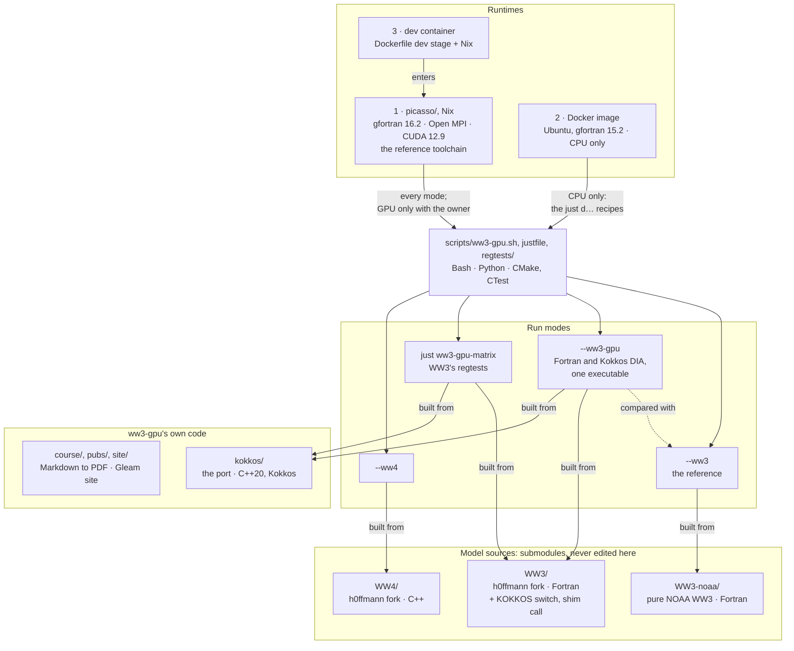

<div align="center">


# ww3-gpu

<sub>the WW3 GPU Lab · since 2026 · <a href="https://h0ffmann.github.io/ww3-gpu/">the site</a> · <a href="https://h0ffmann.github.io/ww3-gpu/book/">the book</a> · <a href="RELEASES.md">releases</a> · <a href="#how-to-cite">cite</a> · <a href="README.pt-BR.md">português</a></sub>

[](https://doi.org/10.5281/zenodo.23221351)
[](RELEASES.md)
[](https://github.com/h0ffmann/ww3-gpu/actions/workflows/ci.yml)
[](https://h0ffmann.github.io/ww3-gpu/)
[](https://github.com/h0ffmann/ww3-dia-gpu-v2)
[](#licensing)
[](README.pt-BR.md)

</div>

A book in progress on agentic coding and agentic research, compiled from this repository, written
around one problem: moving the expensive kernels of WAVEWATCH III® (WW3), NOAA's third-generation
spectral wind-wave model, to GPUs without changing the answer.

The repository is the book's source and its evidence. Its 17 lessons are the chapters, built into
a PDF on every merge ([`pdf/ww3-lab-course.pdf`](pdf/ww3-lab-course.pdf)). The code they describe
is next to them: a Nix-pinned Fortran/MPI/NetCDF toolchain that builds WW3 and runs a regression
test in one command, and a C++/Kokkos port of the DIA nonlinear interaction term (`W3SNL1`),
written with coding agents, that reproduced the Fortran output bit for bit on the Serial, OpenMP
and CUDA backends in its former unit tests, and is byte-identical to the Fortran DIA on all 100
serial `NL1` entries of WW3's own regtests on the CPU, the port's only tests since
[ADR-0010](docs/ADRs/ADR-0010-kokkos-validated-by-ww3-regtests-only.md). On an RTX 4090 it runs
1,000 sea points in 0.047 ms against 24.96 ms serial
([`kokkos/PORT_STATUS.md`](kokkos/PORT_STATUS.md)). Every claim carries its evidence (`(v)`
checked, `⚠` not) and every number the command that reproduces it. The same repository is the
groundwork for an undergraduate project at Escola Politécnica, UFRJ, co-advised at LabECO, UFSC.

It is written first for scientists: PhD researchers, postdocs and independent researchers in wave
modelling, numerical methods and HPC. Its second reader is a researcher or engineer from another
field who wants to run coding agents on scientific code without losing the answer. If you use it,
please [cite it](#how-to-cite).

## the book

*Without Changing the Answer* (working title) is written in the tradition of self-published
technical books built from a public repository, such as Sandy Maguire's *Thinking with Types* and
Gabriel Volpe's *Practical FP in Scala* `(v)` marola's
[MIP-0014 §4](https://github.com/marola-dev/marola/blob/main/docs/MIPs/MIP-0014-marola-book.md),
read 2026-10-08. Its subject is a method: how coding agents port Fortran under a bit-for-bit gate
and a validation ladder (agentic coding), and how plans, evaluations and measurements are written so
that an agent can be held to them (agentic research). The rules in [`AGENTS.md`](AGENTS.md), the
design docs in [`docs/WFIPs/`](docs/WFIPs/README.md), the decisions in
[`docs/ADRs/`](docs/ADRs/README.md) and the research log in [`docs/log/`](docs/log/README.md) are
chapters in waiting. [ADR-0003](docs/ADRs/ADR-0003-repository-is-a-book.md) records the decision and
[WFIP-0002](docs/WFIPs/WFIP-0002-lab-as-a-book.md) the plan.

Each tagged release is an edition, archived on Zenodo as a book ([`RELEASES.md`](RELEASES.md)). A
free Leanpub edition is fed by CI from the same chapters
([`docs/LEANPUB_202610.md`](docs/LEANPUB_202610.md)).

```console
just book          # the chapters as a PDF (nix, picasso's publisher lab)
just book-html     # the chapters as web pages, into build/site/book/
just leanpub       # the chapters as a Leanpub manuscript
just adrs          # one line per decision
just wfip check    # the design docs and their definitions of done
```

## the website

<https://h0ffmann.github.io/ww3-gpu/> is a Gleam + Lustre front page, prerendered, with no script.
Every fact on it is read from this repository's files by `site/content`: the chapters, the
decisions, the designs, the notes, the DOI and the people. The chapters are at
[`/book/`](https://h0ffmann.github.io/ww3-gpu/book/), next to the
[PDF](https://h0ffmann.github.io/ww3-gpu/ww3-lab-course.pdf), the progress page
(`/andamento/`), the decisions (`/adrs/`) and an easy Brazilian Portuguese report for the GTA,
DEL/UFRJ (`/relatorio-gta/`, from [`pubs/relatorio-gta/`](pubs/relatorio-gta/relatorio.easy.pt-BR.md), PDF in
[`pdf/relatorio-gta-pedro-cruz.pdf`](pdf/relatorio-gta-pedro-cruz.pdf)). [`DESIGN.md`](DESIGN.md) has its look: a sea at night,
and three lights on it. The same page is built in Brazilian Portuguese at
[`/pt-BR/`](https://h0ffmann.github.io/ww3-gpu/pt-BR/), from one source and a table of
translations, [`site/data/translations/pt-BR.tsv`](site/data/translations/pt-BR.tsv): the build
fails when a sentence has no row.

```console
just site          # the chapters, then the front page, into build/site/
just site-serve    # serve build/site on http://localhost:8000
```

<details><summary>Environment details</summary>

| Type | Program |
| :---- | :-----: |
| Language | Gleam (JavaScript target), Lustre |
| Bundling and tests | node, esbuild, gleeunit |
| Toolchain | picasso's `labs/gleam-website`, through `flake.nix` (`nix develop .#site`) |
| Book pages | pandoc (`scripts/build_html.sh`) |
| Deploy | `.github/workflows/pages.yml`, GitHub Pages |

</details>

## the second brain

The ideas this lab stands on are notes in [`notes/`](notes/index.md), one idea in one note, each
with its source and a status (`unverified` until a source is checked), linked to each other, under
[`NOTES.md`](NOTES.md). What was tried, including what failed, is the journal:
[`docs/log/`](docs/log/README.md), append-only. Where each kind of memory lives is in
[`MEMORY.md`](MEMORY.md); the long-term memory across sessions and agents is
[ai-memory](https://github.com/akitaonrails/ai-memory), chosen in
[ADR-0009](docs/ADRs/ADR-0009-ww3-gpu-adopts-ai-memory-from-fabio-akita.md).

Part of that memory is published. The ai-memory pages the owner tags `publish` are copied into
[`memory/`](memory/README.md), which starts with [`HUMAN.md`](memory/HUMAN.md): who owns this
repository and the standing orders they gave, in their own words. These pages are leads, not
evidence; what matters is also in a file here with its `(v)` or `⚠`. With the ai-memory plugin
installed for Claude Code ([`MEMORY.md`](MEMORY.md) has the steps), load them into your own store
after cloning and after each pull that changes `memory/`. They land under `published/`, unpinned
and never as rules, so a page from a pull request cannot become a standing order in your store.

```console
just notes          # the slip box keeps its rules: front matter, ids, links, the index
just refs           # every reference of the proposal has a verdict in its REFERENCES.md
just memory import  # load memory/ into your ai-memory; unchanged pages are skipped
just memory export  # owner: copy the wiki pages tagged `publish` into memory/
just memory check   # memory/ holds only published pages: no session, log, e-mail or home path
```

## study areas

Each line is a separate piece of work. Merged ones live on `main`; the rest are open pull requests
or issues, linked so you can follow them.

| Area | Question it answers | Where | State |
|---|---|---|---|
| The course | How do you build, run and measure WW3, then port a kernel? | [`course/`](course/README.md), [`examples/`](examples/README.md), [`exercises/`](exercises/README.md) | 17 lessons, merged |
| Kokkos port of `W3SNL1` | Can a WW3 kernel run on a GPU with bit-identical results? | [`kokkos/`](kokkos/README.md), [lesson 12](course/12-porting-a-kernel-w3snl1.md) | Bit-identical on 3 backends in the unit tests ADR-0010 removed; WW3 regtest matrix on the CPU byte-identical to the Fortran DIA on all 100 serial `NL1` entries (2026-10-15) |
| Benchmarks | What do an i9 and an RTX 4090 actually give WW3? | [`bench/`](bench/README.md), [`gpu/`](gpu/README.md), [lesson 09](course/09-benchmark-profile-compile-run.md) | Tooling merged |
| Port priority | Which routine should be ported next? | [ADR-0002](docs/ADRs/ADR-0002-port-order-wall-time.md), [`PORT_STATUS.md`](kokkos/PORT_STATUS.md) | Port by measured wall time. A first profile puts `W3SDS4` at 67 % of source-term time ([#45](https://github.com/h0ffmann/ww3-gpu/issues/45)) |
| Porting with agents | How can coding agents port forty routines without a human redoing the checks? | [`AGENTS_KOKKOS`](docs/AGENTS_KOKKOS_202609.md), [lesson 13](course/13-bulk-porting-with-agents.md), [#42](https://github.com/h0ffmann/ww3-gpu/issues/42) | Rules merged; task queue and parity ladder in #42 |
| Agent tooling | Which agent frameworks and research tools fit that workflow? | [#25](https://github.com/h0ffmann/ww3-gpu/pull/25), [#41](https://github.com/h0ffmann/ww3-gpu/pull/41), [#38](https://github.com/h0ffmann/ww3-gpu/issues/38), [ADR-0009](docs/ADRs/ADR-0009-ww3-gpu-adopts-ai-memory-from-fabio-akita.md) | Evaluations in review; ai-memory chosen |
| Bit-for-bit proof | What can be proved, and not only tested, about the Fortran → C++ translation? | [`BITWISE_PROOF`](docs/BITWISE_PROOF_202610.md), [`docs/proof/`](docs/proof/README.md), [ADR-0001](docs/ADRs/ADR-0001-proof-language.md) | No proof language; exhaustive sweeps, GIMPLE diffs and SMT queries. `W3SNL1` section 1 swept over all 2^32 inputs |
| Triton and ML weather forcing | Does a Triton kernel of the `W3SDS4` cumulative term beat the Kokkos one? Does WeatherNext 3 wind improve the wave forecast? | [#45](https://github.com/h0ffmann/ww3-gpu/issues/45), [`W3SDS4_TRITON_PLANO`](docs/W3SDS4_TRITON_PLANO_202610.pt.md) (pt-BR) | Planned |
| Single-H100 port | What would a full port to one H100 take? | [`KOKKOS_H100_PLAN`](docs/KOKKOS_H100_PLAN_202609.md) | Plan |
| WW4 and SWAN | What replaces WW3, and what covers the coast? | [lesson 14](course/14-ww4-and-the-future.md), [lesson 15](course/15-swan.md) | Merged |
| The book and the proposal | The lessons compiled as a book, and the project proposal | [`pubs/`](pubs/README.md), PDFs and Word files in [`pdf/`](pdf/), [WFIP-0002](docs/WFIPs/WFIP-0002-lab-as-a-book.md) | Built by CI on every merge |

[`docs/AWESOME-WW3_202609.md`](docs/AWESOME-WW3_202609.md) is a curated link list, and
[`docs/GLOSSARY.md`](docs/GLOSSARY.md) expands every abbreviation, switch, routine and tool name.

## three runtimes

ww3-gpu runs in three places. All three run the same `scripts/ww3-gpu.sh`, with the same options,
checks and exit codes; they differ in their compilers and in what they can run. picasso is the
reference: the bit-for-bit verdicts, the regtest matrix and every timing come from it.
[`VERSIONS.md`](VERSIONS.md) lists every pinned version of each, and the figure in "can WW3 use
my GPU?" shows how they fit with the sources and the run modes.

| | 1 · picasso (Nix) | 2 · Docker image | 3 · dev container |
|---|---|---|---|
| You need | Nix and just | Docker (just is optional) | Docker, and VS Code or the Dev Containers CLI 0.89.0 or later; a full clone |
| What it is | the submodule `picasso/` (`labs/pratico`): one locked nixpkgs | `docker/Dockerfile`, final stage: the compiled programs and the case inputs, no sources | `docker/Dockerfile`, stage `dev`: Ubuntu's compilers, the gate tools and Nix, which enters picasso |
| Compilers | gfortran 16.2.0, CMake 4.4.3, Kokkos 5.2.2 | Ubuntu 26.04: gfortran 15.2.0, Kokkos 5.2.2 from its release tarball | picasso's, inside `nix develop`; Ubuntu's outside it |
| MPI, PDLIB | Open MPI 5.0.11, PT-Scotch, METIS and ParMETIS | none | picasso's |
| CUDA | the `#cuda` shell (Kokkos for `ADA89`) | none | none |
| WW3's regtests | all of them: `just ww3-gpu-matrix`, NOAA's data pinned by SHA-256 | `ww3_ts1` and `bench_small` only | picasso's, CPU only |
| Bit for bit | the reference toolchain | holds inside one executable of the image; the image is not the reference | picasso's |
| Commands | `just smoke`, `just full-ww3-gpu`, ... | the same with a `d` in front: `just dsmoke`, ... | picasso's, inside the container |

### 1 · picasso: the reference

[picasso](https://github.com/h0ffmann/picasso) is the Nix toolchain of this lab. The compilers come
from its pinned flake, so there is nothing else to install.

```console
git clone --recurse-submodules git@github.com:h0ffmann/ww3-gpu.git && cd ww3-gpu
just submodule-init             # sparse-checkout picasso (once per clone)
just get                        # clone upstream NOAA-EMC/WW3 develop into ~/src/WW3
just rt                         # build with ww3_tp1.1's own switch and run that regtest (~30 s)
just build                      # rebuild with the lab switch (switches/switch_lab_shrd, ST4 physics)
just example01                  # first course example: fetch-limited growth (~1 min)
just kokkos-test serial-debug   # build and test the C++/Kokkos kernels
```

More recipes on the same toolchain:

```console
just ww3                # enter the toolchain shell
just smoke              # WW3 as written, then the Kokkos DIA against the Fortran DIA (ww3_ts1)
just full-ww3-gpu       # the Kokkos DIA on bench_small
just ww3-gpu-matrix     # WW3's regtest matrix, CPU only
```

Then start at [`course/00-orientation.md`](course/00-orientation.md). `just` lists every task; each
recipe is a thin wrapper over a script in `scripts/`, except `just ww3-gpu-matrix*`, which drive WW3's
regtest matrix through CMake/CTest in `regtests/`. The toolchain, the WW3 fork and the Kokkos
presets are in [`docs/TOOLCHAIN.md`](docs/TOOLCHAIN.md). For coastal cases, add SWAN with
`just swan`.

<details><summary>Environment details</summary>

| Type | Program |
| :---- | :-----: |
| Fortran, MPI, NetCDF | `picasso/labs/pratico`, pinned (`just ww3`, `just dev`) |
| C++ kernels | Kokkos (Serial, OpenMP, CUDA), GoogleTest |
| Publications | picasso's `labs/publisher` through `flake.nix` |
| Host alternative | `just prereqs` on Debian/Ubuntu |
| Every pinned version | [`VERSIONS.md`](VERSIONS.md) |

</details>

The submodule directory was `nix-config/` until 2026-10-15. In a clone made before that date,
run this once after `git pull`:

```console
git submodule sync && just submodule-init
[ -z "$(git -C nix-config status --short)" ] && rm -rf nix-config   # only when it holds no edits
```

### 2 · the Docker image

The image is Ubuntu 26.04 with WW3, WW3 with the Kokkos DIA and WW4 already compiled: it holds the
programs, their runtime libraries and the case inputs, not the sources. CPU only.

```console
git clone --recurse-submodules git@github.com:h0ffmann/ww3-gpu.git && cd ww3-gpu
just dbuild         # build the image ww3-gpu:local from this checkout
just dsmoke         # WW3 as written, then the Kokkos DIA against the Fortran DIA (ww3_ts1, seconds)
just dfull-ww3-gpu     # the Kokkos DIA on bench_small (9 520 sea points, 12 hours)
just dsmoke-ww4     # WAVEWATCH IV; exit 5 while a part the case needs is not ported
just drun --help    # any other scripts/ww3-gpu.sh option
```

Every recipe that runs `scripts/ww3-gpu.sh` on the host has its pair in the image, with a `d` in
front: `smoke`, `smoke-ww3`, `smoke-ww3-gpu`, `full-ww3`, `full-ww3-gpu`, `smoke-ww4` and `full-ww4`
become `dsmoke`, `dsmoke-ww3`, and so on. The image needs no Nix and no picasso: its build stage
installs Ubuntu's compilers and libraries, compiles Kokkos 5.2.2 from its release tarball (Ubuntu
packages an older one), and the final stage copies only the compiled programs.

CI scans the image with Trivy on every change to it and weekly (`.github/workflows/docker-scan.yml`): a HIGH or CRITICAL vulnerability with a fix fails the job. `just dscan` runs the same scan here.

The Kokkos code on the GPU has its own image, `docker/Dockerfile.cuda`: NVIDIA's CUDA 13.4 on
Ubuntu 26.04, Kokkos 5.2.2 built with CUDA for compute capability 8.9 (the RTX 4090; `KOKKOS_ARCH`
picks another), and only `--ww3-gpu --gpu` inside. The host needs the NVIDIA driver and the
[NVIDIA Container Toolkit](https://docs.nvidia.com/datacenter/cloud-native/container-toolkit/latest/install-guide.html)
for `docker run --gpus all`. As on the host, every `--gpu` run asks the supervising person for
`yes` at the terminal ([Running on the GPU](AGENTS.md#running-on-the-gpu-hard-rule)).

```console
just dbuild-cuda            # build ww3-gpu-cuda:local
just dsmoke-ww3-gpu-cuda    # --ww3-gpu smoke --gpu: the Fortran and the CUDA Kokkos routines, same executable
just dfull-ww3-gpu-cuda     # the same on bench_small
```

Without just, the same with plain Docker:

```console
docker build -f docker/Dockerfile -t ww3-gpu:local .
docker run --rm --user "$(id -u):$(id -g)" -v "$PWD/build/docker-runs:/work/runs" ww3-gpu:local --ww3-gpu smoke
```

Every run lands in `build/docker-runs/`. Inside, the entry point is `scripts/ww3-gpu.sh`, the same
script the host uses, so the options, the checks and the exit codes are the same
([`docker/Dockerfile`](docker/Dockerfile) says what each stage builds). The compilers are
Ubuntu's: `--ww3-gpu` still compares the Kokkos and the Fortran DIA inside one executable, so its
bit-for-bit verdict holds in the image; a number from the image is not a number from the pinned
toolchain of [`docs/TOOLCHAIN.md`](docs/TOOLCHAIN.md), which uses another gfortran.

### 3 · the dev container

`.devcontainer/devcontainer.json` builds the `dev` stage of `docker/Dockerfile`: Ubuntu 26.04 with
the image's compilers, the gate tools and Nix, as the user `ubuntu`. When the container is created,
`scripts/agent_env.sh` fetches `picasso/` over https; from then on the `just` recipes enter
picasso's shells, so a result inside the container is a picasso result. It is the way to work on
this repository on a machine without Nix, from VS Code, Codespaces or the CLI:

```console
npx --yes @devcontainers/cli@0.89.0 up --workspace-folder .
npx --yes @devcontainers/cli@0.89.0 exec --workspace-folder . just smoke-ww3-gpu
```

- Open a full clone, not a git worktree. A worktree's `.git` points into the main repository,
  which the container does not mount, and `agent_env.sh` stops with "not a git repository".
- Use the Dev Containers CLI 0.89.0 or later: 0.80.0 waits forever after "Container started" with
  Docker 29.
- `/nix` lives in the container, so a rebuilt container downloads picasso's toolchain again
  (about 3.1 GB, about a minute on the lab's link).

(v) 2026-10-15, CLI 0.89.0, Docker 29.9.1, `main` at `78e5a33`, full clone: `devcontainer up`
passed, `just kokkos-test serial-debug` passed 10 of 10, `just smoke-ww3-gpu` gave byte-identical
Fortran and Kokkos outputs, and every file the runs wrote belongs to the host user.

## two things worth knowing before you invest

WAVEWATCH IV™ (WW4) exists, and WW3 is scheduled for sunset. [NOAA-EMC/WW4](https://github.com/NOAA-EMC/WW4)
is a rewrite from scratch: a new repository with no backward compatibility, a C++ core with Rust
alongside, and Fortran kept only for solvers. On 2026-10-07 it had 39 commits, placeholders for
solvers and source terms, no physics and no release. The first public release is expected in
January 2027 according to the proposal's advisor ⚠ (no NOAA source; ON 525 said summer 2027). The
plan, including the commitment to stop supporting WW3 once WW4 matures, is in
[NCEP Office Note 525](https://doi.org/10.25923/h7j3-1h25). WW3 is still worth learning: the
physics is the same and the concepts carry over. See
[`course/14-ww4-and-the-future.md`](course/14-ww4-and-the-future.md); `just ww4-status` diffs WW4
against the last snapshot (`docs/ww4-status.json`).

SWAN is the other half of the toolkit. It is implicit and unconditionally stable, has no CFL limit
and runs in stationary mode, so the standard coastal set-up is WW3 offshore and SWAN nearshore. Its
source now lives on [TU Delft GitLab](https://gitlab.tudelft.nl/citg/wavemodels/swan). See
[`course/15-swan.md`](course/15-swan.md).

## can WW3 use my GPU?

NVIDIA ships a Fortran compiler: `nvfortran`, part of the free
[NVIDIA HPC SDK](https://developer.nvidia.com/hpc-sdk). It handles CUDA Fortran, OpenACC, OpenMP
target offload and `do concurrent` offload (`-stdpar=gpu`). An RTX 4090 is Ada, compute capability
8.9, so the flag is `-gpu=cc89`.

WW3 itself has no GPU support upstream. The only published port
([Ikuyajolu et al., GMD 2023](https://gmd.copernicus.org/articles/16/1445/2023/)) put OpenACC on one
module, `W3SRCEMD`, and got about 1.3× against 42 CPU cores on Summit's V100s. Data transfer bound
the result, and the code was not merged into `NOAA-EMC/WW3`. So compile WW3 with `nvfortran` for the
CPU, use `gpu/` to learn GPU Fortran, and `bench/` to measure your own hardware instead of trusting
anyone's table, including the ones here. The Kokkos port takes the other route: kernels that keep
their data on the device and match the Fortran within the tolerances WW3's regtests are judged by
([`course/09-benchmark-profile-compile-run.md`](course/09-benchmark-profile-compile-run.md)).

There are three ways to run WAVEWATCH here (`scripts/ww3-gpu.sh`). The model sources come from
three submodules, and this repository holds only the Kokkos rewrite:

| Directory | What it is | Used by |
|---|---|---|
| `WW3-noaa/` | pure WW3: [NOAA-EMC/WW3](https://github.com/NOAA-EMC/WW3) at `03adda91`, not changed | `--ww3`, the reference |
| `WW3/` | your fork, [h0ffmann/WW3](https://github.com/h0ffmann/WW3) branch `ww3-gpu/kokkos-st4`: `WW3-noaa/` plus the KOKKOS patch, 5 files under `model/src/` and 813 added lines | `--ww3-gpu` and the regtest matrix |
| `WW4/` | [h0ffmann/WW4](https://github.com/h0ffmann/WW4), `develop` | `--ww4` |

The fork exists for one reason: the call from WW3 into the Kokkos code has to be inside WW3
(`W3SRCE`, `model/src/w3srcemd.F90`), and this repository never edits WW3. The fork carries that
call behind the `KOKKOS` switch and leaves the Fortran routine selectable. Before each `--ww3`,
`scripts/ww3-gpu.sh` compares the two trees and stops (exit 3) when the fork differs from
`WW3-noaa/` outside the KOKKOS patch. So `--ww3` is pure NOAA WW3, and `--ww3-gpu --cpu` compares
the Kokkos port with it.

The whole system on one page: where the model sources come from, what this repository adds, the
run modes, and the three runtimes they run on.



<details open>
<summary>How to read this figure</summary>

**Takeaway.** Two copies of WW3 come in from outside, pure NOAA WW3 and the owner's fork; this
repository adds only the C++ rewrite and its tools, and every way of running the model works on
the Nix toolchain, while the Docker image covers the CPU runs without Nix.

**How to read.** Top to bottom. A runtime runs the one script, `scripts/ww3-gpu.sh` with its
recipes; the script offers the run modes; each run mode is built from the sources below it.
Solid arrows say what enters, runs or is built from what; the dashed arrow is the comparison of
the Kokkos run with pure NOAA WW3. The runtimes are numbered from the reference (1) to the most
derived (3); the dev container reaches the modes only through picasso.

**Not shown.** The book and the site (`course/`, `pubs/`, `site/`) build in CI, not on these runtimes. The fork's branch and the five files of its KOKKOS patch (the table above), the
CUDA build and its supervision rule (`AGENTS.md`, "Running on the GPU"), CI, and the versions of
each runtime ([`VERSIONS.md`](VERSIONS.md)).

**Evidence.** (v) read 2026-10-15: the table and paragraph above; `scripts/ww3-gpu.sh` (header);
`docker/Dockerfile` (stages `toolchain`, `build`, `dev`, runtime); `.devcontainer/devcontainer.json`;
[`VERSIONS.md`](VERSIONS.md) for the compiler versions. The dev container ran `just kokkos-test
serial-debug` and `just smoke-ww3-gpu` through picasso on 2026-10-15 (Dev Containers CLI 0.89.0,
full clone).

</details>


```bash
just smoke             # smoke-ww3, then smoke-ww3-gpu: regtest ww3_ts1, seconds
just smoke-ww3         # --ww3: WW3 as written
just smoke-ww3-gpu        # --ww3-gpu --cpu: WW3 with the Kokkos DIA (W3SNL1), compared with the Fortran and --ww3
just full-ww3          # the expensive case: bench_small, 9 520 sea points, minutes
just full-ww3-gpu         # the same with the Kokkos DIA
just smoke-ww4         # --ww4: WAVEWATCH IV; exit 5 while a part the case needs is not ported
just full-ww4          # the same on bench_small; `just ww4-parts full` lists the parts
just port-score        # how much of WW3 runs on Kokkos, and the routines ranked by time
```

### Health

[](https://github.com/h0ffmann/ww3-gpu/actions/workflows/health.yml)

| id | combination | what it runs | in CI |
|---|---|---|---|
| h1 | `--ww3-gpu --cpu` | WW3 with the Kokkos DIA on OpenMP, against the Fortran DIA and pair to pair against `--ww3` (`ww3_ts1`) | **yes**: [`health.yml`](.github/workflows/health.yml), on every pull request and on `main` |
| h2 | `--ww3-gpu --gpu` | the same on CUDA | no: it needs a GPU and the owner supervising (AGENTS.md hard rule) |
| w3 | `--ww3 --cpu` | WW3 as written | inside h1, as its pair |
| w4 | `--ww4 --cpu` | WAVEWATCH IV | no: it exits 5 until WW4 has the parts |

Only h1 is in CI, by the owner's word of 14 October 2026. Each ported routine has a report in
[`kokkos/port_report/`](kokkos/port_report/README.md): what was ported, every benchmark, how it
was regtested. The port has no tests of its own; WW3's regtests are its tests
([ADR-0010](docs/ADRs/ADR-0010-kokkos-validated-by-ww3-regtests-only.md)). The website draws its benchmarks.

`--ww3-gpu` runs on the CPU (Kokkos OpenMP) by default, and is then compared pair to pair with
`--ww3`. `just smoke-ww3-gpu gpu` runs CUDA, only with a human supervising: it asks at the terminal
(AGENTS.md hard rule). An NVIDIA GPU whose driver does not answer stops it with exit 4 and the
cause. On
14 October 2026 both cases passed on OpenMP; the GPU run was not made yet. `--ww4` stops with
exit 5 on both cases today: WW4's `develop` has the time loop and no source term or propagation
solver yet
([`docs/PORT_ASSESSMENT_202610.md`](docs/PORT_ASSESSMENT_202610.md)).

## structure

| Path | Contents |
|---|---|
| `course/` | The book's chapters: 17 lessons, 00 to 15 and 19 |
| `examples/`, `exercises/` | Runnable cases with real `.nml` inputs; exercises for lessons 09 to 13, with solutions |
| `kokkos/` | The `ww_kokkos` kernel library (`W3SNL1` ported), the tools and their GoogleTest suites (none for the port, ADR-0010) |
| `gpu/`, `bench/` | GPU Fortran sandbox for an RTX 4090; i9 against 4090 benchmarks |
| `proof/` | The runnable half of the proof plan (all 2^32 inputs of `W3SNL1` section 1; SMT queries) |
| `docs/` | Plans, decisions (`ADRs/`), designs (`WFIPs/`), the research log, the link list, the glossary |
| `notes/` | The second brain ([`NOTES.md`](NOTES.md)) |
| `site/` | The Gleam front page ([`DESIGN.md`](DESIGN.md)) |
| `pubs/` | The book's build and the UFRJ/DEL project proposal; built files land in `pdf/` |
| `scripts/`, `switches/`, `env/` | Get, build and run WW3 and SWAN; annotated switch files; conda and an untested build-environment Dockerfile |
| `docker/`, `.dockerignore` | The Ubuntu runtime image: WW3, WW3 with the Kokkos DIA and WW4 compiled, no sources ([the Docker image](#2--the-docker-image)) |
| `picasso/`, `WW3-noaa/`, `WW3/`, `WW4/` | Submodules: the pinned toolchain, pure [NOAA-EMC/WW3](https://github.com/NOAA-EMC/WW3), the [h0ffmann/WW3](https://github.com/h0ffmann/WW3) fork, the [h0ffmann/WW4](https://github.com/h0ffmann/WW4) fork |

Lab code is C++, Fortran and shell. Python appears only in the publishing pipeline and the repo's
own checks. CI checks shell syntax, compiles the Fortran sandbox and examples, builds and tests
`kokkos/` on both CPU presets, checks the notes, the references, the design docs and the results,
and link-checks the Markdown. It does not build WW3, which needs the NOAA FTP data bundle.

## conventions

- `⚠` marks a claim not verified. Check it before relying on it.
- `(v)` marks a claim verified against a source fetched while building this repo.
- Input files use the namelist (`.nml`) interface instead of the legacy fixed-format `.inp` files.
- A commit carries a `Tested:` trailer and no cost record
  ([ADR-0009](docs/ADRs/ADR-0009-ww3-gpu-adopts-ai-memory-from-fabio-akita.md)).

## ponytail, off by default

[ponytail](https://github.com/DietrichGebert/ponytail) is a Claude Code plugin (MIT) whose rules
push an agent towards the smallest change that works. It is enabled here, pinned to `v5.2.0`, and
**off** by default (`PONYTAIL_DEFAULT_MODE=off` in [`.claude/settings.json`](.claude/settings.json)):
its rules cover a whole session and cannot be limited to some files or languages, and they pull
against "Translate, don't improve", the rule of the ported kernels ([`AGENTS.md`](AGENTS.md)).

- Turn it on for one session when you work on C++ around the port (tests, the benchmark harness,
  CMake): `/ponytail` (or `/ponytail lite`, `/ponytail ultra`). Turn it off with `/ponytail off`
  or "stop ponytail".
- In `kokkos/src/` a ported routine reproduces the Fortran's arithmetic. ponytail's "the smallest
  change" never licenses a refactor, a vectorisation or a simplification there.
- Its codebase map is off (`PONYTAIL_MAP=0`). It lists Python and JS files only, never C++, CUDA,
  Fortran or Markdown, so here it would point at the tooling instead of the code.
- One-shot commands work in any mode: `/ponytail:ponytail-review` (a change),
  `/ponytail:ponytail-audit` (the repository), `/ponytail:ponytail-debt`, `/ponytail:ponytail-help`.

## related authors

- **Guimarães P.V.** ([ORCID 0000-0002-1686-4722](https://orcid.org/0000-0002-1686-4722)),
  Department of Mechanical Engineering, UFSC (LabECO): the co-advisor of the project this
  repository is the groundwork for, and a contributor (Supervisor) on the Zenodo record.
- **Fabio Akita** ([akitaonrails](https://github.com/akitaonrails)), legendary br dev (the owner's
  words, 2026-10-14): the author of [ai-memory](https://github.com/akitaonrails/ai-memory) (MIT),
  the long-term memory this repository adopts
  ([ADR-0009](docs/ADRs/ADR-0009-ww3-gpu-adopts-ai-memory-from-fabio-akita.md)).

## related work

[marola](https://github.com/marola-dev/marola) ([marola.dev](https://marola.dev/)) is an open,
non-profit platform for sea conditions and bathing-water quality at Brazilian beaches, by the same
author and the marola members. Its wave data already comes from WAVEWATCH III through NCEP's
GFS-Wave; running a detailed spectral wave model for its own bays is the planned next step
([MIP-0052](https://github.com/marola-dev/marola/blob/main/docs/MIPs/MIP-0052-wave-model-compute.md)),
and this repository is its groundwork. Cite marola by its concept DOI,
[10.5281/zenodo.23224155](https://doi.org/10.5281/zenodo.23224155).

The sister works this repository borrows its shape from, each by the same author:
[picasso](https://doi.org/10.5281/zenodo.23311208) (the toolchain, the paper and website labs),
[*Closed Source: The God that Failed*](https://doi.org/10.5281/zenodo.23333656) (the citation and
paper discipline), [*Nashkell: Rhizomatic experiments*](https://doi.org/10.5281/zenodo.23356739)
(an open book with a Gleam site) and [h0ffmann](https://doi.org/10.5281/zenodo.23352630) (the
notes, the site and its translation rules). Every tie of the Zenodo record, and what points back at
it, is in [`RELATED_WORK.md`](RELATED_WORK.md).

## how to cite

Cite the concept DOI [10.5281/zenodo.23221351](https://doi.org/10.5281/zenodo.23221351) for the
project as a whole: it always resolves to the latest release. To pin the exact text and code you
read, cite that release's own DOI ([`RELEASES.md`](RELEASES.md) lists each one). GitHub's **Cite
this repository** button exports APA and BibTeX from [`CITATION.cff`](CITATION.cff).

BibTeX:

```bibtex
@software{hoffmann_ww3gpu,
  author    = {Hoffmann, Matheus},
  title     = {{WW3 GPU Lab: agentic coding and agentic research on a bit-for-bit GPU port of WAVEWATCH III}},
  year      = {2026},
  publisher = {Zenodo},
  doi       = {10.5281/zenodo.23221351},
  url       = {https://github.com/h0ffmann/ww3-gpu}
}
```

APA:

> Hoffmann, M. (2026). *WW3 GPU Lab: agentic coding and agentic research on a bit-for-bit GPU
> port of WAVEWATCH III* [Computer software]. Zenodo. https://doi.org/10.5281/zenodo.23221351

ABNT (NBR 6023):

> HOFFMANN, Matheus. **WW3 GPU Lab**: agentic coding and agentic research on a bit-for-bit GPU
> port of WAVEWATCH III. [S. l.]: Zenodo, 2026. DOI 10.5281/zenodo.23221351.
> Disponível em: https://doi.org/10.5281/zenodo.23221351.

A downstream project can declare the dependency in its own `CITATION.cff`:

```yaml
references:
  - type: software
    title: "WW3 GPU Lab: agentic coding and agentic research on a bit-for-bit GPU port of WAVEWATCH III"
    authors:
      - family-names: Hoffmann
        given-names: Matheus
        orcid: "https://orcid.org/0009-0009-1056-7661"
    doi: 10.5281/zenodo.23221351
    repository-code: "https://github.com/h0ffmann/ww3-gpu"
```

Cite WW3 itself separately, as the WAVEWATCH III Development Group's user manual for the version
you ran. A new patch release is cut every Friday when `main` has changed, or by hand with
`just release`; Software Heritage archives the git history next to each Zenodo deposit
([`.claude/skills/release`](.claude/skills/release/SKILL.md)).

## licensing

| What | Whose | Terms |
|---|---|---|
| This repository | Matheus Hoffmann | MIT ([`LICENSE`](LICENSE)) |
| The kernels translated from WW3: `kokkos/src/ww_kokkos/snl1_*`, `kokkos/src/fortran_iface/w3kokkosmd.F90`, the patch in `kokkos/src/fortran_iface/PATCH.md` | derived works of WW3 | `LGPL-3.0-or-later`, stated in each file's `SPDX-License-Identifier` line |
| Vendored skills (`humanizar`, `humanizer`, `ponytail*`, `sharingan`) | their authors | their own licences, pinned in [`.claude/skills/skills.lock`](.claude/skills/skills.lock) |
| ai-memory, used and not vendored | Fabio Akita | MIT |

No WW3 source is vendored here. `scripts/01_get_ww3.sh` clones it, and upstream regression-test
inputs are fetched, not redistributed. Third-party tools listed in
`docs/AWESOME-WW3_202609.md` keep their own licences.

## trademarks

WAVEWATCH III® is a registered trademark and WAVEWATCH IV™ a trademark of NOAA's National Weather
Service. They are used here only to refer to that software. This repository is an independent
learning project and is not affiliated with, sponsored by or endorsed by NOAA. In prose we say WW3
and WW4.

## contributing

See [`CONTRIBUTING.md`](CONTRIBUTING.md). The most useful contribution is confirming or correcting
anything marked `⚠`. Coding agents read [`AGENTS.md`](AGENTS.md) first, then
[`MEMORY.md`](MEMORY.md). A pattern or skill from another repository comes in through the
[`sharingan`](.claude/skills/sharingan/SKILL.md) skill, which pins it and reads its licence first.
