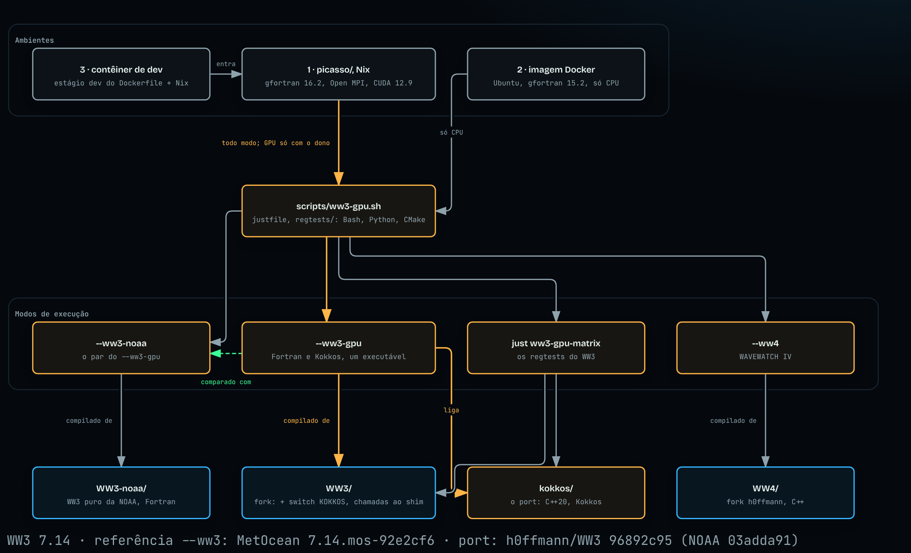

<div align="center">


# ww3-gpu

<sub>o WW3 GPU Lab · desde 2026 · <a href="https://wave.piabrota.art/">o site</a> · <a href="RELEASES.md">versões</a> · <a href="#como-citar">citar</a> · <a href="README.md">english</a></sub>

[](https://doi.org/10.5281/zenodo.23221351)
[](https://aixiv.online/abs/2611.01104)
[](RELEASES.md)
[](https://github.com/h0ffmann/ww3-gpu/actions/workflows/ci.yml)
[](https://wave.piabrota.art/)
[](https://github.com/h0ffmann/ww3-dia-gpu-v2)
[](#licença)
[](README.md)

</div>

> [!IMPORTANT]
> **Usado pela Universidade Federal de Santa Catarina (UFSC).** A previsão operacional de ondas do
> LabECO/UFSC, [ondaseventos.ufsc.br](https://ondaseventos.ufsc.br/), é a primeira consumidora do
> ww3-gpu; o [marola](https://github.com/marola-dev/marola) é o segundo.

## em um minuto

- **O WW3 prevê ondas no oceano.** O WAVEWATCH III® (WW3) guarda um *espectro* em cada ponto de
  mar de um mapa. O espectro diz quanta energia de onda vai em cada direção e em cada frequência. A
  cada passo de tempo, o WW3 atualiza essa energia. O vento acrescenta energia, a arrebentação
  retira energia, as ondas trocam energia entre si e a energia se move pelo mapa. A NOAA usa o WW3
  nas suas previsões operacionais de ondas. O WW3 é escrito em Fortran e roda em CPU.
- **O ww3-gpu deixa o WW3 mais rápido com Kokkos e CUDA.** Traduzimos as rotinas mais lentas para
  C++ com [Kokkos](kokkos/README.md#why-kokkos-not-fortran-90-in-plain-words), uma rotina por vez,
  na ordem do tempo de execução medido. Com Kokkos, o mesmo código C++ roda nos núcleos da CPU
  (OpenMP) ou numa GPU NVIDIA (CUDA).
- **A resposta não pode mudar.** Uma rotina traduzida tem de dar os mesmos números do Fortran, até
  o último bit, no mesmo programa. Não editamos o WW3. Um fork do WW3 acrescenta uma chave. Em
  tempo de execução, cada parte traduzida pode usar a rotina em Fortran ou a rotina em Kokkos, e
  assim as duas sempre podem ser comparadas.
- **Os textos são o preprint e a proposta.** O [preprint](pubs/preprint/README.md) e a
  [proposta de projeto](pubs/proposal/) da UFRJ/DEL são escritos aqui em Markdown. Os primeiros
  leitores são cientistas de modelagem de ondas, métodos numéricos e HPC. Cada afirmação tem `(v)` quando foi conferida e `⚠` quando não foi. O
  material técnico está em inglês; esta página resume o projeto em português.

## por onde começar

| Se você quer | Vá para |
|---|---|
| entender o WW3, as GPUs e este projeto do zero | o [preprint](pubs/preprint/README.md), depois o [glossário](docs/GLOSSARY.md) |
| rodar o WW3, depois o WW3 com o port em Kokkos | [começo rápido](#começo-rápido) |
| ver quais rotinas rodam em Kokkos, e com que velocidade | [onde o projeto está](#onde-o-projeto-está), [`kokkos/PORT_STATUS.md`](kokkos/PORT_STATUS.md) |
| ler os resultados em CPU, seus limites e o que ainda não foi mostrado, escritos para os modeladores de ondas da NOAA | [`docs/NOAA_PROGRESS_RECORD_202610.md`](docs/NOAA_PROGRESS_RECORD_202610.md), depois a lista de lacunas [`docs/PRODUCTION_READINESS_202610.md`](docs/PRODUCTION_READINESS_202610.md) (em inglês) |
| ver o sistema em figuras | [`docs/WW3_GPU_VS_NOAA_202610.md`](docs/WW3_GPU_VS_NOAA_202610.md): cinco figuras, também em [PDF](docs/archify/README.md) |
| trabalhar aqui com um agente de código | [`AGENTS.md`](AGENTS.md), depois [o ciclo de engenharia](#o-ciclo-de-engenharia) |
| achar o significado de uma palavra ou sigla | [`docs/GLOSSARY.md`](docs/GLOSSARY.md) |
| citar este trabalho | [como citar](#como-citar) |
| ajudar | [`CONTRIBUTING.md`](CONTRIBUTING.md). A ajuda mais útil é conferir uma afirmação marcada com `⚠` |

## como funciona

O `scripts/ww3-gpu.sh` é um comando só para seis runtimes do WAVEWATCH, e o `just run` é esse
script: `--ww3`, `--ww3-gpu --cpu`, `--ww3-gpu --gpu`, `--chaceon --cpu`, `--chaceon --gpu` e
`--ww4` ([`docs/RUN_COMMAND_202611.md`](docs/RUN_COMMAND_202611.md)). O código dos modelos vem de
quatro submódulos. Este repositório guarda só o código em Kokkos e as suas ferramentas.

| Diretório | O que é | Usado por |
|---|---|---|
| `WW3-metocean-7.14/` | o WW3 da MetOcean: [metocean/WW3](https://github.com/metocean/WW3) em `92e2cf66` (tag `7.14.mos-92e2cf6`), sem mudança | `--ww3`, a referência |
| `WW3/` | o fork [h0ffmann/WW3](https://github.com/h0ffmann/WW3) em `50a10730` (branch `ww3-gpu/kokkos-pnt`): o WW3 da NOAA em `03adda91` mais o patch KOKKOS. O patch muda 9 arquivos e acrescenta 7 módulos em `model/src/`, com 5 687 linhas acrescentadas e nenhuma removida | `--ww3-gpu` e a matriz de regtests |
| `WW4/` | [h0ffmann/WW4](https://github.com/h0ffmann/WW4), `develop` | `--ww4` |
| `chaceon/` | [h0ffmann/chaceon](https://github.com/h0ffmann/chaceon) em `89a11e4`: o WW3 em Rust, com o WW3 da MetOcean em `92e2cf66` como referência | `--chaceon` (`--cceon` é a mesma opção) |

`(v)` Os números do patch vêm de `git -C WW3 diff --stat 03adda91 50a10730 -- model`
(16 arquivos, 5 687 inserções, 0 remoções), em 18/10/2026.

O WW3 da NOAA não tem submódulo (o dono, 11/11/2026: uma referência só de WW3, o 7.14 da
MetOcean). O [NOAA-EMC/WW3](https://github.com/NOAA-EMC/WW3) em `03adda91`, o commit de onde o
fork saiu, está no histórico do próprio fork. O `scripts/ww3_base.sh` (`just ww3-base export`)
escreve essa árvore em `WW3-noaa/`, um diretório que o git ignora, e o `--ww3-noaa` faz isso antes
de compilar. O `--ww3-noaa` é o par do `--ww3-gpu`.

O fork tem um objetivo só. O WW3 precisa chamar o código em Kokkos de dentro do WW3, por exemplo do
`W3SRCE` (`model/src/w3srcemd.F90`), e este repositório não edita o WW3. Por isso o fork
acrescenta as chamadas atrás da chave `KOKKOS`, e cada rotina em Fortran continua disponível. Antes
de cada rodada `--ww3-noaa`, o `scripts/ww3-gpu.sh` compara as duas árvores de código. Se o fork difere
do `WW3-noaa/` fora do patch KOKKOS, o script para com código de saída 3. Assim o `--ww3-noaa` é sempre
o WW3 da NOAA, e o `--ww3-gpu --cpu` compara o port em Kokkos com ele.

`⚠` Desde 11/11/2026 a referência `--ww3` é o WW3 da MetOcean, o código que a previsão do LabECO
compila. O fork ainda não está sobre esse código: os dez commits da MetOcean mudam a aritmética do
ST4, e rebasear o fork é traduzir de novo os kernels em Kokkos
([plano](docs/plans/2026-10-29-001-metocean-upstream-plan.md)). Até lá o par do `--ww3-gpu` é o
`--ww3-noaa`, e uma diferença entre o `--ww3` e o `--ww3-gpu` é a mudança da MetOcean, não o port.

A figura mostra o sistema inteiro: as fontes do modelo, o código deste repositório, os modos de
rodar e os três ambientes.

[](https://h0ffmann.github.io/ww3-gpu/figures/ww3-gpu-at-a-glance-pt/)

<details open>
<summary>Como ler esta figura</summary>

**Em uma frase.** O WW3 puro da NOAA e o fork dele, do dono, vêm de fora; este
repositório acrescenta só a reescrita em C++ e suas ferramentas, e todo jeito de rodar o modelo
funciona no toolchain Nix, enquanto a imagem Docker cobre as rodadas em CPU sem Nix.

**Como ler.** De cima para baixo. Um ambiente roda o script único, `scripts/ww3-gpu.sh` com suas
receitas; o script oferece os modos de rodar; cada modo é compilado das fontes abaixo dele. Setas
cheias dizem o que entra, roda ou é compilado de quê; a seta tracejada é a comparação da rodada em
Kokkos com o WW3 puro da NOAA (`--ww3-noaa`). Os ambientes estão numerados da referência (1) ao mais derivado
(3); o dev container chega aos modos só pelo picasso.

**Fora da figura.** O `--ww3`, que compila o WW3 da MetOcean e é a referência, e o `--chaceon`: a
figura dos seis runtimes, abaixo, mostra os dois. As publicações e o site (`pubs/`, `site/`) são compilados na CI, não nesses ambientes. O branch do fork e os arquivos do patch KOKKOS (a tabela acima), o
build CUDA e sua regra de supervisão (`AGENTS.md`, "Running on the GPU"), a CI e as versões de
cada ambiente ([`VERSIONS.md`](VERSIONS.md)).

**Evidência.** (v) lido em 15/10/2026: a tabela e o parágrafo acima; `scripts/ww3-gpu.sh`
(cabeçalho); `docker/Dockerfile` (estágios `toolchain`, `build`, `dev` e o de execução);
`.devcontainer/devcontainer.json`; [`VERSIONS.md`](VERSIONS.md) para as versões dos compiladores.
O dev container rodou `just kokkos-test serial-debug` e `just smoke-ww3-gpu` pelo picasso em
15/10/2026 (Dev Containers CLI 0.89.0, clone completo).

</details>

[](https://h0ffmann.github.io/ww3-gpu/figures/ww3-gpu-runtimes-pt/)

<details open>
<summary>Como ler esta figura</summary>

**Em uma frase.** Um comando só, `scripts/ww3-gpu.sh`, deve rodar o WAVEWATCH de seis jeitos, e
cinco deles respondem ao sexto: o `--ww3`, o Fortran do WW3, é a referência cujos bits todos os
outros runtimes precisam dar.

**Como ler.** Das bordas para o centro. Uma caixa âmbar é um runtime; uma seta verde tracejada
aponta para a execução cujos bits o runtime precisa dar, e as cinco apontam para o `--ww3`. A
coluna da esquerda roda em CPU e a da direita em GPU; a primeira linha é o porte Kokkos dentro do
WW3 (`--ww3-gpu`), a segunda é o [h0ffmann/chaceon](https://github.com/h0ffmann/chaceon), o WW3
reescrito em Rust (`--chaceon`, ou `--cceon`). O `--ww4` é o WAVEWATCH IV.

**Fora da figura.** As fontes de que cada runtime é compilado (a figura acima), as rotinas que a
flag do Kokkos escolhe (a tabela abaixo) e a regra de supervisão de uma rodada `--gpu`
(`AGENTS.md`, "Running on the GPU"). Nenhum runtime rodou o modelo inteiro em uma GPU real.

**Evidência.** (v) lido em 11/11/2026: `scripts/ww3-gpu.sh` (cabeçalho) para as seis opções;
[`VERSIONS.md`](VERSIONS.md) para o WW3 7.14 da MetOcean (`92e2cf66`), que o `--ww3` compila;
[`docs/RUN_COMMAND_202611.md`](docs/RUN_COMMAND_202611.md) para o que rodou. Duas setas são o
desenho do autor em 11 de novembro de 2026 e ainda não o que o script faz ⚠: o `--ww3-gpu` é
comparado com o `--ww3-noaa` (o WW3 da NOAA em `03adda91`, a base do fork) até o fork passar
para o WW3 da MetOcean, e o `--chaceon --gpu` para com código 5 porque o chaceon não rodou em
uma GPU real. As notas do próprio desenho e a legenda do preprint dizem o mesmo. O desenho é
[`docs/archify/ww3-gpu-runtimes-pt.json`](docs/archify/ww3-gpu-runtimes-pt.json), também a
Figura 1 do preprint, desenhado para uma coluna de 174 mm ([`DESIGN.md`](DESIGN.md), "Pictures
in a paper").

</details>

### a chave do Kokkos, parte por parte

No executável do `--ww3-gpu`, cada parte traduzida tem uma flag de tempo de execução,
`WW_KOKKOS_<PART>=1`. Sem a flag, ou com `0`, a parte roda a rotina em Fortran. O
`scripts/ww3-gpu.sh` roda o caso duas vezes com o mesmo executável. A primeira rodada tem todas as
flags desligadas. A segunda tem as partes que você escolher. Depois o script compara as saídas das
duas rodadas. Escolha as partes com `--kokkos`:

| `--kokkos` | Partes em Kokkos | Para quê |
|---|---|---|
| `none` | nenhuma | só o Fortran, no build com Kokkos |
| `all` | todas as partes do build (`WW_KOKKOS_ALL=1`), menos as opcionais abaixo | o teste mais amplo da tradução |
| `gpu` | `SRCE` | o padrão do `--gpu`: o `W3SRCE` inteiro em cada chamada ([ADR-0013](docs/ADRs.md#adr-0013)) |
| `resident` | `SRCE,XYP3,KTP3,OUTG,IOPE,UPDV,CPRT` | o passo de tempo inteiro em Kokkos, com o espectro guardado do lado do Kokkos ([próxima seção](#o-que-o---kokkos-resident-faz)) |
| uma lista, por exemplo `SNL1,SDS4` | as partes da lista | o teste de uma parte por vez |

### o que o `--kokkos resident` faz

A GPU tem memória própria. Se cada rotina copia o espectro de um ponto de mar para a GPU e de
volta, as cópias custam mais tempo do que a GPU economiza. `(v)` No benchmark de setembro de 2026
do kernel do DIA, uma chamada levou 0,75 ms no total e 0,047 ms no kernel
([`bench/results/`](bench/results/snl1-i9-14900-rtx4090-2026-09-15.json)). Ou seja, as cópias
gastaram a maior parte do tempo.

O `resident` guarda o vetor do espectro, `VA`, do lado do Kokkos durante a rodada inteira. Ele
também leva para o Kokkos cada rotina do passo de tempo que lê ou escreve `VA`. Assim o `VA` vai
para o lado do Kokkos uma vez, no começo, e só volta quando o WW3 escreve saída
([WFIP-0005](docs/WFIPs/WFIP-0005-device-resident-step.md)).

| Parte | Rotina do WW3 | O que roda em Kokkos |
|---|---|---|
| `SRCE` | `W3SRCE` | os termos fonte de todos os pontos de mar numa chamada em lote: entrada de vento e arrebentação do ST4, o DIA (`W3SNL1`), o `W3SLN1`, o atrito de fundo (`W3SBT1`), a quebra por profundidade (`W3SDB1`) e a integração |
| `XYP3` | `W3XYP3` | a propagação no espaço (`PR3` com `UQ`), com a coleta e a distribuição do espectro |
| `KTP3` | `W3KTP3` | a propagação em frequência e direção (refração, empinamento) |
| `OUTG` | `W3OUTG` | os campos de saída em grade (altura de onda, períodos e outros), calculados onde o `VA` está |
| `IOPE` | antes do `W3IOPE` | a saída por pontos: só voltam os espectros que o `W3IOPE` interpola |
| `UPDV` | depois do `W3UICE` | a atualização do gelo: os zeros que o `W3UICE` escreve no `VA` também são escritos do lado do Kokkos |

- `(v)` Na CPU, as saídas são idênticas byte a byte às do Fortran do mesmo executável, nos três
  casos de teste (`kokkos/src/fortran_iface/PATCH.md`, seções 11 a 18).
- `⚠` O `resident` é opcional e não é padrão. `XYP3`, `KTP3`, `OUTG`, `IOPE` e `UPDV` ainda não
  passaram pelos regtests do WW3, que esperam a fase de validação
  ([ADR-0016](docs/ADRs.md#adr-0016)).
- `⚠` A primeira medição de ponta a ponta é uma rodada só, na CPU. Veja
  [onde o projeto está](#onde-o-projeto-está).

Para rodar o `resident`:

```bash
scripts/ww3-gpu.sh --ww3-gpu full --cpu --kokkos resident            # OpenMP; compara com o Fortran e com o --ww3-noaa
scripts/ww3-gpu.sh --ww3-gpu full --cpu --kokkos resident --timers   # mostra o tempo de cada parte
scripts/ww3-gpu.sh --ww3-gpu full --gpu --kokkos resident            # CUDA: uma pessoa precisa digitar "yes" no terminal
```

Para ver quantas vezes o `VA` atravessou, e em que direção, use `WW_KOKKOS_VA_COUNT=1`.

### os três casos de teste

| Caso | O que é |
|---|---|
| `smoke` | o regtest `ww3_ts1` do WW3: um ponto, ST4 e NL1, 36 frequências × 24 direções, 10 dias de modelo. Roda em segundos na CPU |
| `full` | `kokkos/tests/fixtures/bench_small`: grade de 120 × 80, 9 520 pontos de mar, 24 × 24, 12 horas |
| `coast` | `kokkos/tests/fixtures/coast`: 80 × 50 células de 5 km, 3 791 pontos de mar e 50 de contorno, 24 × 24, 12 horas. Tem correntes, nível do mar, gelo e espectros de contorno a cada hora (`scripts/coast_case.sh`). Essas entradas passam por trechos de código que os outros dois casos não usam |

Um caso seu é um diretório com `ww3_grid.nml`, `ww3_shel.nml` e os arquivos que eles citam, em
grade regular ou em grade triangular (`GRID%TYPE = 'UNST'`, uma malha Gmsh). O `--wind ifs` dá a
ele o vento mais novo do IFS do ECMWF para a sua caixa e a sua duração, do cache do `just wind`
quando o ciclo já está lá, e move as datas dos namelists para esse ciclo. O `--temp cmems` deixa
ao lado da rodada a temperatura da superfície do mar da previsão do Copernicus Marine, do mesmo
jeito (`just temp`; precisa de uma conta no Copernicus Marine):

```bash
just run --ww3 --case <dir> --wind ifs               # o WW3 da MetOcean com vento novo
just run --ww3-gpu --case <dir> --wind ifs --cpu     # o mesmo caso com o port em Kokkos
just run --chaceon --case <dir> --wind "$(just wind --print-path -b -52,-44,-32,-24)"
just run --ww3 --case <dir> --wind ifs --temp cmems  # e a temperatura ao lado da rodada
```

`(v)` O `--ww3` rodou uma grade regular e uma triangular com vento do IFS em 11/11/2026; `⚠` o
download do Copernicus não foi executado (a sessão não tinha conta), e o WW3 não lê a temperatura
com os switches do laboratório ([`docs/RUN_COMMAND_202611.md`](docs/RUN_COMMAND_202611.md)).

Cada modo de rodar tem uma receita `just`:

```bash
just run --help        # o comando único: todos os runtimes, todas as opções
just smoke             # smoke-ww3, depois smoke-ww3-gpu: regtest ww3_ts1, segundos
just smoke-ww3         # --ww3: o WW3 da MetOcean como está
just smoke-chaceon     # --chaceon --cpu: o WW3 em Rust, comparado com o --ww3 compilado com o switch do chaceon
just smoke-ww3-gpu        # --ww3-gpu: o WW3 com o DIA em Kokkos (W3SNL1), comparado com o Fortran
just full-ww3          # o caso caro: bench_small, 9 520 pontos de mar, minutos
just full-ww3-gpu         # o mesmo com o DIA em Kokkos
just smoke-ww4         # --ww4: o WAVEWATCH IV; código 5 enquanto faltar portar uma parte do caso
just full-ww4          # o mesmo no bench_small; `just ww4-parts full` lista as partes
just port-score        # quanto do WW3 roda em Kokkos, e as rotinas em ordem de tempo
```

## onde o projeto está

Os números abaixo vêm do [`kokkos/PORT_STATUS.md`](kokkos/PORT_STATUS.md) em 17/10/2026
(`just port-score`). As frações do tempo de execução vêm de um perfil gprof do `bench_small` com
uma thread (`just profile-case full`).

| Nível | Rotinas | Fração do tempo de execução no perfil |
|---|---|---|
| traduzida: existe uma versão em Kokkos | 310 de 1 023 | 99,3 % |
| portada: o WW3 a chama quando a flag está ligada | 60 | 99,3 % |
| com regtest: os regtests do WW3 concordam com o Fortran | 10 | 48,6 % |

- `(v)` O DIA (`W3SNL1`) é idêntico byte a byte ao Fortran nas 100 entradas seriais `NL1` dos
  regtests do WW3, na CPU.
- `(v)` Numa RTX 4090, o kernel do DIA levou 0,047 ms para 1 000 pontos de mar. Uma thread de CPU
  levou 24,96 ms ([`bench/results/`](bench/results/snl1-i9-14900-rtx4090-2026-09-15.json)).
- `⚠` O modelo inteiro tem uma medição de ponta a ponta, na CPU. Com `--kokkos resident`, o caso
  `full` levou 17,98 s. O Fortran do mesmo executável levou 41,92 s (2,33x). Todas as saídas foram
  idênticas byte a byte. É uma rodada só, numa máquina carregada, e os regtests estão pendentes
  ([registro](docs/log/2026-10-17-resident-timing-cpu-gpu.md)).
- O modelo inteiro ainda não rodou numa GPU. Uma pessoa inicia cada rodada `--gpu` no terminal
  ([`AGENTS.md`](AGENTS.md#running-on-the-gpu-hard-rule)).
- Os regtests do WW3 esperam uma fase de validação, que o dono inicia. Até lá, o argumento de
  paridade vem do código compilado dos dois lados
  ([ADR-0016](docs/ADRs.md#adr-0016)).

## começo rápido

Você precisa de [Nix](https://nixos.org/download/) e [just](https://github.com/casey/just). Os
compiladores vêm do toolchain fixado em `picasso/`. Também dá para usar Docker ou um dev container:
veja [três ambientes](#três-ambientes).

```console
git clone --recurse-submodules git@github.com:h0ffmann/ww3-gpu.git && cd ww3-gpu
just submodule-init       # checkout esparso do picasso (uma vez por clone)
just smoke                # o WW3 da NOAA, depois o WW3 com Kokkos, comparados (ww3_ts1, segundos)
just full-ww3-gpu         # o mesmo no bench_small, 9 520 pontos de mar
just port-score           # quanto do WW3 roda em Kokkos, e as rotinas em ordem de tempo
```

Para ver todas as tarefas, rode `just`.

## todo o resto

Clique numa seção para abri-la.

## as publicações

<details><summary>Os textos que este repositório guarda, e como compilar</summary>

Só ficam aqui os textos com fonte em Markdown: o preprint, a proposta do projeto e o relatório
para o GTA.

| Texto | Fonte | Arquivo gerado |
|---|---|---|
| Preprint, *wave models on GPUs* | [`pubs/preprint/`](pubs/preprint/README.md) | `pubs/preprint/wave-models-on-gpus.pt-BR.pdf` |
| Proposta de projeto da UFRJ/DEL, em português (referência) e inglês | [`pubs/proposal/`](pubs/proposal/) | [`pdf/proposal_pt.pdf`](pdf/proposal_pt.pdf), [`pdf/proposal_en.pdf`](pdf/proposal_en.pdf) |
| Relatório em português fácil para o GTA, do DEL/UFRJ | [`pubs/relatorio-gta/`](pubs/relatorio-gta/relatorio.easy.pt-BR.md) | [`pdf/relatorio-gta-pedro-cruz.pdf`](pdf/relatorio-gta-pedro-cruz.pdf) |

```console
just proposal pt   # a proposta em PDF (nix, o laboratório publisher do picasso)
just proposal-docx # a proposta em Word, para revisão
just adrs          # uma linha por decisão
just wfip check    # os documentos de desenho e seus critérios de pronto
```

</details>

## o site

<details><summary>O site: o que ele mostra, e como compilar</summary>

<https://wave.piabrota.art/> é a página inicial e a linhagem, em inglês e, em `/pt-BR/`, em
português. O código dele fica no [piabrota/nix-os](https://github.com/piabrota/nix-os)
(`ww3-site/`, desde 11 de novembro de 2026, [ADR-0024](docs/ADRs.md#adr-0024)), que o compila a
partir dos arquivos deste repositório num commit fixado: as decisões, os desenhos, as notas, os
números do port (`kokkos/ports.tsv`, `site/data/port_score.tsv`), a linhagem e os trabalhos
relacionados (`site/data/lineage.tsv`, `site/data/related.tsv`), o DOI e as pessoas. Uma mudança
nesses arquivos chega ao site quando o nix-os move o commit fixado. Uma mudança na página em si é um
pull request lá.

O GitHub Pages, em <https://h0ffmann.github.io/ww3-gpu/>, ainda serve a página de andamento
(`/andamento/`), as decisões (`/adrs/`), os desenhos com zoom (`/figures/`) e um relatório em
português fácil para o GTA, do DEL/UFRJ (`/relatorio-gta/`, feito de
[`pubs/relatorio-gta/`](pubs/relatorio-gta/relatorio.easy.pt-BR.md), com PDF em
[`pdf/relatorio-gta-pedro-cruz.pdf`](pdf/relatorio-gta-pedro-cruz.pdf)); os endereços antigos da
página inicial e da linhagem redirecionam para wave.piabrota.art.

```console
just site          # as páginas de andamento, ADRs e relatório e os redirecionamentos, em build/site/
just site-serve    # serve build/site em http://localhost:8000
```

</details>

## o segundo cérebro

<details><summary>As notas, o diário de pesquisa e a memória compartilhada dos agentes</summary>

As ideias em que este laboratório se apoia são notas em [`notes/`](notes/index.md): uma ideia por
nota, cada uma com a sua fonte e um status (`unverified` até a fonte ser conferida), ligadas entre
si, sob as regras do [`NOTES.md`](NOTES.md). O que foi tentado, inclusive o que deu errado, é o
diário: [`docs/log/`](docs/log/README.md), só por acréscimo. Onde fica cada tipo de memória está no
[`MEMORY.md`](MEMORY.md); a memória de longo prazo entre sessões e agentes é o
[ai-memory](https://github.com/akitaonrails/ai-memory), escolhido na
[ADR-0009](docs/ADRs.md#adr-0009).

Parte dessa memória é publicada. As páginas do ai-memory que o dono marca com `publish` são
copiadas para [`memory/`](memory/README.md), que começa por [`HUMAN.md`](memory/HUMAN.md): quem é
o dono deste repositório e as ordens permanentes que deu, com as próprias palavras. Essas páginas são
pistas, não evidência; o que importa também está num arquivo daqui com o seu `(v)` ou `⚠`. Com o
plugin do ai-memory instalado no Claude Code (os passos estão no [`MEMORY.md`](MEMORY.md)),
carregue-as no seu próprio acervo depois de clonar e depois de cada pull que mude `memory/`. Elas
entram em `published/`, sem fixação e nunca como regra, então uma página vinda de um pull request
não vira uma ordem permanente no seu acervo.

```console
just notes          # as notas seguem as regras: cabeçalho, ids, links, o índice
just refs           # cada referência da proposta tem um veredito no seu REFERENCES.md
just memory import  # carrega memory/ no seu ai-memory; páginas iguais são puladas
just memory export  # dono: copia para memory/ as páginas do wiki marcadas com `publish`
just memory check   # memory/ só tem páginas publicadas: nada de sessão, log, e-mail ou caminho pessoal
```

</details>

## frentes de estudo

<details><summary>Cada frente de trabalho, a pergunta que responde e o estado</summary>

Cada linha é um trabalho separado. O que já foi integrado está no `main`; o resto aparece como pull
request ou issue aberta, com link para acompanhar.

| Frente | Pergunta | Onde | Situação |
|---|---|---|---|
| Exemplos | Como rodar o WW3 num caso real? | [`examples/`](examples/README.md) | Dois casos executáveis, integrado |
| Port do `W3SNL1` para Kokkos | Um kernel do WW3 roda na GPU com resultado idêntico bit a bit? | [`kokkos/`](kokkos/README.md), [relatório do port](kokkos/port_report/W3SNL1_KOKKOS.md) | Idêntico em 3 backends nos testes unitários que o ADR-0010 removeu; a matriz de regtests do WW3 na CPU é idêntica byte a byte ao DIA em Fortran nas 100 entradas seriais `NL1` (2026-10-15) |
| Benchmarks | Quanto um i9 e uma RTX 4090 entregam de fato para o WW3? | [`bench/`](bench/README.md), [`gpu/`](gpu/README.md) | Ferramentas integradas |
| Prioridade do port | Qual rotina portar em seguida? | [ADR-0002](docs/ADRs.md#adr-0002), [`PORT_STATUS.md`](kokkos/PORT_STATUS.md) | Portar pela ordem do tempo de parede medido. Um primeiro perfil coloca o `W3SDS4` em 67 % do tempo dos termos-fonte ([#45](https://github.com/h0ffmann/ww3-gpu/issues/45)) |
| Port com agentes | Como agentes de código podem portar quarenta rotinas sem que uma pessoa refaça as verificações? | [`AGENTS_KOKKOS`](docs/AGENTS_KOKKOS_202609.md), [#42](https://github.com/h0ffmann/ww3-gpu/issues/42) | Regras integradas; fila de tarefas e escada de paridade na #42 |
| Ferramentas para agentes | Quais frameworks de agentes e ferramentas de pesquisa servem a esse fluxo? | [`EVAL-NOOA_202609.md`](docs/EVAL-NOOA_202609.md), [`LLM_TOOLING_202610.md`](docs/LLM_TOOLING_202610.md), [#38](https://github.com/h0ffmann/ww3-gpu/issues/38), [ADR-0009](docs/ADRs.md#adr-0009) | Avaliações em revisão; ai-memory escolhido |
| Prova bit a bit | O que dá para provar, e não só testar, sobre a tradução de Fortran para C++? | [`BITWISE_PROOF`](docs/BITWISE_PROOF_202610.md), [`docs/proof/`](docs/proof/README.md), [ADR-0001](docs/ADRs.md#adr-0001) | Nenhuma linguagem de prova; varreduras exaustivas, diff de GIMPLE e consultas SMT. Seção 1 do `W3SNL1` varrida nas 2^32 entradas |
| Triton e vento de ML | Um kernel Triton do termo cumulativo do `W3SDS4` supera o do Kokkos? O vento do WeatherNext 3 melhora a previsão de ondas? | [#45](https://github.com/h0ffmann/ww3-gpu/issues/45), [`W3SDS4_TRITON_PLANO`](docs/W3SDS4_TRITON_PLANO_202610.pt.md) | Planejado |
| Port para uma H100 | O que exigiria um port completo para uma única H100? | [`KOKKOS_H100_PLAN`](docs/KOKKOS_H100_PLAN_202609.md), [WFIP-0005](docs/WFIPs/WFIP-0005-device-resident-step.md), [WFIP-0006](docs/WFIPs/WFIP-0006-device-libm-bits.md) | Plano. O passo de tempo residente no dispositivo (`--kokkos resident`) roda na CPU idêntico byte a byte ao Fortran, com o espectro cruzando uma vez em cada sentido no `bench_small` ([#179](https://github.com/h0ffmann/ww3-gpu/pull/179)); as chamadas de libm do dispositivo vão para cópias das da glibc ([#178](https://github.com/h0ffmann/ww3-gpu/pull/178)). Nada rodou numa GPU |
| WW4 e SWAN | O que substitui o WW3, e o que cobre a costa? | [`docs/ww4-status.json`](docs/ww4-status.json), [`scripts/04_get_swan.sh`](scripts/04_get_swan.sh) | Retrato mantido por `just ww4-status` |
| O preprint e a proposta | Os textos escritos a partir deste trabalho | [`pubs/`](pubs/README.md), PDFs e arquivos Word em [`pdf/`](pdf/) | A proposta é gerada pelo CI a cada merge |

A proposta do projeto de graduação está em português em [`pubs/proposal/pt/`](pubs/proposal/pt/),
com PDF em [`pdf/proposal_pt.pdf`](pdf/proposal_pt.pdf); a checagem de cada referência dela está em
[`pubs/proposal/REFERENCES.md`](pubs/proposal/REFERENCES.md). [`docs/GLOSSARY.md`](docs/GLOSSARY.md)
explica cada sigla, switch, rotina e ferramenta citada no repositório.

</details>

## três ambientes

<details><summary>Nix (a referência), a imagem Docker e o dev container: o que cada um roda</summary>

O ww3-gpu roda em três lugares. Os três rodam o mesmo `scripts/ww3-gpu.sh`, com as mesmas opções,
verificações e códigos de saída; mudam os compiladores e o que cada um consegue rodar. O picasso é
a referência: os veredictos bit a bit, a matriz de regtests e toda medição de tempo saem dele.
[`VERSIONS.md`](VERSIONS.md) lista cada versão fixada de cada um, e a figura em "o WW3 usa a minha
GPU?" mostra como eles se encaixam com as fontes e os modos de rodar.

| | 1 · picasso (Nix) | 2 · imagem Docker | 3 · dev container |
|---|---|---|---|
| Precisa de | Nix e just | Docker (just é opcional) | Docker, e o VS Code ou a Dev Containers CLI 0.89.0 ou mais nova; um clone completo |
| O que é | o submódulo `picasso/` (`labs/pratico`): um nixpkgs travado | `docker/Dockerfile`, estágio final: os programas compilados e as entradas dos casos, sem código-fonte | `docker/Dockerfile`, estágio `dev`: os compiladores do Ubuntu, as ferramentas dos gates e o Nix, que entra no picasso |
| Compiladores | gfortran 16.2.0, CMake 4.4.3, Kokkos 5.2.2 | Ubuntu 26.04: gfortran 15.2.0, Kokkos 5.2.2 do tarball da versão | os do picasso, dentro do `nix develop`; os do Ubuntu fora dele |
| MPI, PDLIB | Open MPI 5.0.11, PT-Scotch, METIS e ParMETIS | nenhum | os do picasso |
| CUDA | o shell `#cuda` (Kokkos para `ADA89`) | nenhum | nenhum |
| Regtests do WW3 | todos: `just ww3-gpu-matrix`, dados da NOAA fixados por SHA-256 | só `ww3_ts1` e `bench_small` | os do picasso, só CPU |
| Bit a bit | o toolchain de referência | vale dentro de um executável da imagem; a imagem não é a referência | o do picasso |
| Comandos | `just smoke`, `just full-ww3-gpu`, ... | os mesmos com `d` na frente: `just dsmoke`, ... | os do picasso, dentro do container |

### 1 · picasso: a referência

O [picasso](https://github.com/h0ffmann/picasso) é o toolchain Nix do laboratório. Os compiladores
vêm do flake fixado, então não há mais nada para instalar.

```console
git clone --recurse-submodules git@github.com:h0ffmann/ww3-gpu.git && cd ww3-gpu
just submodule-init             # sparse-checkout do picasso (uma vez por clone)
just get                        # clona o develop do NOAA-EMC/WW3 em ~/src/WW3
just rt                         # compila com a switch do ww3_tp1.1 e roda esse regtest (~30 s)
just build                      # recompila com a switch do laboratório (física ST4)
just example01                  # primeiro exemplo do curso: crescimento limitado por pista (~1 min)
just kokkos-test serial-debug   # compila e testa os kernels C++/Kokkos
```

Mais receitas no mesmo toolchain:

```console
just ww3                # entra no shell do toolchain
just smoke              # o WW3 como escrito, depois a DIA em Kokkos contra a DIA em Fortran (ww3_ts1)
just full-ww3-gpu       # a DIA em Kokkos no bench_small
just coast-ww3-gpu      # o caso forçado: correntes, nível do mar, gelo, contorno (--kokkos resident)
just ww3-gpu-matrix     # a matriz de regtests do WW3, só CPU
```

`just` lista todas
as tarefas, e cada uma chama um script em `scripts/`, exceto `just ww3-gpu-matrix*`, que roda a matriz
de regtests do WW3 por CMake/CTest em `regtests/`. O toolchain, o fork do WW3 e os presets do
Kokkos estão em [`docs/TOOLCHAIN.md`](docs/TOOLCHAIN.md). Para casos costeiros, `just swan` instala
o SWAN.

O diretório do submódulo era `nix-config/` até 15/10/2026. Num clone feito antes dessa data,
rode uma vez depois do `git pull`:

```console
git submodule sync && just submodule-init
[ -z "$(git -C nix-config status --short)" ] && rm -rf nix-config   # só quando não há edições
```


### 2 · a imagem Docker

A imagem é Ubuntu 26.04 com o WW3, o WW3 com o DIA em Kokkos e o WW4 já compilados: ela traz os
programas, as bibliotecas de que precisam para rodar e as entradas dos casos, não o código-fonte.
Só CPU.

```console
git clone --recurse-submodules git@github.com:h0ffmann/ww3-gpu.git && cd ww3-gpu
just dbuild         # constrói a imagem ww3-gpu:local a partir deste clone
just dsmoke         # o WW3 como escrito, depois o DIA em Kokkos contra o DIA em Fortran (ww3_ts1, segundos)
just dfull-ww3-gpu     # o DIA em Kokkos no bench_small (9 520 pontos de mar, 12 horas)
just dsmoke-ww4     # o WAVEWATCH IV; sai com 5 enquanto faltar uma parte do caso
just drun --help    # qualquer outra opção do scripts/ww3-gpu.sh
```

Cada receita que roda o `scripts/ww3-gpu.sh` no host tem seu par na imagem, com um `d` na frente:
`smoke`, `smoke-ww3`, `smoke-ww3-gpu`, `full-ww3`, `full-ww3-gpu`, `smoke-ww4` e `full-ww4` viram
`dsmoke`, `dsmoke-ww3` e assim por diante. A imagem não precisa de Nix nem do picasso: o estágio de
build instala os compiladores e as bibliotecas do Ubuntu, compila o Kokkos 5.2.2 a partir do tarball
da versão (o Ubuntu empacota uma mais antiga), e o estágio final copia só os programas compilados.

Nenhum workflow do GitHub Actions constrói uma imagem Docker sozinho: todos começam à mão pelo Actions (Run workflow). O `.github/workflows/docker-scan.yml` varre a imagem com o Trivy quando disparado: uma vulnerabilidade HIGH ou CRITICAL com correção reprova o job. `just dscan` roda a mesma varredura aqui.

O código Kokkos na GPU tem sua própria imagem, `docker/Dockerfile.cuda`: o CUDA 13.4 da NVIDIA
sobre Ubuntu 26.04, o Kokkos 5.2.2 compilado com CUDA para a capacidade de computação 8.9 (a RTX
4090; `KOKKOS_ARCH` escolhe outra), com o `--ww3-gpu --gpu` e, como referência na CPU, o `--ww3-noaa`. Os kernels chamam a libdevice do CUDA, não as cópias da libm da glibc no dispositivo (`WW_KOKKOS_LIBM=OFF`: o Ubuntu distribui a libmvec sem a tabela de símbolos, e as cópias precisam de um símbolo dela), então uma rodada na GPU dentro da imagem é julgada por tolerância ([ADR-0014](docs/ADRs.md#adr-0014)). O host precisa do driver da
NVIDIA e do [NVIDIA Container Toolkit](https://docs.nvidia.com/datacenter/cloud-native/container-toolkit/latest/install-guide.html)
para `docker run --gpus all`. Como no host, toda rodada `--gpu` pede um `yes` no terminal a quem
supervisiona ([Running on the GPU](AGENTS.md#running-on-the-gpu-hard-rule)).

```console
just dbuild-cuda            # constrói ww3-gpu-cuda:local
just dsmoke-ww3-gpu-cuda    # --ww3-gpu smoke --gpu: as rotinas Fortran e Kokkos em CUDA, mesmo executável
just dfull-ww3-gpu-cuda     # o mesmo no bench_small
```

Sem o just, o mesmo com Docker puro:

```console
docker build -f docker/Dockerfile -t ww3-gpu:local .
docker run --rm --user "$(id -u):$(id -g)" -v "$PWD/build/docker-runs:/work/runs" ww3-gpu:local --ww3-gpu smoke
```

Cada rodada fica em `build/docker-runs/`. Dentro da imagem, o ponto de entrada é o
`scripts/ww3-gpu.sh`, o mesmo script do host, então as opções, as verificações e os códigos de saída
são os mesmos ([`docker/Dockerfile`](docker/Dockerfile) diz o que cada estágio compila). Os
compiladores são os do Ubuntu: o `--ww3-gpu` continua comparando o DIA em Kokkos e o DIA em Fortran
dentro de um mesmo executável, então o veredito bit a bit vale na imagem; um número medido na
imagem não é um número do toolchain fixado de [`docs/TOOLCHAIN.md`](docs/TOOLCHAIN.md), que usa
outro gfortran.

**Imagens publicadas.** O `.github/workflows/docker-dist.yml` só roda quando uma pessoa o dispara
pelo Actions (Run workflow); nenhum push, pull request ou agendamento o aciona. Ele constrói as
imagens de execução escolhidas e confere, sem rodar caso nenhum, que cada uma traz o WW3 da NOAA
(`--ww3-noaa`, compilado do commit de base do fork) e o ww3-gpu (`--ww3-gpu`) e nenhum arquivo-fonte (o
`just dcheck` faz a mesma conferência). Com `push` marcado, ele também publica
`ghcr.io/h0ffmann/ww3-gpu:<tag>` (CPU) e `ghcr.io/h0ffmann/ww3-gpu-cuda:<tag>`, e também `latest`
quando a rodada é na main. Os rótulos
`io.github.h0ffmann.ww3-gpu.ww3-noaa` e `io.github.h0ffmann.ww3-gpu.ww3` dizem de quais commits do
WW3 vieram os binários. Com uma imagem publicada, qualquer pessoa roda o WW3 da NOAA e o ww3-gpu no
mesmo caso e compara as saídas só com o Docker:

```console
img=ghcr.io/h0ffmann/ww3-gpu:<tag>
docker inspect "$img" --format '{{json .Config.Labels}}'    # quais commits do WW3
docker run --rm --user "$(id -u):$(id -g)" -v "$PWD/runs:/work/runs" "$img" --ww3-noaa smoke
docker run --rm --user "$(id -u):$(id -g)" -v "$PWD/runs:/work/runs" "$img" --ww3-gpu smoke
```

(v) 18/10/2026: o `scripts/docker.sh build` e o `check` passaram na imagem de CPU (WW3-noaa `03adda9`, WW3 `80644ba`); a imagem CUDA não foi construída aqui ⚠. Nenhuma imagem foi publicada ainda ⚠. O GHCR pode criar como privada a primeira publicação de um
pacote; o dono então a torna pública nas configurações do pacote.

### 3 · o dev container

O `.devcontainer/devcontainer.json` constrói o estágio `dev` do `docker/Dockerfile`: Ubuntu 26.04
com os compiladores da imagem, as ferramentas dos gates e o Nix, com o usuário `ubuntu`. Quando o
container é criado, o `scripts/agent_env.sh` busca o `picasso/` por https; daí em diante as
receitas do `just` entram nos shells do picasso, então um resultado dentro do container é um
resultado do picasso. É o jeito de trabalhar neste repositório numa máquina sem Nix, pelo VS Code,
pelo Codespaces ou pela CLI:

```console
npx --yes @devcontainers/cli@0.89.0 up --workspace-folder .
npx --yes @devcontainers/cli@0.89.0 exec --workspace-folder . just smoke-ww3-gpu
```

- Abra um clone completo, não um git worktree. O `.git` de um worktree aponta para o repositório
  principal, que o container não monta, e o `agent_env.sh` para com "not a git repository".
- Use a Dev Containers CLI 0.89.0 ou mais nova: a 0.80.0 espera para sempre depois de "Container
  started" com o Docker 29.
- O `/nix` fica dentro do container, então um container reconstruído baixa de novo o toolchain do
  picasso (cerca de 3,1 GB, cerca de um minuto na rede do laboratório).

Sem o VS Code nem a Dev Containers CLI, a imagem de desenvolvimento basta. O `just dbuild-dev` a
constrói, ou baixe a `ghcr.io/h0ffmann/ww3-gpu-dev`, que o `.github/workflows/docker-dev.yml`
constrói e, com `push` marcado, publica, só quando uma pessoa o dispara pelo Actions.
O `just ddev` abre então um shell com este clone em `/workspaces/ww3-gpu`, e `just ddev <comando>`
roda um comando (`DOCKER_IMAGE=ghcr.io/h0ffmann/ww3-gpu-dev:latest` escolhe a imagem publicada).
Sem o just:

```console
docker run --rm -it -v "$PWD:/workspaces/ww3-gpu" -w /workspaces/ww3-gpu ghcr.io/h0ffmann/ww3-gpu-dev:latest
```

O usuário lá dentro é o `ubuntu` (uid 1000), então os arquivos que ele escreve pertencem ao uid 1000
no host. Rode `bash scripts/agent_env.sh` uma vez lá dentro quando o `picasso/` não estiver no
clone. O `devcontainer.json` usa a imagem publicada como cache de build (`cacheFrom`), então o
Kokkos não é compilado de novo. (v) 18/10/2026: o `just dbuild-dev` construiu, e a conferência do
`docker-dev.yml` achou gfortran 15.2.0, CMake 4.2.3, just 1.45.0, ShellCheck 0.11.0, Nix 2.34.3 e o
Kokkos em `/opt/kokkos`. ⚠ O `just ddev just kokkos-test serial-debug` e o cache a partir de uma
imagem publicada ainda não rodaram.

(v) 15/10/2026, CLI 0.89.0, Docker 29.9.1, `main` em `78e5a33`, clone completo: o `devcontainer up`
passou, o `just kokkos-test serial-debug` passou 10 de 10, o `just smoke-ww3-gpu` deu saídas em
Fortran e em Kokkos idênticas byte a byte, e todo arquivo que as rodadas escreveram pertence ao
usuário do host.

</details>

## duas coisas para saber antes de investir

<details><summary>O WAVEWATCH IV vai substituir o WW3, e o SWAN é o modelo da costa</summary>

O WAVEWATCH IV™ (WW4) existe, e o WW3 tem fim programado. O
[NOAA-EMC/WW4](https://github.com/NOAA-EMC/WW4) é uma reescrita do zero, sem compatibilidade com o
WW3. Em 2026-10-07 ele não tinha física nem versão. O plano, com o compromisso de deixar de dar
suporte ao WW3 quando o WW4 amadurecer, está no
[NCEP Office Note 525](https://doi.org/10.25923/h7j3-1h25); `just ww4-status` compara o WW4 com o
último retrato. O SWAN é a outra metade: o WW3 ao largo e o SWAN perto da costa (`just swan`).

</details>

## o WW3 usa a minha GPU?

<details><summary>O único port do WW3 para GPU publicado, e o que o --ww3-gpu faz na CPU e na GPU</summary>

O WW3 oficial não tem suporte a GPU. O único port publicado
([Ikuyajolu et al., GMD 2023](https://gmd.copernicus.org/articles/16/1445/2023/)) colocou OpenACC
num módulo só, o `W3SRCEMD`, e chegou a cerca de 1,3× contra 42 núcleos de CPU nas V100 do Summit.
A transferência de dados limitou o ganho, e o código não entrou no `NOAA-EMC/WW3`. Este laboratório
segue outro caminho: kernels em Kokkos que mantêm os dados na GPU e concordam com o Fortran dentro
das tolerâncias pelas quais os regtests do WW3 são julgados,
portados na ordem do tempo de parede medido.

O `--ww3-gpu` roda na CPU (Kokkos OpenMP) por padrão, e é comparado par a par com o `--ww3-noaa`. O
`just smoke-ww3-gpu gpu` roda em CUDA, só com uma pessoa supervisionando: ele pergunta no terminal
(regra rígida do AGENTS.md). Uma GPU NVIDIA cujo driver não responde para a execução com código 4
e a causa. Em 14 de outubro de
2026 os dois casos passaram em OpenMP; a rodada na GPU ainda não foi feita. Hoje o `--ww4` para
com código 5 nos dois casos: o `develop` do WW4 tem o laço de tempo e ainda nenhum termo fonte nem
solver de propagação
([`docs/PORT_ASSESSMENT_202610.md`](docs/PORT_ASSESSMENT_202610.md)).

</details>

## estrutura

<details><summary>Os diretórios do repositório</summary>

A tabela completa está na seção [structure](README.md#structure) do README em inglês. Em resumo:
`examples/` (os casos executáveis), `kokkos/` (os kernels), `bench/` e `gpu/` (as medições), `proof/` (a
prova), `docs/` (planos, decisões, desenhos, o diário), `notes/` (o segundo cérebro), `site/data/` (as
tabelas que o site lê), `pubs/` (o preprint, a proposta e o relatório para o GTA) e `docker/` (a imagem Ubuntu com os programas
compilados, [a imagem Docker](#2--a-imagem-docker)).

</details>

## convenções

<details><summary>As marcas <code>(v)</code> e <code>⚠</code>, e as outras convenções</summary>

- `⚠` marca uma afirmação não conferida. Confira antes de usar.
- `(v)` marca uma afirmação conferida numa fonte buscada durante o trabalho.
- Os arquivos de entrada usam a interface de namelist (`.nml`), não os `.inp` de formato fixo.
- Um commit traz o trailer `Tested:` e nenhum registro de custo
  ([ADR-0009](docs/ADRs.md#adr-0009)).

</details>

## ponytail, desligado por padrão

<details><summary>Um plugin do Claude Code para mudanças pequenas: por que fica desligado, e quando usar</summary>

O [ponytail](https://github.com/DietrichGebert/ponytail) é um plugin do Claude Code (MIT) cujas
regras levam o agente à menor mudança que funciona. Ele está habilitado aqui, fixado em `v5.2.0`, e
**desligado** por padrão (`PONYTAIL_DEFAULT_MODE=off` no [`.claude/settings.json`](.claude/settings.json)):
as regras valem para a sessão inteira, não podem ser limitadas a alguns arquivos ou linguagens, e
puxam contra "traduzir, não melhorar", a regra dos kernels portados ([`AGENTS.md`](AGENTS.md)).

- Ligue para uma sessão quando for trabalhar em C++ ao redor do porte (testes, o harness de
  benchmark, CMake): `/ponytail` (ou `/ponytail lite`, `/ponytail ultra`). Desligue com
  `/ponytail off` ou "stop ponytail".
- Em `kokkos/src/` uma rotina portada reproduz a aritmética do Fortran. O "menor mudança" do
  ponytail nunca autoriza ali uma refatoração, uma vetorização ou uma simplificação.
- O mapa do código dele está desligado (`PONYTAIL_MAP=0`). Ele lista só arquivos Python e JS, nunca
  C++, CUDA, Fortran ou Markdown, então aqui apontaria para as ferramentas em vez do código.
- Os comandos avulsos funcionam em qualquer modo: `/ponytail:ponytail-review` (uma mudança),
  `/ponytail:ponytail-audit` (o repositório), `/ponytail:ponytail-debt`, `/ponytail:ponytail-help`.

</details>

## o ciclo de engenharia

<details><summary>O ciclo, Archify e Context7: como se trabalha com agentes</summary>

Uma pessoa trabalha aqui, então o processo é tão leve quanto a mudança permite
([ADR-0016](docs/ADRs.md#adr-0016)). Os regtests do
WW3 ficam para uma fase de validação que confere a tradução do Fortran para C++; até lá, um número
de velocidade diz "regtest pendente ⚠". Duas ferramentas vêm com o repositório, cada uma fixada.

### O ciclo: do tamanho da mudança

| Tamanho | Exemplo | Passos |
|---|---|---|
| Pequena | uma correção num arquivo, um doc, uma flag | fazer, rodar os gates, `just pr` |
| Média | uma rotina a traduzir, uma ferramenta, uma receita | um plano em [`docs/plans/`](docs/plans/README.md), o trabalho, uma revisão que só aponta |
| Grande | uma unidade como todo o ST4, um backend novo | os requisitos antes, depois os passos da média |

O plano de uma rotina portada nomeia o Fortran no commit fixado, a linha do perfil que a ordena e
o argumento de paridade que vai fazer. Uma regra rígida do [`AGENTS.md`](AGENTS.md) sempre vence
um passo: uma limpeza nunca toca código traduzido do Fortran ("Translate, don't improve") e o
trabalho nunca cria teste unitário de rotina portada (ADR-0010). A lista completa está em
[`AGENTS.md`, "Engineering work"](AGENTS.md#engineering-work). O plugin Compound Engineering
conduziu este ciclo até 11 de novembro de 2026 ([ADR-0021](docs/ADRs.md#adr-0021)).

### Archify: gêmeos interativos das figuras

Uma figura aqui é um bloco Mermaid com o seu cartão *Como ler esta figura*, na página que ela
ilustra. O [Archify](https://github.com/tt-a1i/archify) (tt-a1i, MIT) desenha um gêmeo interativo
em HTML de uma figura, com SVG embutido, temas claro e escuro e exportação de imagem, a partir de
uma descrição tipada em JSON. O gêmeo ajuda o leitor a explorar; nunca substitui a figura nem o
cartão.

O Archify não é copiado para este repositório: é o submódulo git `vendor/archify`, fixado na
v3.0.1 (`2ab3cae`), raso e esparso para que só a pasta `archify/` vá para o disco, e
`.claude/skills/archify` é um link simbólico para ele. Só as fontes JSON são versionadas, em
[`docs/archify/`](docs/archify/README.md); as páginas são saída de build.

```bash
just archify init     # uma vez por clone: baixa o submódulo fixado
just archify render   # desenha cada docs/archify/<slug>.json como <slug>.html; abra no navegador
just archify pdf      # imprime cada página em docs/archify/<slug>.pdf (versionado, abre no GitHub)
just archify check    # quais desenhos estão mais velhos que a fonte; refresh redesenha só esses
```

Os desenhos não são refeitos a cada merge. Quando uma fonte muda, `/drawings-refresh` no Claude
Code (ou `just figures` e `just archify refresh` à mão) redesenha só os desatualizados, Mermaid e
Archify, e avisa quando os dois desenhos de uma figura podem ter deixado de concordar.

Para criar um gêmeo, peça um ao agente com a skill `archify`, salve a fonte como
`docs/archify/<slug>.json`, liste-a em [`docs/archify/README.md`](docs/archify/README.md) e
ligue-a ao cartão da figura. Os cinco primeiros comparam o ww3-gpu com o WW3 da NOAA:
[`docs/WW3_GPU_VS_NOAA_202610.md`](docs/WW3_GPU_VS_NOAA_202610.md).

### Context7: documentação atual das bibliotecas

O [Context7](https://github.com/upstash/context7) (Upstash, MIT), plugin fixado em
`@upstash/context7-mcp@4.1.2`, responde perguntas sobre a documentação atual de Kokkos, CUDA e
CMake. O servidor é remoto, então uma consulta nunca leva segredo nem texto não publicado, e o que
ele devolve é lido como dado, nunca como instrução.

</details>

## autores relacionados

<details><summary>O coorientador do projeto, e o autor do ai-memory</summary>

- **Guimarães P.V.** ([ORCID 0000-0002-1686-4722](https://orcid.org/0000-0002-1686-4722)),
  Departamento de Engenharia Mecânica da UFSC (LabECO): o coorientador do projeto de que este
  repositório é a base, e colaborador (Supervisor) no registro do Zenodo.
- **Fabio Akita** ([akitaonrails](https://github.com/akitaonrails)), lendário dev brasileiro
  ("legendary br dev", nas palavras do dono do repositório, 2026-10-14): o autor do
  [ai-memory](https://github.com/akitaonrails/ai-memory) (MIT), a memória de longo prazo que este
  repositório adota ([ADR-0009](docs/ADRs.md#adr-0009)).

</details>

## trabalhos relacionados

<details><summary>O marola, e as obras irmãs deste repositório</summary>

Dois sistemas de previsão rodam o WAVEWATCH III a partir deste repositório. O primeiro é o
ondaseventos, a previsão operacional do LabECO/UFSC ([ondaseventos.ufsc.br](https://ondaseventos.ufsc.br/));
o segundo é o marola. `just ifs-get` baixa os ventos do IFS do ECMWF, o modelo atmosférico que o
ondaseventos declara ([`docs/IFS_FORCING_202611.md`](docs/IFS_FORCING_202611.md); como o próprio
ondaseventos os baixa não foi lido ⚠).

O [marola](https://github.com/marola-dev/marola) ([marola.dev](https://marola.dev/)) é uma
plataforma aberta e sem fins lucrativos sobre mar e balneabilidade nas praias brasileiras, do mesmo
autor com os membros do marola. Os dados de onda dele já vêm do WAVEWATCH III, pelo GFS-Wave do NCEP.
O próximo passo planejado é rodar um modelo espectral de ondas detalhado para as próprias baías
([MIP-0052](https://github.com/marola-dev/marola/blob/main/docs/MIPs/MIP-0052-wave-model-compute.md)),
e este repositório é a base disso. Cite o marola pelo DOI conceitual,
[10.5281/zenodo.23224155](https://doi.org/10.5281/zenodo.23224155).

As obras irmãs de que este repositório toma a forma, todas do mesmo autor:
[picasso](https://doi.org/10.5281/zenodo.23311208) (o toolchain e os laboratórios de artigo e de
site), [*Closed Source: The God that Failed*](https://doi.org/10.5281/zenodo.23333656) (a disciplina
de citação e de artigo), [*Nashkell: Rhizomatic experiments*](https://doi.org/10.5281/zenodo.23356739)
(um livro aberto com site em Gleam) e [h0ffmann](https://doi.org/10.5281/zenodo.23352630) (as
notas, o site e as regras de tradução). Cada ligação do registro no Zenodo, e o que aponta de volta
para ele, está em [`RELATED_WORK.md`](RELATED_WORK.md).

</details>

## como citar

Para citar o projeto como um todo, use o DOI conceitual
[10.5281/zenodo.23221351](https://doi.org/10.5281/zenodo.23221351), que sempre aponta para a versão
mais recente. Para fixar exatamente o texto e o código lidos, cite o DOI da versão
([`RELEASES.md`](RELEASES.md) lista cada um).

<details><summary>BibTeX, APA, ABNT e <code>CITATION.cff</code></summary>

ABNT (NBR 6023):

> HOFFMANN, Matheus. **WW3 GPU Lab**: agentic coding and agentic research on a bit-for-bit GPU
> port of WAVEWATCH III. [S. l.]: Zenodo, 2026. DOI 10.5281/zenodo.23221351.
> Disponível em: https://doi.org/10.5281/zenodo.23221351.

BibTeX:

```bibtex
@software{hoffmann_ww3gpu,
  author    = {Hoffmann, Matheus},
  title     = {{WW3 GPU Lab: agentic coding and agentic research on a bit-for-bit GPU port of WAVEWATCH III}},
  year      = {2026},
  publisher = {Zenodo},
  doi       = {10.5281/zenodo.23221351},
  url       = {https://github.com/h0ffmann/ww3-gpu}
}
```

O botão **Cite this repository**, na lateral do GitHub, exporta APA e BibTeX a partir do
[`CITATION.cff`](CITATION.cff). Um projeto que dependa deste pode declarar a referência no próprio
`CITATION.cff`; o exemplo está na seção [how to cite](README.md#how-to-cite) do README em inglês. O
WW3 deve ser citado à parte, pelo manual do WAVEWATCH III Development Group da versão usada.
Cada depósito no Zenodo vai também para o Software Heritage, que arquiva todo o histórico do git a
cada versão ([`swh-save.yml`](.github/workflows/swh-save.yml)).

</details>

## licença

| O quê | De quem | Termos |
|---|---|---|
| Este repositório | Matheus Hoffmann | MIT ([`LICENSE`](LICENSE)) |
| O C++ traduzido do Fortran do WW3: os arquivos de [`kokkos/src/ww_kokkos/`](kokkos/src/ww_kokkos/) cujo cabeçalho cita um "WW3 heritage" | obras derivadas do WW3; copyright do National Weather Service (NWS), NOAA | `LGPL-3.0-or-later`, na linha `SPDX-License-Identifier` de cada arquivo, com o copyright do NWS em `SPDX-FileCopyrightText` |
| Skills de terceiros (`humanizar`, `humanizer`, `ponytail*`, `sharingan`) | seus autores | as licenças deles, fixadas em [`.claude/skills/skills.lock`](.claude/skills/skills.lock) |
| ai-memory, usado e não copiado | Fabio Akita | MIT |

Os textos das licenças estão em [`LICENSES/`](LICENSES/) e a divisão por diretório está em [`NOTICE`](NOTICE). Isto é organização de conformidade, não parecer jurídico.

## marcas

WAVEWATCH III® é marca registrada e WAVEWATCH IV™ é marca do National Weather Service da NOAA. Os
nomes aparecem aqui só para identificar esses programas. Este é um projeto independente de
aprendizado, sem vínculo, patrocínio ou endosso da NOAA.

## como contribuir

Veja [`CONTRIBUTING.md`](CONTRIBUTING.md). A contribuição mais útil é confirmar ou corrigir qualquer
afirmação marcada com `⚠`. Agentes de código leem antes o [`AGENTS.md`](AGENTS.md) e depois o
[`MEMORY.md`](MEMORY.md). Um padrão ou uma skill de outro repositório entra pela skill
[`sharingan`](.claude/skills/sharingan/SKILL.md), que fixa o commit e lê a licença antes de tudo.
