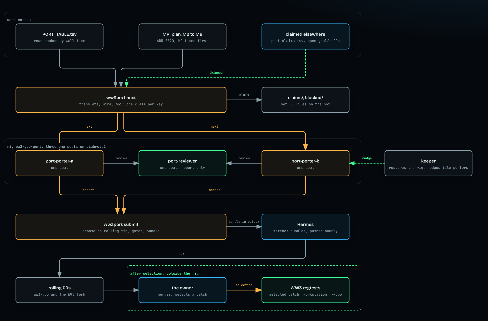

# WFIP-0007: The port runs 24/7 on an OpenRig of omp seats, with claims so no routine is worked twice

| | |
|---|---|
| **Status** | Draft |
| **Author** | M. Hoffmann (asked 2026-11-11 in the project thread: "add now openRig spec with OMP harness, take a look on piabrota/nix-os before implementing. It must cover the more efficient process to finish ww3-gpu port running 24/7, without manual intervation, just need coordination to not work on the same routine twice, most work here can be paralelized, regtests will only run after selection") |
| **Created** | 2026-11-11 |
| **Deliverable** | D5 |
| **Related** | goal `nTftdMNx-6408`; issue #42 (the port planner); [`kokkos/PORT_TABLE.tsv`](../../kokkos/PORT_TABLE.tsv), [`kokkos/port_claims.tsv`](../../kokkos/port_claims.tsv); [ADR-0002](../ADRs.md#adr-0002), [ADR-0010](../ADRs.md#adr-0010), [ADR-0016](../ADRs.md#adr-0016), [ADR-0017](../ADRs.md#adr-0017), [ADR-0020](../ADRs.md#adr-0020) (Proposed); the [MPI plan](../plans/2026-11-01-002-mpi-kokkos-plan.md), whose units M2 to M8 the rig carries (#210, its M0 and M1 already on `main`); [Batch 4 plan](../plans/2026-11-01-001-port-batch-4-plan.md); piabrota/nix-os `docs/OPENRIG.md` and `openrig/specs/` at `72de36b` |
| **Effort** | L: a new rig, three AgentSpecs, an omp overlay, one claim command and a keeper in piabrota/nix-os (the spec files are written, [`WFIP-0007/openrig/`](WFIP-0007/openrig/README.md)); two rule changes here (`/port-next`, `port_claims.tsv`) |
| **Gain** | `proposal` (D5: the 127 untranslated and 244 unwired rows move without a person at a terminal); `lab/dev-loop` (the owner's time goes to selection and regtests, not to dispatch) |
| **Effort vs Gain** | do next: the compute share is already translated (99.3 %), so what is left is many small rows, which is the shape that parallel seats speed up and a single session does not |
| **Depends on** | the owner's answers in §11 (which rig is always on, how Hermes may name branches, the toolchain on the box); a GitHub App read token for `h0ffmann/ww3-gpu` and `h0ffmann/WW3` on piabrota2; one umbrella issue filed by the owner |
| **Blocked by** | none |
| **Risk** | the box's memory: three seats plus one gfortran/Kokkos build inside `MemoryHigh=3G` is not measured, and a build that does not fit makes the rig slower than one session on the owner's machine |

### Readiness

| | |
|---|---|
| **Manually reviewed** | no |
| **Written by** | M. Hoffmann, with an agent |
| **Tasks** | `WFIP-0007.tasks.md` once Accepted; the units are in §5.8 |
| **Tests** | none of the port's own (ADR-0010). `ww3port` gets the shell self-tests of §7; the port's evidence stays the gates and the static parity argument, and WW3's regtests after selection |
| **Spec-kit** | none |
| **Issues** | not filed: Draft |

## 1. Summary

An OpenRig rig, `ww3-gpu-port`, runs on piabrota2 next to the rigs that already exist there. Its
seats run Oh My Pi (`runtime: omp`) and loop without a person: a worker claims the next free row
of `kokkos/PORT_TABLE.tsv`, translates or wires it, argues bit parity statically, gets a review
from a reviewer seat, and submits. A claim is an atomic file on the box, so two seats never take
the same routine, and two wiring jobs never edit the same WW3 caller file at once. Accepted work
collects on one rolling branch that Hermes pushes. The queue carries three kinds of item: a row to
translate, a row to wire, and a unit of the MPI plan (M2 to M8 of ADR-0020). WW3's regtests are not
in the loop: they run only on the batch the owner selects, in the validation phase of ADR-0016. The
RigSpec, AgentSpecs and omp rules are written, in nix-os's layout, in
[`WFIP-0007/openrig/`](WFIP-0007/openrig/README.md).

## 2. Motivation

What is left of the port, from `kokkos/PORT_TABLE.tsv` at `fc33ad1` (v, `awk -F'\t' 'NR>8{print $6}'
kokkos/PORT_TABLE.tsv | sort | uniq -c`, 2026-11-11):

| state | rows |
|---|---|
| todo (not translated) | 127 |
| translated, not wired | 244 |
| wired | 58 |
| regtested | 14 |

`kokkos/PORT_STATUS.md` at the same commit (v): translated 99.3 % of the run time, ported 99.3 %,
regtested 48.6 %. So the rows still open are small: of the 127 todo rows, 5 have a self share of
0.01 % or more in a committed profile (v, same `awk` with `$4+0>=0.01`). They come in families
that share a file (`yowpdlibmain.F90` 14, `w3nmlshelmd.F90` 13, `w3gsrumd.F90` 11, v). Many small,
independent rows are the case where seats in parallel pay; one session working row 1 at a time,
as `/port-next` asks today, does not.

Today nothing runs while the owner is away. `/port-next` stops unless the routine is row 1 and an
issue names it (`.claude/commands/port-next.md`, steps 1 and 2), and `port_claims.tsv` is kept by
hand in a pull request, so a claim reaches another agent only after a merge.

## 3. What changes for the reader

Before: the owner opens a session, runs `/port-next <row 1>`, waits, opens the PR, merges, repeats.

After: the owner reads one rolling draft PR and the outbox report, and makes two kinds of call,
neither of which blocks the rig: merge the rolling PR when convenient, and select a batch for the
regtests. A status line the owner can ask Hermes for:

```console
$ ww3port status
claimed   porter-a   translate  w3gsrumd:w3gfcl_r8        since 02:14  heartbeat 3 min
claimed   porter-b   wire       w3srcemd.F90 (w3sbs1)     since 02:31  heartbeat 1 min
review    reviewer   translate  w3cspcmd:w3cspc           round 1
accepted  12 since 2026-11-11 00:00   blocked 1 (w3timemd:tick21: object not reproducible)
rolling   goal/<issue>-port-rolling  +12 commits over origin/main
```

This output is the design, not a run ⚠.

## 4. Sources and dependencies reviewed

### 4.1 OpenRig on piabrota2 (piabrota/nix-os at `72de36b`, read 2026-11-11 (v))

- OpenRig 0.7.7 runs as the unit `openrig`, loopback only, `MemoryMax=4G`, `MemoryHigh=3G` at
  piabrota2, "at most three seats at the same time, in one rig" (`docs/OPENRIG.md`, "Status today",
  "Limits"). piabrota2 is a KVM 4 VPS with 4 vCPU and 16 GB (`hosts/piabrota2/default.nix:1`).
- An omp seat takes about 340 MiB and the daemon about 220 MiB idle; with
  `permission_policy: builtin:yolo` omp runs with `--approval-mode yolo`, and the deny rules of
  `hermes/omp.yml` still refuse `git push`, `gh` and `sudo`
  (`hermes/skills/hermes-omp/references/openrig-seats.md`).
- The model of an omp seat is written `anthropic/claude-sonnet-5-5` on the member, or no key
  reaches it (same file, table row "a model the runner forwards a key for").
- OpenRig merges each seat's guidance into `AGENTS.md` of the seat's `cwd`; a role goes in as a
  startup file with `delivery_hint: send_text` (`hermes/skills/hermes-rig/references/rig-spec.md`).
- The chaceon port already has this shape: rigs `wave-forecaster-dev` (porter and auditor) and
  `wave-forecaster-dev-integrate` (integrator and auditor, on omp), AgentSpecs `wf-shared`,
  `wf-porter`, `wf-auditor`, `wf-integrator`, a keeper `openrig-wf-keeper` that restores the port
  rig every 2 minutes, read tokens in `/run/openrig-github/`, and an outbox
  `/var/lib/rig-outbox/wave-forecaster-dev` from which Hermes fetches a `git bundle` and pushes a
  `hermes/*` branch (`docs/OPENRIG.md`, "wave-forecaster-dev"). The keeper "sends no task: an idle
  rig does no work" (same section). That is the gap this WFIP fills.
- Two precedents for claims: the thesis rig's `thesis fetch` claims a section with a file made
  under `set -C` (atomic), takes over a claim older than 7200 s under a `mkdir` lock, and exits 3
  when nothing is free (`docs/THESIS.md`, "One section, from claim to verdict"); and OpenRig's own
  `rig queue claim` (`hermes/skills/hermes-rig/references/commands.md`), whose locking was not
  read ⚠.
- The box has "no Docker, no GPU, no Vulkan and no Fortran compiler" (`openrig/specs/agents/wf-shared/guidance/norms.md`).

### 4.2 This repository

- `.omp/AGENTS.md` imports `AGENTS.md`; omp reads `.omp/`, `.claude/commands` and `.mcp.json` from
  the working directory only, and a `task` subagent gets `.omp/RULES.md` instead of `AGENTS.md`.
- `kokkos/port_claims.tsv` (routine, file, claim, plan) merges into `PORT_TABLE.tsv` through
  `scripts/port_score.py --write`; `--check` fails on a stale table.
- [ADR-0017](../ADRs.md#adr-0017) (Accepted): no MPI path is translated, wired or regtested;
  [ADR-0020](../ADRs.md#adr-0020), which would lift it, is Proposed.

**The pick.** Reuse piabrota2's OpenRig, the omp wrapper, the outbox and the keeper pattern; add a
claim command on the `thesis` model, because the rows are ranked work items with a file each, and a
file on the box is visible to every seat at once, which a pull request is not.

## 5. Design

### 5.0 How the rig is fed

[](https://h0ffmann.github.io/ww3-gpu/figures/openrig-port-feed/)

<details open>
<summary>How to read this figure</summary>

**Takeaway.** Work enters only through the queue: the ledger's ranked rows and the MPI plan's
units, minus what is claimed elsewhere. Two omp porters take items from it, one reviewer checks
each, and accepted work leaves as a bundle for Hermes. The regtests sit after the owner's
selection, outside the rig.

**How to read.** Top to bottom. The top row is where work comes from; the dashed arrow from
"claimed elsewhere" is what the queue skips. The region in the middle is the rig, three omp seats.
The keeper on the right restores the rig and nudges an idle porter. The bottom row is the handoff:
`ww3port submit`, Hermes, the rolling PR, and the owner, whose selection is the only way into the
regtests.

**Not shown.** The build lock and the caller-file locks (§5.3); the fork branches of `h0ffmann/WW3`
that travel with a `wire` or `mpi` item; Hermes's own checks before a push.

**Evidence.** Every node is a file or a section of this WFIP: the rig is
[`rig.yaml`](WFIP-0007/openrig/specs/rigs/ww3-gpu-port/rig.yaml), the queue and its kinds §5.2, the
claims §5.3, the loop the porter's [`role.md`](WFIP-0007/openrig/specs/agents/wg-porter/guidance/role.md),
the keeper the appendix, selection §5.6. None of it has run ⚠.

</details>

### 5.1 The rig: `ww3-gpu-port`, three omp seats

| seat | agent | does |
|---|---|---|
| `port-porter-a`, `port-porter-b` | `wg-porter` | loop: claim, translate or wire, gates, static parity, ask review, submit |
| `port-reviewer` | `wg-reviewer` | reviews one submission at a time against the Fortran at the pin, report only |

Three seats is the box's limit. Two workers and one reviewer, because a review reads one diff and
a translation also builds; the ratio is a guess until §7's first day is measured ⚠. More workers
need more memory (§11) or another host (§9). The files are
[`rig.yaml`](WFIP-0007/openrig/specs/rigs/ww3-gpu-port/rig.yaml) and the three AgentSpecs beside it
([`wg-shared`](WFIP-0007/openrig/specs/agents/wg-shared/guidance/norms.md),
[`wg-porter`](WFIP-0007/openrig/specs/agents/wg-porter/guidance/role.md),
[`wg-reviewer`](WFIP-0007/openrig/specs/agents/wg-reviewer/guidance/role.md)).

### 5.2 The work queue

`ww3port queue` builds the queue at the rolling tip from `kokkos/PORT_TABLE.tsv`, in its `priority`
order (ADR-0002), and the MPI plan's units in its own order, with three kinds of item:

| kind | from rows | lock key | done when |
|---|---|---|---|
| `translate` | `state` todo | the routine | the `ports.tsv` row, kernel, port report and glossary rows exist and the gates pass |
| `wire` | `translated` yes, `wired` no | the routine and the WW3 caller file (e.g. `w3srcemd.F90`) | the shim, the fork hunk behind its `WW_KOKKOS_*` flag (default: the Fortran) and the `wired` column filled |
| `mpi` | a unit M2 to M8 of the [MPI plan](../plans/2026-11-01-002-mpi-kokkos-plan.md) | the unit and every fork file its "Fork" column names (M2: `w3wavemd.F90`, `w3kokkos_prop3md.F90`) | the unit's "Gate now" column passed; every MPI path off unless asked for by name (ADR-0020, decision 5) |

The MPI units enter in the plan's order and with its gate: M2 first, because "Nothing past M2
should start before the workstation has timed M2" (v, the plan, "Units"). So M3 to M8 wait in the
queue as `waiting: M2 timing` until the owner writes `gates/m2-timed` in `$WW3PORT_HOME` after that
workstation session; M6 and M7 may then run at once, since they share no fork file. The `PDLIB`
rows of `PORT_TABLE.tsv` (`PDLIB_JACOBI_GAUSS_SEIDEL_BLOCK`, 37.54 % of the `pdlib` profile, v,
the plan) are wired by M6, not as `wire` items. While ADR-0020 is Proposed, an `mpi` item merges
only with its paths off, which is what decision 5 asks anyway.

Left out of the queue, each with the reason printed: rows that are not routines (`init`,
`finalise.0`, `main`: Batch 4 plan, "Row 1 is not a routine"); every row only an MPI build reaches,
which goes to its MPI unit instead; rows in `port_claims.tsv` at `origin/main` or on any open `goal/*` branch
of this repository (`git ls-remote`); rows in `blocked/`.

The caller-file key is what makes wiring parallel: two seats may wire at once only into different
WW3 files, so their fork hunks never conflict. An `mpi` unit that names `w3wavemd.F90` waits for
every `wire` item on that file to submit, and blocks the next one until it does.

### 5.3 The claim command: `ww3port`

A shell command in piabrota/nix-os (`ww3port/`, as `thesis/` is), no model and no network except
`git fetch`. State lives in `/var/lib/openrig/work/ww3-gpu-port/`:

| command | does |
|---|---|
| `ww3port next --as <seat>` | resumes the seat's own claim if it holds one; else takes the first free item: `set -C` writes `claims/<key>.claim` (seat, item, time), one file per lock key, all or none; exit 3 when the queue is empty |
| `ww3port beat --as <seat>` | touches the claim; the role runs it at every step |
| `ww3port release <item> --as <seat>` | gives the item back |
| `ww3port block <item> --reason "<text>"` | moves it to `blocked/`, never retried until the owner deletes the file |
| `ww3port submit <item> --as <seat>` | only for the holder after the reviewer's `accept`: under `flock rolling.lock`, rebases the seat's commits onto the rolling tip, runs `python3 scripts/port_score.py --write` and `--check`, the gates of §5.5 again, commits, writes `outbox/<item>.bundle` and `outbox/<item>.md`, removes the claim |
| `ww3port status` | §3 |

A claim with no heartbeat for 4 h is stale; `next` takes it over under a `mkdir` lock, as `thesis`
does. Shared lists (`ports.tsv`, `GLOSSARY.md`, `justfile`, `PATCH.md`) are appended to; on a
rebase conflict in a generated file `submit` regenerates it with `port_score.py --write` and never
edits it by hand; any other conflict blocks the item.

### 5.4 The seats' loop (the role of `wg-porter`)

1. `ww3port next`. Exit 3: say "queue empty" and stop.
2. Branch `goal/<issue>-port-<routine>` from the rolling tip in the seat's own clone.
3. `translate`: `/port-next <routine>` steps 3 to 5, with the two rule changes of §5.7. `wire`: the
   shim and the fork hunk, as `kokkos/src/fortran_iface/PATCH.md` describes, on the fork branch
   `ww3-gpu/port-<routine>` of `h0ffmann/WW3`.
4. The gates of §5.5, under `flock /var/lib/openrig/work/ww3-gpu-port/build.lock`, so one build
   runs at a time.
5. Send the commit to `port-reviewer`; fix what it reports; at most three rounds, then `block`.
6. `ww3port submit`, then back to 1.

Stop and `block` on: an object that the C++ cannot reproduce; a reduction, limiter or integration
order that cannot be kept (ask the owner, AGENTS.md "Porting"); a needed change to a tolerance,
`test.comp`, `nccmp-tol` or the matrix driver; anything that needs `--gpu`. The seat never runs a
regtest and never runs on a GPU.

### 5.5 What the loop checks, and what it leaves for selection

| check | in the loop | after selection |
|---|---|---|
| `just kokkos-test serial-debug`, `just kokkos-test openmp-release` | yes | |
| static parity: the `-O3` GIMPLE or disassembly of the Fortran object and the C++ (ADR-0016) | yes, recorded in the port report | |
| `python3 scripts/port_score.py --check`, `shellcheck` on changed scripts, `just vale` | yes | |
| review by `port-reviewer` | yes | |
| `just smoke-ww3-gpu`, `just full-ww3-gpu`, `just ww3-gpu-matrix` (`--cpu`, `WW3GPU_STRICT=ON`) | no | yes |
| any `--gpu` run | no | only with the owner at the terminal |

### 5.6 Handoff, the rolling branch and selection

- Hermes fetches each bundle into its clone (as for chaceon), and pushes the rolling branch
  `goal/<issue>-port-rolling` of this repository and `ww3-gpu/port-rolling` of the fork once an
  hour, with one draft PR each, body by `just uprd`. A seat never pushes.
- The owner merges the rolling PR when convenient. Nothing waits on that merge: the queue reads
  the rolling tip, and `ww3port submit` writes the `port_claims.tsv` rows, so a session elsewhere
  sees a claim within the hour.
- **Selection.** `ww3port select` lists the accepted, unregtested rows ranked by wall time, with
  their static parity record. The owner picks a batch; the regtests of §5.5's last rows run on it,
  on the owner's machine, and only then may a `regtested` cell or a timing change. That is the
  validation phase of ADR-0016; this WFIP does not move it.

### 5.7 Rule changes in this repository

1. `/port-next`, step 1: "If `$ARGUMENTS` is not row 1, stop" becomes "the first row with no claim
   in `port_claims.tsv`, `PORT_TABLE.tsv` or the box's claims", for a seat started by `ww3port`.
2. `/port-next`, step 2: one umbrella issue, filed by the owner, covers every row of the queue; a
   port with no issue is still not work.
3. `AGENTS.md`, "Where a change belongs": a row for `ww3port`'s claims. Both need the owner's
   agreement in a session (AGENTS.md, "A learning").

### 5.8 Units

1. This WFIP and the spec files of [`WFIP-0007/openrig/`](WFIP-0007/openrig/README.md) (here).
2. `ww3port` with its self-tests (nix-os). 3. The spec files copied to `openrig/specs/` and
`omp/ww3-gpu-port.yml`, and the omp wrapper taking it (nix-os). 4. The NixOS option
`piabrota.openrig.ww3gpu`: the toolchain, folders, read tokens for `h0ffmann/ww3-gpu` and
`h0ffmann/WW3`, outbox, keeper (nix-os). 5. §5.7's rule changes (here). 6. A first supervised day:
the owner watches, memory and throughput are measured (§7).

### 5.9 The omp harness of a seat

Each seat is `omp --mode rpc` under OpenRig's runner, through nix-os's one wrapper
(`omp/wrapper.nix` with `ceiling = null` and `hermes/omp-seat-append-system.md`, v at `72de36b`):

| layer | from | what it gives the seat |
|---|---|---|
| model and roles | `hermes/omp.yml` `modelRoles` | Sonnet for the work and `task` subagents, Haiku for side roles; `anthropic/claude-sonnet-5-5` on each member so the key reaches it |
| off by default | `hermes/omp.yml` | no LSP, eval kernels, browser, memory backend or advisor: each is memory per seat |
| deny rules, the box | `hermes/omp.yml` `bash.patterns` | no `git push`, `git remote`, `gh`, `sudo`, `curl`, package installs, secrets, or `rig daemon`/`setup`/`host` |
| deny rules, this rig | [`omp/ww3-gpu-port.yml`](WFIP-0007/openrig/omp/ww3-gpu-port.yml) | no WW3 run (`just smoke*`, `full*`, `perf*`, `ww3-gpu-matrix*`, `scripts/ww3-gpu.sh --ww3*`, `ctest`, `mpirun`), no `--gpu`, no `libm_bits.sh --device`, no `WW3GPU_GPU_CONFIRMED` or `WW3GPU_IN_SHELL`, no hand edit of a claim, no `just pr` or `release` |
| rules appended to the system prompt | `hermes/omp-seat-append-system.md` | one seat of a rig; smallest diff; no push; tools from Nix only; stop on an owner's decision |
| guidance | `wg-shared/guidance/norms.md`, merged by OpenRig into the seat folder's `AGENTS.md` | this repository's rules on the box: read `.omp/AGENTS.md`, the queue is the only work, the build lock, what is left for selection |
| role and start | `wg-porter` or `wg-reviewer`, `send_text` startup files; the porter's start action runs `ww3port next` | the loop of §5.4, or the review |
| approval | `permission_policy: builtin:yolo` in the rig | `--approval-mode yolo`: RPC mode has nobody to answer a prompt |

The seat's working folder is its own folder, and the clone is `ww3-gpu/` under it. omp loads
`.omp/` only from its working folder, so this repository's `.omp/AGENTS.md`, its hook extension and
`.claude/commands` are not loaded by themselves; the norms make the seat read the first two files,
and the proposal hook is not needed because a seat never touches `pubs/proposal/`. Starting the
seat in the clone itself would load `.omp/`, but OpenRig would then merge its guidance into the
clone's tracked `AGENTS.md` ⚠ (rig-spec.md: "Guidance merges into `AGENTS.md` of the working
folder"), so it is not chosen. omp skills are not found on disk either, and a resource path cannot
leave the spec folder, so `ww3-port` is read from the clone too, as `wf-shared` does for chaceon.

## 6. Parity and physics impact

None by itself: the rig changes who runs `/port-next`, not what a port computes. Every row it
produces is held to AGENTS.md's "Translate, don't improve" and "Bit for bit", argued statically
until selection, then judged by WW3's regtests with `kokkos/tools/nccmp-tol/tolerances.txt`
unchanged. A `WW_KOKKOS_*` flag a seat adds defaults to the Fortran.

## 7. Verification plan and definition of done

- [ ] `ww3port` passed its self-tests: two seats racing `next` on one item get one claim, a stale claim is taken over, `block` sticks: `bash ww3port/test.sh` (nix-os)
- [ ] The rig validated: `rig spec validate` and `rig up <spec> --plan` passed on the box
- [ ] One supervised day ran: the owner watched, peak memory of the unit `openrig` stayed under `MemoryHigh` (`kvm4-health`), and the count of accepted items per day was recorded in `docs/log/`
- [ ] No item was worked twice in that day: `ww3port status --history` shows one claim per lock key at a time
- [ ] No `mpi` item past M2 was claimed before `gates/m2-timed` existed: `ww3port status --history`
- [ ] Every accepted item passed §5.5's loop gates: `python3 scripts/port_score.py --check` and `just kokkos-test serial-debug` on the rolling tip
- [ ] The rig ran unattended for 72 h with the keeper restoring it after a restart: `journalctl -u openrig-ww3-keeper`
- [ ] A first selected batch ran through `just ww3-gpu-matrix` on the owner's machine, `--cpu`

## 8. Risks, limitations, and honest caveats

- **Memory.** 3 × 340 MiB + 220 MiB is about 1.2 GiB before any build (v, from the figures of
  §4.1); what a gfortran `-O3` object plus a Kokkos OpenMP build of the port adds is not measured
  ⚠. The build lock caps it at one build, which may make builds the bottleneck.
- **Toolchain on the box.** The seats need this repository's pinned gfortran, CMake and Kokkos for
  the gates and the static parity argument; the box has no Fortran compiler today (§4.1). How
  nix-os gets them from `picasso/` at its pin is not checked ⚠.
- **One rig at a time.** The chaceon port rig is always on (`docs/OPENRIG.md`, "Always on") and
  the box runs one rig at a time; this rig cannot run beside it (§11).
- **Hermes's branches.** Hermes may push only `hermes/*`; this repository refuses any name that is
  not `goal/<id>-<slug>` (`scripts/branch_name.sh`). One of the two must change (§11).
- **Small rows are not free.** A row under one gprof sample has no measured cost; finishing them
  moves the "translated" line count, not the run time. The queue keeps the wall-time order, so the
  rig works the measured rows first.
- **Review by the same model family.** The reviewer seat runs the same model as the workers; the
  static parity record is the evidence, the review is not.
- **Subscription rate limits** may idle seats for hours; not measured ⚠.

## 9. Alternatives considered

- **Do nothing**: one session at a time while the owner is present. Lost: nothing moves at night.
- **The owner's workstation instead of piabrota2**: likely more memory, Docker and the Fortran
  toolchain, so more workers and the regtests on the same host. Not picked as default because the
  OpenRig unit, tokens, outbox and keeper exist only on piabrota2, and the workstation's size was
  not read today ⚠. The design is host-neutral except §5.8 unit 4.
- **Claims as pull requests** (`port_claims.tsv` only): a claim is seen only after a merge, so two
  seats race; kept as the published copy, not the lock.
- **`rig queue`**: OpenRig's own work items. Its claim semantics were not read ⚠; `ww3port` mirrors
  a design the box already runs (`thesis`).
- **A coordinator seat that assigns work**: one more seat of memory for what a file lock does.
- **Regtest every candidate**: against the owner's order and ADR-0016, and the box cannot run them.

## 11. Open questions

- Which rig is always on: `ww3-gpu-port` or chaceon's `wave-forecaster-dev`? **Default:** the
  keeper restores `ww3-gpu-port`; the chaceon rig is started by hand. The owner decides.
- How do Hermes's pushes satisfy the branch rule? **Default:** nix-os lets Hermes push `goal/*` to
  `h0ffmann/ww3-gpu` and `ww3-gpu/*` to `h0ffmann/WW3` only; the owner decides.
- Hermes's commits carry no `Co-Authored-By`, which AGENTS.md asks of agent commits. **Default:**
  `submit` writes the trailer block of this repository into each commit; the owner decides.
- The seat's `cwd` is its own folder, so omp does not load the clone's `.omp/` extension.
  **Default:** the norms tell the seat to read `ww3-gpu/.omp/AGENTS.md` and `AGENTS.md` first; the
  seats never touch `pubs/proposal/`, so the proposal hook is not needed.
- More than two workers? **Default:** no, until §7's supervised day shows the memory; the owner
  raises `MemoryHigh` or moves the rig.
- ADR-0020 is Proposed, and the owner's 2026-11-11 message puts the MPI plan in this rig.
  **Default:** `mpi` items run with every MPI path off (ADR-0020, decision 5) and the ADR stays
  Proposed until the owner accepts it; M3 to M8 wait for the owner's M2 timing on the workstation.
- A stronger model for the L units (M2, M6, M7)? **Default:** Sonnet, as every seat on the box; a
  member's `model` can name another, which is the owner's call.

## Appendix

### The spec files

The RigSpec, the AgentSpecs and the omp rules are in [`WFIP-0007/openrig/`](WFIP-0007/openrig/README.md),
in nix-os's layout, with the destination of each file. Not validated ⚠.

### The keeper

The keeper `openrig-ww3-keeper` is `openrig-wf-keeper` with two changes: its rig is
`ww3-gpu-port`, and every 5 minutes it sends `rig send port-<seat>@ww3-gpu-port "Run ww3port next
and continue your loop."` to a worker that holds no claim and whose last heartbeat is older than 20
minutes, and nothing when `ww3port next` would exit 3. Whether `rig ps` exposes a seat's idleness
was not checked ⚠, so the heartbeat file is the signal.

### Checked live

- piabrota/nix-os, public clone at `72de36b` (2026-11-11 12:02 -0300): `docs/OPENRIG.md`,
  `docs/THESIS.md`, `openrig/specs/rigs/wave-forecaster-dev*/rig.yaml`,
  `openrig/specs/agents/wf-shared/guidance/norms.md`, `openrig/specs/agents/wf-porter/*`,
  `hermes/skills/hermes-rig/references/{rig-spec,commands,concepts}.md`,
  `hermes/skills/hermes-omp/references/openrig-seats.md`, `hosts/piabrota2/default.nix`.
- piabrota/nix-os at `72de36b`, for §5.9: `omp/wrapper.nix`, `hermes/omp.yml`,
  `hermes/omp-seat-append-system.md`, `openrig/specs/agents/wf-integrator/agent.yaml`,
  `openrig/specs/agents/wf-auditor/{guidance/role.md,startup/context.md}`.
- This repository at `fc33ad1`: `kokkos/PORT_TABLE.tsv`, `kokkos/PORT_STATUS.md`,
  `kokkos/port_claims.tsv`, `.omp/AGENTS.md`, `.claude/commands/port-next.md`; at `4898c6a`,
  `docs/plans/2026-11-01-002-mpi-kokkos-plan.md` and ADR-0020 (#210's M0 and M1 are on `main`).

### Not checked

OpenRig's `rig queue` locking; `rig ps` idleness; whether `PI_CONFIG_FILES` takes two overlays;
the startup action's `applies_on` on a restore; the memory of a port build on the box; how the
picasso toolchain reaches the seat profile; the owner's workstation size; subscription rate limits.
