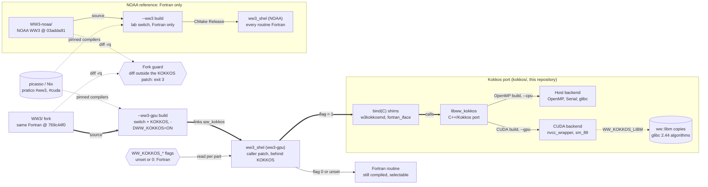
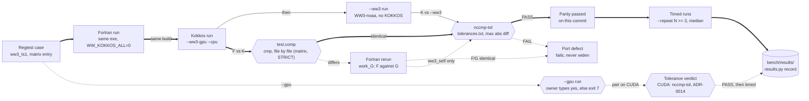
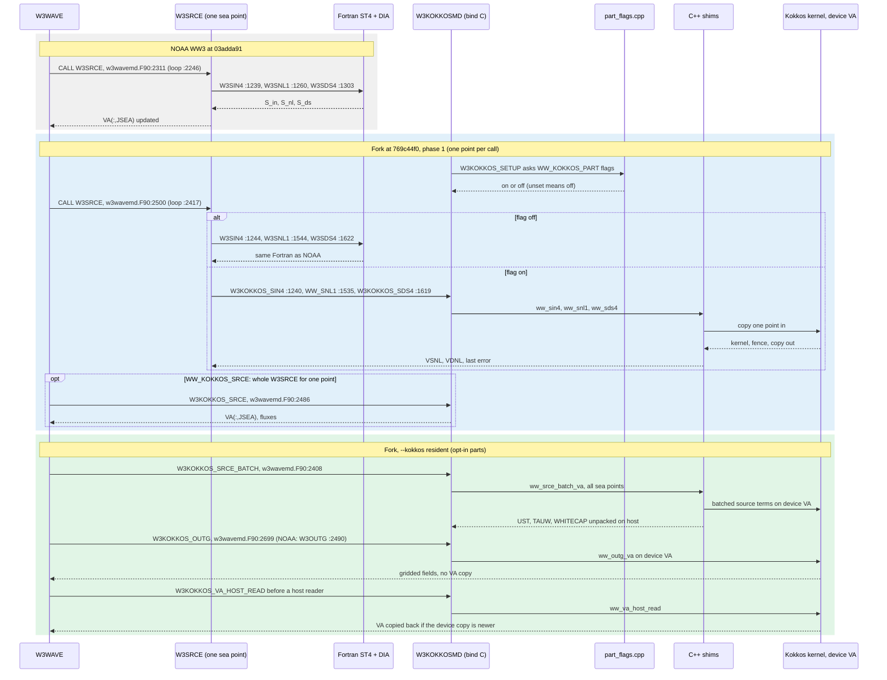
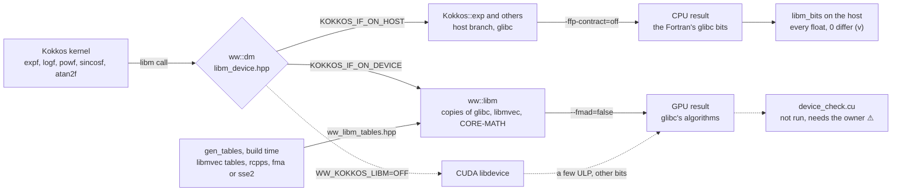

# ww3-gpu compared with NOAA's WW3, in five figures

What ww3-gpu changes in NOAA's WAVEWATCH III® and what it keeps: how the two executables are
built, how a result is judged against NOAA's, where a time step leaves the Fortran, which states a
routine passes through on its way to Kokkos, and how the GPU can return the CPU's bits. Read
2026-10-17 at this repository's `b38b5fc8`, the fork `WW3/` at `769c44f0` and pure NOAA WW3
(`WW3-noaa/`) at `03adda91`. No speed figure appears: none has passed WW3's regtests yet, and those
are postponed to a validation phase ([ADR-0016](ADRs/ADR-0016-speed-first-regtests-postponed-one-person-loop.md)).

Each figure is a Mermaid fence with its reading card; its interactive twin is rendered from a
source in [`docs/archify/`](archify/README.md) by `scripts/archify.sh render`, and printed to a PDF
next to it.

## The two builds

How to read this figure

**Takeaway.** Both executables compile the same Fortran physics. ww3-gpu adds a `KOKKOS` switch, call-site branches and `bind(C)` shims into a C++/Kokkos library, and every Kokkos part can be switched back to the Fortran routine at run time inside the same binary.

**How to read.** The top row is pure NOAA WW3 as `scripts/ww3-gpu.sh --ww3` builds it from `WW3-noaa/`. The bottom row is `--ww3-gpu` built from the `WW3/` fork. The fork guard sits between the two source trees: before `--ww3` builds, the script runs `diff -rq` over `model/` and stops with exit 3 when a file outside the KOKKOS patch differs. Both builds take their compilers from the pinned `picasso/labs/pratico` flake. Inside the ww3-gpu executable a `WW_KOKKOS_<PART>` flag set to `1` (or `WW_KOKKOS_ALL=1` with the part flag unset) sends that part through the shims to Kokkos; unset or `0` keeps the Fortran routine. The Kokkos library runs on the OpenMP or Serial backend on the host (`--cpu`, glibc's libm) or on the CUDA backend (`--gpu`), where kernels call `ww::libm` copies of glibc's algorithms when `WW_KOKKOS_LIBM` is defined.

**Not shown.** Which parts are wired, translated or regtested (see `kokkos/PORT_STATUS.md` and `kokkos/ports.tsv`); the per-call host to device copies of phase 1 and the resident spectrum of phase 2; WW4; the MPI (`DIST`) branches, which the Kokkos path does not cover; any timing, since no end-to-end figure has passed a regtest replay.

**Evidence.** All read 2026-10-17 unless marked otherwise.
- `scripts/ww3-gpu.sh:2-8` (two submodules, `--ww3` from `WW3-noaa/`), `:397-398` (source per mode), `:401-431` (fork guard, exit 3), `:330-336` (enters `nix develop picasso/labs/pratico#ww3` or `#cuda`), `:474-487` (adds `KOKKOS` to the switch, `-DWW_KOKKOS=ON`, `nvcc_wrapper` for CUDA), `:288-291` (`--ww3 --gpu` refused, exit 64), `:317-328` (typed yes, else exit 7) (v, read 2026-10-17).
- Fork at `769c44f0`: `model/src/cmake/switches.json:854-865` (the `kokkos` category, `KOKKOS` builds `w3kokkosmd.F90`), `model/src/CMakeLists.txt:24-44` (`WW_KOKKOS` option, `find_package(ww_kokkos 0.9)`), `model/src/w3srcemd.F90:621` (`USE W3KOKKOSMD`) and `:1530-1547` (`IF ( KOKKOS_SNL1 )` calls the shim, else `CALL W3SNL1`), `model/src/w3kokkosmd.F90:1050` (`BIND(C, NAME='ww_kokkos_flag')`) (v, read 2026-10-17 with `git show`).
- `kokkos/src/fortran_iface/part_flags.cpp:1-11` and `kokkos/src/fortran_iface/PATCH.md:658-673` (flag resolution, Fortran by default) (v, read 2026-10-17).
- `kokkos/CMakePresets.json:19-40` (OpenMP preset; CUDA preset with `nvcc_wrapper`, `CMAKE_CUDA_ARCHITECTURES` 89) (v, read 2026-10-17).
- `kokkos/src/ww_kokkos/libm_device.hpp:1-12` and `docs/GPU_LIBM_BITS_202610.md:31-35` (device copies of glibc 2.44 under `WW_KOKKOS_LIBM`) (v, read 2026-10-17). That these copies give glibc's bits on a device ⚠: no device run has compared them.
- That the fork differs from `WW3-noaa/` only inside the patch at these exact two commits ⚠: the guard's logic was read, not run here.

## The verdict

How to read this figure

**Takeaway.** On the CPU a ported routine passes only when its output files are byte-identical to the Fortran routine of the same executable, apart from files two Fortran runs already write differently. A GPU run is judged by `nccmp-tol`'s tolerances instead (ADR-0014). A timing enters `bench/results/` only after one of these verdicts passed on the same commit.

**How to read.** Thick arrows are the passing path. The executable built with the `KOKKOS` switch runs the case twice, the Fortran run with every flag off and the Kokkos run with the selected parts on. In the regtest matrix (`just ww3-gpu-matrix`, `WW3GPU_STRICT=ON`) WW3's `test.comp` compares the two run directories with `cmp`. When a file differs, the Fortran run is repeated (`work_G`): a file that also differs between the two Fortran runs is WW3's own variation (`ww3_self`) and is excused, any other file fails the entry. `nccmp-tol` then compares every `ww3.*.nc` with `kokkos/tools/nccmp-tol/tolerances.txt`. A FAIL fails, and a PASS never excuses a byte difference. `scripts/ww3-gpu.sh --ww3-gpu <case> --cpu` (CI job h1 on `ww3_ts1`) runs the same pair and then `--ww3`, pure NOAA WW3, and compares the Kokkos output with both by `nccmp-tol`. It reports, without failing on it, whether the Fortran and Kokkos files are byte-identical. After parity, `--repeat N` alternates the runs, checks every output against run 1's and writes medians that `scripts/results.py record` turns into a record, refusing fewer than three runs. The dashed branch at the bottom is the GPU path: it needs the owner at a terminal, and its verdict is the tolerance check, which the record states as "GPU: judged by tolerance, not bits".

**Not shown.** The build steps (first figure); the MPI and OpenMP selections of the matrix; the `kokkos_spectra` column, which says whether an entry exercised the port at all; the static GIMPLE argument that stands in for the regtests until the validation phase (ADR-0016); the `--timers` breakdown. No speed-up figure is shown: the only record in `bench/results/` is a 2026-09-15 kernel study kept under the older `l1` rule, not an end-to-end run that passed this workflow.

**Evidence.** All read 2026-10-17 unless marked otherwise.
- `WW3-noaa` at `03adda91`, `regtests/bin/test.comp:80` (`cmp --silent` per file, "is identical" or "is different"); the matrix calls the fork's copy, identical at that line at `769c44f0` (v, read 2026-10-17 with `git show`).
- `regtests/cmake/run_entry.cmake:1-13` (F and K runs, `work_G` rerun, `ww3_self`), `:149-162` (`compare()` with `test.comp`), `:165-166` and `:231-249` (rerun and exclusion of `ww3_self` files) (v, read 2026-10-17).
- `regtests/cmake/ww3gpu_common.cmake:259-285` (row verdict: nccmp-tol FAIL or MISSING fails; under STRICT a test.comp difference fails) and `regtests/CMakeLists.txt:29-30,65` (`WW3GPU_STRICT` on by default) (v, read 2026-10-17).
- `scripts/ww3-gpu.sh:567-572` (two runs, one executable), `:604` (byte-identical message only), `:605-617` (`nccmp-tol` against the Fortran and against `--ww3`, the script stops on failure under `set -e`), `:623-646` (alternated `--repeat`, medians), `:649-676` (`perf.tsv`), `:317-328` (owner's typed yes) (v, read 2026-10-17).
- `.github/workflows/health.yml:46-47` (CI h1 runs `--ww3-gpu smoke --cpu`) (v, read 2026-10-17).
- `scripts/results.py:42-48` (refuses a timing without `regtest: passed`), `:108-113` (fewer than three runs refused), `:131-133` (the ADR-0014 wording for CUDA) (v, read 2026-10-17).
- `docs/ADRs/ADR-0014-gpu-runs-judged-by-tolerance.md:27-41` (CPU unchanged, CUDA judged by tolerance, never widened, timing after a pass) (v, read 2026-10-17).
- `bench/results/snl1-i9-14900-rtx4090-2026-09-15.json` (the only record, `l1`, no end-to-end `regtest`) (v, read 2026-10-17).
- That `just ww3-gpu-matrix-cuda` applies the ADR-0014 verdict ⚠: `WW3GPU_STRICT` defaults to ON for every backend and the cuda recipe does not turn it off, so a CUDA matrix run would still fail on a byte difference; no CUDA run of the matrix or of `--gpu` has been recorded.

## One time step

How to read this figure

**Takeaway.** In NOAA's WW3, W3WAVE calls W3SRCE once per sea point and W3SRCE calls the Fortran source terms. The ww3-gpu fork keeps those same calls in the same executable and adds a branch at each one: when a `WW_KOKKOS_<PART>` flag is on, the call goes through a `bind(C)` interface in `w3kokkosmd.F90` to a C++ shim and a Kokkos kernel. In phase 1 the shim copies one sea point to the device and back for every call. The `--kokkos resident` preset keeps the spectrum `VA` on the device, replaces the sea-point loop with one batched launch, computes W3OUTG's fields there, and copies `VA` back only before a host statement reads it.

**How to read.** Time runs downward. The three shaded bands are NOAA's code, the fork's per-call path, and the fork's resident path. Solid arrows are calls, dashed arrows are returns. Line numbers are in `model/src/w3wavemd.F90` or `model/src/w3srcemd.F90` at the commit named in the band. Under `alt`, exactly one branch runs per call, and with every flag off the fork runs the same Fortran call as NOAA.

**Not shown.** Propagation (W3XYP3, W3KTP3 and the support routines W3GATH, W3SCAT, W3UWND and others), which the fork routes the same way. The `!$OMP CRITICAL` around `WW_SNL1`. The conditions under which `W3KOKKOS_SRCE_ON(IT)` leaves a call to the Fortran (GQM, Liu's ice dispersion, `SINTAILPAR(4) <= 0.5` with `IT > 0`). The PDLIB branch. Timings: none are claimed.

**Evidence.** Read 2026-10-17 unless marked otherwise.
- NOAA at 03adda91: `model/src/w3wavemd.F90:229` (W3WAVE), `:2246` (`DO JSEA=1, NSEAL`), `:2311` (`CALL W3SRCE`), `:2490` (`CALL W3OUTG`); `model/src/w3srcemd.F90:1239` (W3SIN4), `:1260` (W3SNL1), `:1303` (W3SDS4) (v, read 2026-10-17).
- Fork at 769c44f0: `model/src/w3wavemd.F90:2396-2408` (`W3KOKKOS_SRCE_BATCH` under `W3KOKKOS_SRCE_ON(IT)`), `:2417` (loop), `:2482-2500` (`W3KOKKOS_SRCE` or `CALL W3SRCE`), `:2695-2705` (`W3KOKKOS_OUTG` or `W3OUTG`), `:2691` (`W3KOKKOS_VA_HOST_READ`); `model/src/w3srcemd.F90:1237-1248` (SIN4 branch), `:1528-1547` (SNL1 branch), `:1616-1627` (SDS4 branch); `model/src/w3kokkosmd.F90:1803-1811` (`W3KOKKOS_SRCE_ON`), `:1875-1996` (`W3KOKKOS_SRCE_BATCH` calling `WW_SRCE_BATCH_VA`); `model/src/w3kokkos_residentmd.F90:1-60` (the host side of the `VA` sync) (v, read 2026-10-17).
- This repository: `kokkos/src/fortran_iface/part_flags.cpp:1-46` (flag rule and `kOptInOnly`), `kokkos/src/fortran_iface/snl1_shim.cpp:308-409` (per-call copy in, kernel, fence, copy out), `kokkos/src/fortran_iface/srce_shim.cpp:1-14` and `:831` (`ww_srce_batch_va`), `kokkos/src/fortran_iface/resident_shim.cpp:324-360`, `kokkos/src/fortran_iface/outg_shim.cpp:383`, `scripts/ww3-gpu.sh:75-83` and `:167` (the resident preset `SRCE,XYP3,KTP3,OUTG,IOPE,UPDV`, not regtested) (v, read 2026-10-17).
- ⚠ `--kokkos resident` was not run for this figure. The order of calls is read from the source, not traced in a run.

## A routine's states

```mermaid
%% figure: ww3-gpu-port-lifecycle
%% title: Which states does a WW3 routine pass through in ww3-gpu, and how many routines are in each?
stateDiagram-v2
    direction LR
    state "Fortran only, as in NOAA (713 of 1023)" as Fortran
    state "Claimed in port_claims.tsv (0)" as Claimed
    state "Translated: Kokkos code exists (310)" as Translated
    state "Wired: called behind its flag at the pin (60)" as Wired
    state "Regtested: regtested yes (10)" as Regtested
    state "L2: CPU replay inside WW3 (2)" as L2
    state "gpu: L2 on CUDA (0)" as GPU
    state "Default on, host build (0 parts)" as DefHost
    state "Default on, device build (0 parts)" as DefDev

    [*] --> Fortran
    Fortran --> Claimed: claim row added
    Claimed --> Translated: ports.tsv row, claim removed
    Translated --> Wired: fork pin calls it
    Wired --> Regtested: validation phase passes (ADR-0016)
    Regtested --> L2: L2 replay
    L2 --> GPU: CUDA replay, owner present
    L2 --> DefHost: ADR-0013 timing with parity
    GPU --> DefDev: batched or resident, GPU bits match
```

How to read this figure

**Takeaway.** A WW3 routine starts in Fortran, as in NOAA's code. In this repository it can be claimed, translated to Kokkos, wired into the fork behind a run-time flag, and regtested by WW3's own regtests, which compare the Fortran and the Kokkos routine in the same executable. At this commit 310 of WW3's 1023 routines are translated, 60 are wired and 10 are regtested. Two of them (W3SNL1, INSNL1) have passed the L2 replay. None has passed on CUDA, and no part is on by default.

**How to read.** Each box is a state and each arrow is the gate that moves a routine to the next state. The number in a box counts routines at that level. The levels are cumulative: the 310 translated routines include the 60 wired ones, which include the 10 regtested ones. Translated, wired and regtested are the three levels `scripts/port_score.py` computes. L2 and gpu are the steps of the `status` column of `kokkos/ports.tsv`. The two default states are ADR-0013's: a host build may turn on SNL1, SDS4, SIN4, SPR4, ST4_TABLES and SRCE by default, and a device build may turn on SRCE only.

**Not shown.** A failed checkpoint. A `test.comp` difference is a defect of the port, never a widened tolerance, and the routine stays where it is. The `kOptInOnly` parts (XYP1, KTP1, XYP2, KTP2, XYPUG, XYP3, KTP3, OUTG, IOPE, UPDV, ST4_TABLES) ignore `WW_KOKKOS_ALL` and run only when their own flag is `1`. The share of run time at each level.

**Evidence.** Read 2026-10-17 unless marked otherwise.
- `kokkos/PORT_STATUS.md:48-50` (310, 60 and 10 of 1023 routines) and `:54` ("On a GPU: none yet") (v, read 2026-10-17). The 713 is 1023 minus 310, derived here.
- `kokkos/ports.tsv:4-17` (the meaning of status, regtested and wired). Counting its 310 rows gives status L2 for 2 rows and gpu for none, wired yes for 60, regtested yes for 10 (v, read 2026-10-17).
- `kokkos/port_claims.tsv:1-7`: a header with no rows. `kokkos/PORT_TABLE.tsv` states: 250 translated, 50 wired, 10 regtested, 0 claimed (v, read 2026-10-17).
- `scripts/port_score.py:19-22` and `:118-131` (the three levels and `at_level`) (v, read 2026-10-17).
- `docs/ADRs/ADR-0013-operational-parts-default-to-kokkos.md:68-92` (conditions for a default) and `kokkos/src/fortran_iface/part_flags.cpp:33-46` (`kOptInOnly`, and no default list: an unset flag with an unset `WW_KOKKOS_ALL` is off) (v, read 2026-10-17).
- `docs/ADRs/ADR-0010-kokkos-validated-by-ww3-regtests-only.md` (WW3's regtests are the port's only tests) ⚠ (not reread for this figure); [ADR-0016](ADRs/ADR-0016-speed-first-regtests-postponed-one-person-loop.md) moves them from ADR-0011's checkpoints to a validation phase the owner calls (v, 2026-10-17).

## Device math

How to read this figure

**Takeaway.** Every transcendental call in the ported kernels goes through `ww::dm`. On the host it is the same Kokkos call as before, so the CPU build still calls glibc and its regtest record stands. On a CUDA device built with `WW_KOKKOS_LIBM` (on by default) it calls `ww::libm`, copies of the algorithms glibc 2.44 uses (ARM optimized-routines for `expf`, `logf`, `powf`, `sincosf`, `exp`; CORE-MATH for `tanhf`, `log10f`, `atan2f`, `tanh`; libmvec's SSE4 lanes), instead of CUDA's libdevice, which uses other algorithms. On the host these copies equal glibc on every float for the unary functions. Whether the device gives the same bits has not been run.

**How to read.** Data moves left to right: the call, its routing, the library that computes it, the result, and the check. Solid lines are the default paths; dashed lines are the libdevice fallback and the device check that has not run. `gen_tables` runs on the build host and writes what the copies cannot hard-code: libmvec's `powf` tables read from the `libmvec.so.1` the toolchain links, the build CPU's `rcpps` results, and whether glibc picks its fma or sse2 build on that CPU. Contraction is off on both halves of the compile.

**Not shown.** Which kernels call which function (`docs/GPU_LIBM_BITS_202610.md`, "What the Fortran calls per sea point"). The fma and sse2 builds of glibc and how they differ. The SASS operation counts. ADR-0014's tolerance verdict, which still applies to a build without `WW_KOKKOS_LIBM`. Kernels of other switches, which the document says still call libdevice.

**Evidence.** Read 2026-10-17 unless marked otherwise.
- `kokkos/src/ww_kokkos/libm_device.hpp:1-12` (purpose and the ⚠ on device bits), `:27-66` (the device implementations with and without `WW_KOKKOS_LIBM`), `:69-125` (one host/device wrapper per entry point) (v, read 2026-10-17).
- `kokkos/src/ww_kokkos/CMakeLists.txt:288-303` (`-ffp-contract=off` on the host, `--fmad=false` on the device) and `:305-337` (`WW_KOKKOS_LIBM`, the `gen_tables` step) (v, read 2026-10-17).
- `kokkos/tools/libm_bits/glibc_mathf.hpp:1-25` (source of the algorithms and tables), `kokkos/tools/libm_bits/gen_tables.cpp:1-15` (what it generates), `kokkos/tools/libm_bits/device_check.cu:1-12` (the supervised device comparison) (v, read 2026-10-17).
- `docs/GPU_LIBM_BITS_202610.md:114-160` (host results, `scripts/libm_bits.sh all 4`, i9-14900, glibc 2.44: 0 differing on all 2^32 inputs for `expf`, `logf`, `sincosf` and the other unary copies) and `:161-187` (SASS counts) (v, read 2026-10-17, as reported by the document; the checks were not rerun).
- `docs/ADRs/ADR-0014-gpu-runs-judged-by-tolerance.md:51` ("a few ULP per step" for libdevice and the libmvec sites) ⚠: that number is the ADR's expectation, not a measurement.
- ⚠ Device bits: `scripts/libm_bits.sh --device` has not run (it needs the owner at the terminal).

