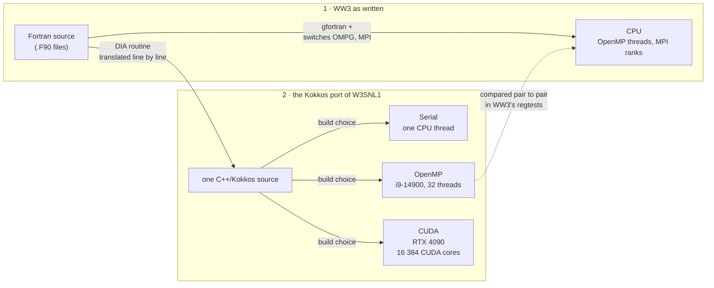

# `kokkos/`: the C++/Kokkos half of the lab

One CMake tree, one backend per configure preset. It holds the portable kernel
library (`ww_kokkos`), the lesson-11 intro programs, the GoogleTest suites of the
lessons and the tools, and the C++ tools. The first ported source term, `W3SNL1`/`INSNL1` (the DIA nonlinear
interactions), lives in `src/ww_kokkos/snl1_*`.

## Toolchain

Everything is built inside the pinned `nix-config/labs/pratico` shells. They are
what put Kokkos, GoogleTest, CMake, Ninja and NetCDF on the search path:

| shell | Kokkos backends | used by |
|---|---|---|
| `nix develop ./nix-config/labs/pratico#ww3` | Serial + OpenMP | `serial-debug`, `openmp-release`, CI |
| `nix develop ./nix-config/labs/pratico#cuda` | CUDA (ADA89) + Serial | `cuda-release`, this host only |

Pins: Kokkos 5.2.0, GoogleTest 1.18.0, CMake 4.4.2, gfortran 15.3.

## Why Kokkos, not Fortran 90, in plain words

**The short answer.** The port writes the expensive part of the wave model once, in a form
that can be built for one processor thread, for every core of the processor, or for the
graphics card, and each build must give the same numbers.



<details open>
<summary>How to read this figure</summary>

**Takeaway.** WW3's own code is built for the processor only; the ported piece is written once and turned into a program for one thread, for the whole processor or for the graphics card, depending on how it is built.

**How to read.** Left to right. Box 1 is WW3 as NOAA ships it, compiled with its parallel switches. Box 2 is this repository's port of one routine: one source, three builds, chosen when the code is compiled, not when it runs. The dashed arrow is the check: the OpenMP build runs inside WW3 and its output is compared with WW3 as written.

**Not shown.** HIP, SYCL and the other Kokkos backends (not built here); the `bind(C)` shim between WW3 and the port; the copies between processor and graphics-card memory; the other WW3 routines, which stay in Fortran. The CUDA build has not yet been run inside WW3 (that run is the owner's, supervised).

**Evidence.** The three presets and the two shells in [Toolchain](#toolchain) and [Presets](#presets) (v, this file); the regtest comparison in [`PORT_STATUS.md`](PORT_STATUS.md), ledger row `W3SNL1` (v, 2026-10-14); hardware as in the text below.

</details>

**A story in three machines.**

- FORTRAN came out in 1957, and IBM's first Fortran compiler was for the IBM 704 (v, [IBM
  history, "Fortran"](https://www.ibm.com/history/fortran), read 2026-10-14). The language was
  shaped by the computers it had to drive.
- Fortran 90 (ISO/IEC 1539:1991 ⚠: ISO's own catalogue page refused the fetch; IBM's XL Fortran
  manual lists it as "ISO/IEC 1539-1:1991 ... informal name, Fortran 90" (v, [IBM
  docs](https://www.ibm.com/docs/en/SSAT4T_16.1.0/com.ibm.xlf161.lelinux.doc/language_ref/standards.html),
  2026-10-14)) added whole-array statements. John Reid wrote that
  arrays belonged in the language "the more so in an era when an increasing number of computers
  have the hardware capability to perform operations on vectors or arrays of operands", and that
  the design "was much influenced by" the ICL DAP, a SIMD machine (v, Reid, *The advantages of
  Fortran 90*, [RAL report](https://numerical.rl.ac.uk/media/reports/rRAL92017.pdf), §§4–5, read
  2026-10-14).
- WW3 is that kind of code: free-form `.F90` files in which parallelism comes from preprocessor
  switches on the CPU, OpenMP threads (`W3_OMPG`, an `!$OMP PARALLEL DO` over sea points at
  `WW3/model/src/w3wavemd.F90:1696-1697`) and MPI ranks (`W3_MPI`, `:193`) (v, WW3@6d1bcdfe). It
  has no GPU path upstream ([README.md](../README.md), "can WW3 use my GPU?").

**The analogy.** Think of the routine as a recipe. WW3's Fortran is a recipe written for one
kind of kitchen, a row of cooks at a counter (CPU cores). To use a factory line with thousands
of workers (a GPU) you would add a second set of instructions to the same card, or write a second
card. Kokkos is a way of writing the recipe once, in C++, and letting the build turn it into
instructions for whichever kitchen is there.

**The words the field uses.**

- *Kokkos* is "a programming model in C++ for writing performance portable applications
  targeting all major HPC platforms" (v, [kokkos/kokkos README](https://github.com/kokkos/kokkos),
  read 2026-10-14). *Performance portability* means one source that runs well on different
  hardware, not just runs.
- A *backend* is what one source is compiled for. Kokkos has a Serial backend for CPUs, which is
  enabled when no other is; OpenMP, C++ threads and HPX (experimental) on the host; CUDA, HIP, SYCL
  and OpenACC (experimental) on devices (v, [Kokkos configuration
  guide](https://kokkos.org/kokkos-core-wiki/get-started/configuration-guide.html), read
  2026-10-14). Only one device backend can be enabled per build (the H100 plan, §2 ⚠). This
  repository builds Serial, OpenMP and CUDA, nothing else ([Toolchain](#toolchain)).
- *This workstation*: an Intel Core i9-14900, 24 cores (8 performance, 16 efficient), 32 threads
  (v, [Intel ARK](https://www.intel.com/content/www/us/en/products/sku/236793/intel-core-i9-processor-14900-36m-cache-up-to-5-80-ghz/specifications.html),
  2026-10-14), and an NVIDIA GeForce RTX 4090, 16 384 CUDA cores (v, [NVIDIA's 40-series
  comparison](https://www.nvidia.com/en-us/geforce/graphics-cards/compare/), 2026-10-14). The
  pairing is the one in
  [`bench/results/snl1-i9-14900-rtx4090-2026-09-15.json`](../bench/results/snl1-i9-14900-rtx4090-2026-09-15.json)
  ("Intel Core i9-14900 (32 hardware threads) + NVIDIA GeForce RTX 4090"). A CUDA core is a far
  simpler unit than a CPU core, so the two counts are not comparable ⚠.

**Why it matters here.** The `W3SNL1` port is one source that gave the Fortran's numbers bit for
bit on Serial, OpenMP and CUDA (L1 tests, 2026-09-15, removed on 2026-10-14 by
[ADR-0010](../docs/ADRs/ADR-0010-kokkos-validated-by-ww3-regtests-only.md)), and the OpenMP build
passes the WW3 regtest replay inside WW3 on the CPU, `hs` within 1.8e-7 relative and not
byte-identical (L2; `just smoke-hoff`, `just full-hoff`) (v, [`PORT_STATUS.md`](PORT_STATUS.md),
read 2026-10-14). Same source did not mean same numbers for free: it took turning off
contraction and copying gfortran's `x**n` ([The W3SNL1 port](#the-w3snl1-port)).

**Where the analogy breaks.** Fortran is not stuck in 1957 or 1991. Modern Fortran has coarrays
(Fortran 2008 ⚠) and `do concurrent`, and `nvfortran` offloads `do concurrent`, OpenACC and OpenMP
target regions to an NVIDIA GPU ([README.md](../README.md), "can WW3 use my GPU?"). Lesson 10
builds one `do concurrent` file for the GPU, for multicore and for plain `gfortran`
([course/10](../course/10-modern-fortran-refactoring.md#do-concurrent)). So the choice is not
"old language, new language". The reasons this repository gives are in
[`docs/KOKKOS_H100_PLAN_202609.md`](../docs/KOKKOS_H100_PLAN_202609.md) (no ADR records the choice
of Kokkos itself):

- §1 and §2: Kokkos over SYCL, chiefly because the Serial backend runs the same kernels on the CPU
  as a deterministic reference, `View` layouts express the column-major question directly, and
  Earth-system models (E3SM's EAMxx and Omega, LICOM3, FESOM2) already went this way.
- §5, conclusion 4: "Directive ports are fast to start and slow to finish; Kokkos rewrites are
  slow to start and then portable"; the LICOM3 row reads "Portability layer ends the 'N variants'
  maintenance problem".
- §7: Route A (Fortran + OpenACC) leaves "a fork with directives"; Route B (C++/Kokkos) a "clean
  C++ product; Serial backend runs anywhere".
- Lesson 11 adds that memory spaces are written on every `View`, so host code cannot quietly read
  device memory ([course/11](../course/11-kokkos-and-modern-cpp.md#execution-and-memory-spaces));
  `nvfortran -stdpar=gpu` instead moves data through managed memory implicitly (lesson 10), which
  [AGENTS.md](../AGENTS.md) forbids as a way to avoid thinking about transfers.

The plan's projections (months, stall risk, speed ceilings) are estimates, not measurements.

**Where to read more.** Lesson 11, [Kokkos and modern C++ for Fortran
people](../course/11-kokkos-and-modern-cpp.md); lesson 12, [porting
`W3SNL1`](../course/12-porting-a-kernel-w3snl1.md); lesson 10, [modern
Fortran](../course/10-modern-fortran-refactoring.md). Papers: Edwards, Trott and Sunderland,
"Kokkos: Enabling manycore performance portability through polymorphic memory access patterns",
*J. Parallel Distrib. Comput.* 74(12), 3202–3216, 2014,
[doi:10.1016/j.jpdc.2014.07.003](https://doi.org/10.1016/j.jpdc.2014.07.003) (v, Crossref,
2026-10-14); Trott et al., "Kokkos 3: Programming model extensions for the exascale era", *IEEE
Trans. Parallel Distrib. Syst.* 33(4), 805–817, 2022,
[doi:10.1109/TPDS.2021.3097283](https://doi.org/10.1109/TPDS.2021.3097283) (v, Crossref,
2026-10-14; `trott2022` in [`refs.bib`](../pubs/proposal/refs.bib)).

## Layout

```
CMakeLists.txt        top level: options, find_package, the ww_kokkos target
CMakePresets.json     serial-debug, openmp-release, cuda-release
cmake/                CompilerWarnings.cmake -- the one warning policy
src/ww_kokkos/        real.hpp (float32 + helpers), spectrum_fixtures.hpp (JONSWAP, cos^2),
                      snl1_{config,tables,dia} (the DIA port), fixture_io (fixture reader)
src/fortran_iface/    ww_kokkos_c.hpp + snl1_shim.cpp (the C ABI, built into ww_kokkos),
                      w3kokkosmd.F90 (the Fortran module), PATCH.md (the WW3 caller)
intro/                01..06, one Kokkos concept each, each a CTest case
tests/                kokkos_env.hpp (runtime lifetime), L1_* suites of the lessons and tools,
                      bench_snl1.cpp, L2_replay.sh
tests/fixtures/       the benchmark's inputs: snl1_nk25_nth24.bin (frozen) and bench_small/
PORT_STATUS.md        the port ledger: phase, parity and ms/call per routine
PORT_RANKING.md       what is still in Fortran, by self time, and each port's test coverage
tools/nccmp-tol/      per-field NetCDF comparator                (Task 5)
tools/bench_case/     benchmark-case generator                   (Task 6)
tools/fetch_analyse/  fetch-growth analyser                      (Task 6)
```

## Building

From the repository root:

```bash
just kokkos-test serial-debug     # configure + build + ctest
just kokkos-test openmp-release
just kokkos-cuda-test             # cuda-release, inside the #cuda shell
just kokkos-clean                 # rm -rf kokkos/build
```

Or directly, from this directory inside a pratico shell:

```bash
cmake --preset openmp-release && cmake --build --preset openmp-release && ctest --preset openmp-release
```

Builds land in `kokkos/build/<preset>/` (git-ignored).

## Presets

| preset | build type | notable |
|---|---|---|
| `serial-debug` | Debug | AddressSanitizer + UndefinedBehaviorSanitizer, `WW_DETERMINISTIC=ON` |
| `openmp-release` | Release | `-O3 -march=x86-64-v3` |
| `cuda-release` | Release | `CMAKE_CXX_COMPILER=nvcc_wrapper`, `CMAKE_CUDA_ARCHITECTURES=89` |

Two things the names do *not* promise:

- **The backend comes from the shell, not from the preset.** OpenMP is the default
  execution space in `#ww3`, so `serial-debug` is a *build type*, not a Serial-only
  build. Code that must run on Serial says `Kokkos::Serial` explicitly: see
  `intro/03_reduce_and_scan.cpp` and the last case in `tests/L1_test_intro.cpp`.
- **`Kokkos_ENABLE_DEBUG_BOUNDS_CHECK` cannot be set here.** It is an option of the
  Kokkos *build*, so it is fixed by the pinned Kokkos derivation in nix-config; a
  consumer project cannot turn it on. `serial-debug`'s safety net is the sanitizers.

`CMakePresets.json` uses presets schema version 10, which needs CMake ≥ 4.1.

## Options

| option | default | meaning |
|---|---|---|
| `WW_ENABLE_FORTRAN` | `ON` | build the Fortran interface module `W3KOKKOSMD` and `intro_06` |
| `WW_DETERMINISTIC` | `OFF` | pin reductions to a fixed summation order for bit-reproducible validation runs |

## Intro programs

Each is a self-checking `main`: it prints one line and exits non-zero if the
concept it demonstrates does not hold, so CI runs the lesson material too.

| program | concept |
|---|---|
| `01_views` | `View` allocation, label, extents, `deep_copy` to a host mirror |
| `02_parallel_for` | `MDRangePolicy<Rank<2>>` + `parallel_reduce`, checked against a closed-form `m0` |
| `03_reduce_and_scan` | `Kokkos::MaxLoc` (value + location) and `parallel_scan` |
| `04_layouts_and_mirrors` | `LayoutLeft` vs `LayoutRight` strides, mirrors, unmanaged views |
| `05_team_scratch` | `TeamPolicy` + `team_scratch(0)`: the DIA kernel's extended spectrum |
| `06_interop_bindc` | `extern "C"` + Fortran `bind(C)`, borrowing a Fortran array |

## Tests

`tests/kokkos_env.hpp` starts the Kokkos runtime once per test binary from a
`::testing::Environment` (two OpenMP threads). `ww_add_test(<name>)` in
`tests/CMakeLists.txt` builds `<name>.cpp`, hands it `WW_FIXTURE_DIR` and registers
it with CTest.

The port has no tests of its own. The owner's rule (2026-10-14): "kokkos code should
NOT have its own tests, hard rule. All tests should come [from] WW3 regtests." The
suites left in CTest test the lessons and the tools, not the port:

| suite | what it pins down |
|---|---|
| `L1_test_intro`, `intro_01`..`intro_06` | the lesson material's invariants |
| `L1_test_nccmp_tol` | the per-field NetCDF comparator |
| `L1_test_bench_case` | the benchmark-case generator |
| `L1_test_fetch_analyse` | the fetch-growth analyser |

The DIA and its shim are validated by WW3's regtests: `scripts/hoff.sh --hoff --cpu`
runs a WW3 case with the Kokkos DIA and compares it with the Fortran DIA of the same
executable and pair to pair with `--ww3` (WW3 built without the KOKKOS switch), and
the regtest matrix of WFIP-0003 (`scripts/hoff_matrix.sh`) extends that to more of
WW3's regtests ⚠ (being written in parallel on 2026-10-14; not run from here).

Removed on 2026-10-14 under that rule: `L1_test_snl1_tables`, `L1_test_snl1_dia`,
`L1_test_snl1_shim`, the Fortran `shim_roundtrip` CTest case, and the standalone
Fortran reference and fixture generator they were built on. Before removal they
showed the port bit-identical to the Fortran (max relative error 0.0) on
serial-debug, openmp-release and cuda-release (2026-09-15; the two CPU presets
re-run 2026-10-14). That result is history now, with no test left to reproduce it.

Kernels live in free functions rather than in `TEST()` bodies: nvcc rejects an
extended lambda inside a private member function, and a `TEST()` body is one.

## The W3SNL1 port

`src/ww_kokkos/snl1_dia.cpp` and `snl1_tables.cpp` are translations, not
reimplementations: same expressions, same order, same float32 arithmetic as
`WW3/model/src/w3snl1md.F90` (WW3 7.14). They carry `SPDX-License-Identifier:
LGPL-3.0-or-later`, like their source; the tooling around them is MIT.

Two consequences worth knowing before touching them:

- **Floating-point contraction is off** for `ww_kokkos` (`-ffp-contract=off`, and
  `--fmad=false` on the CUDA backend). With GCC's default `-ffp-contract=fast`,
  `-O3 -march=x86-64-v3` fuses `AWG1*UE(..) + AWG2*UE(..)` into an FMA (one
  rounding where the Fortran does two), and `openmp-release` drifted 1.1e-5
  relative from the fixture while `serial-debug` was bit-identical. With
  contraction off all three presets reproduced the Fortran **bit for bit** in the L1 tests
  removed on 2026-10-14.
- **`x**n` is not `std::pow`.** gfortran lowers a real raised to an integer to a
  binary-exponent chain of multiplications; `powf` does something else, to within
  a ULP. `snl1_tables.cpp` has a `powi()` that reproduces the chain, and that is
  what made the L1 parity of the removed tests exact rather than merely close.

The DIA has no reduction, so `WW_DETERMINISTIC` changes nothing here: every output
element is written by one thread from inputs no thread modifies.

## The bind(C) boundary

`src/fortran_iface/` is how WAVEWATCH III reaches the kernels. Three files and one
rule each:

| file | rule |
|---|---|
| `ww_kokkos_c.hpp` | the C ABI: `float` (WW3's default `REAL`), Fortran-ordered, caller-owned arrays, and no function that can throw |
| `snl1_shim.cpp` | ownership (finalize only a Kokkos *we* started), lifetime (a `push_finalize_hook` drops the Views before `Kokkos::finalize`), and errors (every entry point is a `try`/`catch` that records a code) |
| `w3kokkosmd.F90` | `MODULE W3KOKKOSMD`: one `ISO_C_BINDING` interface block per C declaration, plus `LOGICAL :: KOKKOS_SNL1` |

The C++ half is compiled into `ww_kokkos` unconditionally, so the benchmark calls
the shim with no Fortran compiler in the loop; only `w3kokkosmd.F90` needs
`WW_ENABLE_FORTRAN`, and it is built as its own target (`ww_kokkos_f`) because it
is meant to be *copied into* `WW3/model/src`. That is what
`src/fortran_iface/PATCH.md` describes, hunk by hunk, with real line numbers.
Nothing in this repository modifies `WW3/`.

Two switches, both read at `ww_kokkos_init()`:

| variable | effect |
|---|---|
| `WW_KOKKOS_SNL1=1` | `ww_snl1_enabled()` returns 1, so `W3KOKKOS_SETUP` sets `KOKKOS_SNL1` and the patched `W3SRCE` calls the port instead of `W3SNL1` |
| `WW_KOKKOS_DEVICE_ID` | which GPU to use (default 0). It is an environment variable and not `MPI_Comm_rank()` on purpose: phase 1 links no MPI, so `ww_kokkos_init(comm_f)` accepts the communicator and ignores it |

`ww_snl1` is `void` because a Fortran `CALL` cannot read a return value; its status
is `ww_snl1_last_error()`, and a caller that ignores it turns a failed launch into
a plausible-looking wrong forecast.

Three limits of phase 1, all of them consequences of the shim holding one
file-static, unlocked context. They are the caller's problem, so `PATCH.md`
handles each one explicitly:

| limit | what goes wrong without it |
|---|---|
| one spectral grid per process | `ww_snl1_init` replaces the tables rather than adding a grid, so a `ww3_multi` run reads past the end of a later grid's spectra |
| one caller at a time | `W3SRCE` runs inside an `!$OMP PARALLEL` region under `W3_OMPG`/`W3_OMP0`; two threads in `ww_snl1` race over the device buffers |
| `sig` starts at bin 1 | the C dummy is assumed-size and `W3GDATMD` allocates `SIG(0:MK+1)`, so passing the bare name builds every quadruplet one frequency bin low |

## Timing

`tests/bench_snl1.cpp` builds `ww_bench_snl1` (not a CTest case): 1 000 sea points,
20 calls, timed both end-to-end through `ww_snl1()` and with everything already on
the device. The numbers, the machine they were measured on and what they do *not*
mean are in [`PORT_STATUS.md`](PORT_STATUS.md).

SPDX-License-Identifier: MIT
