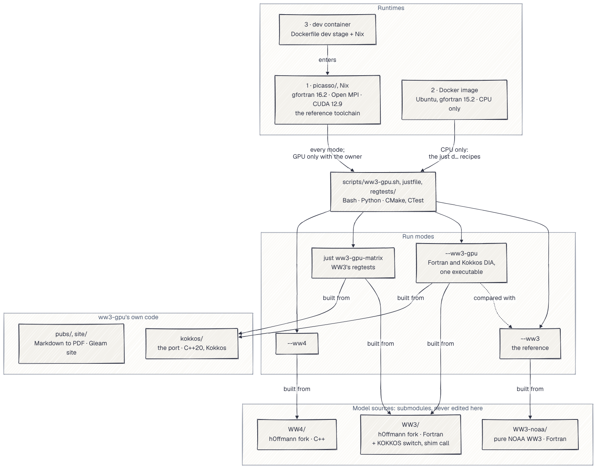
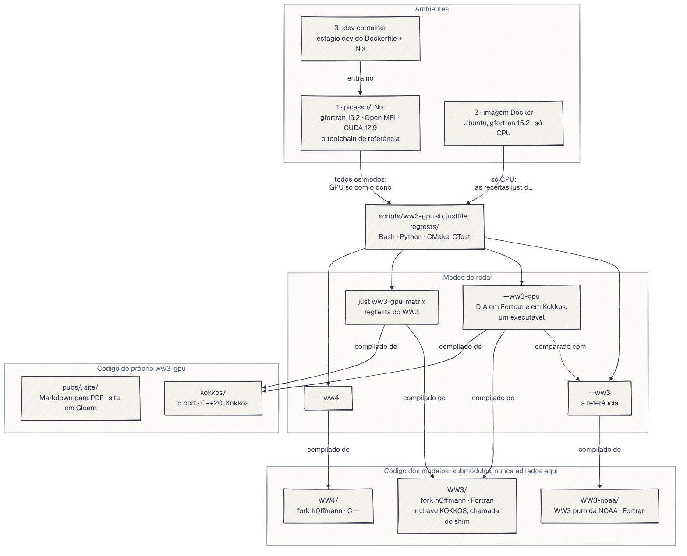
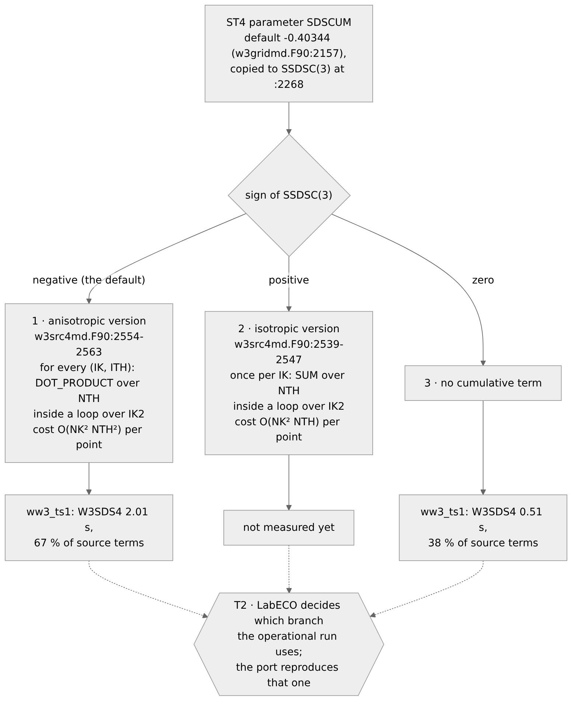
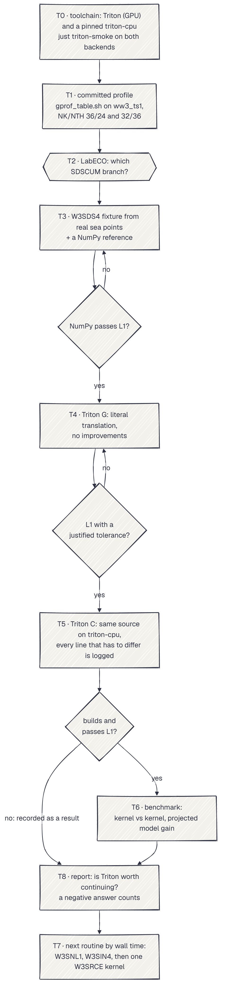
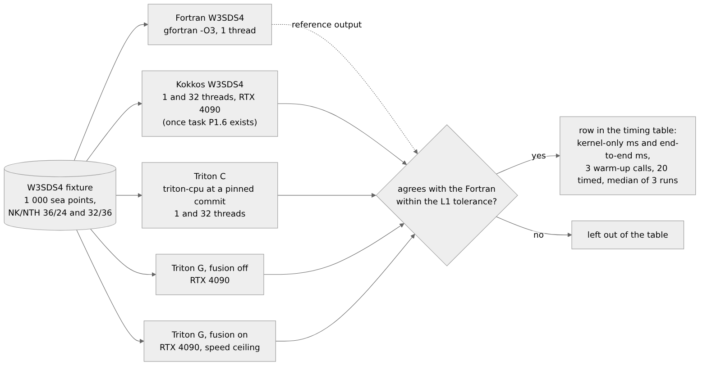
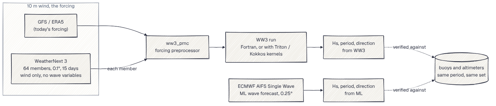
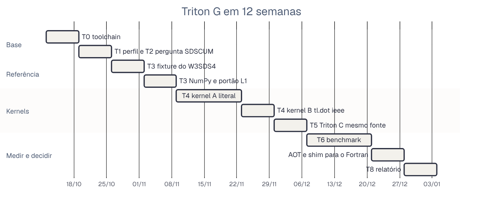
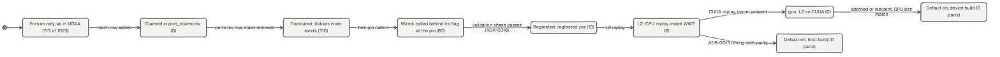
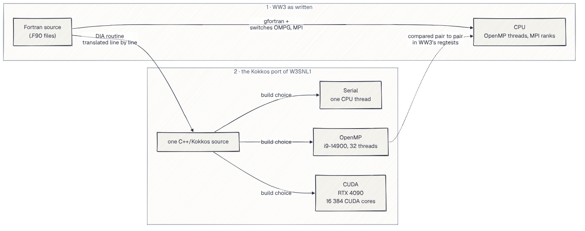
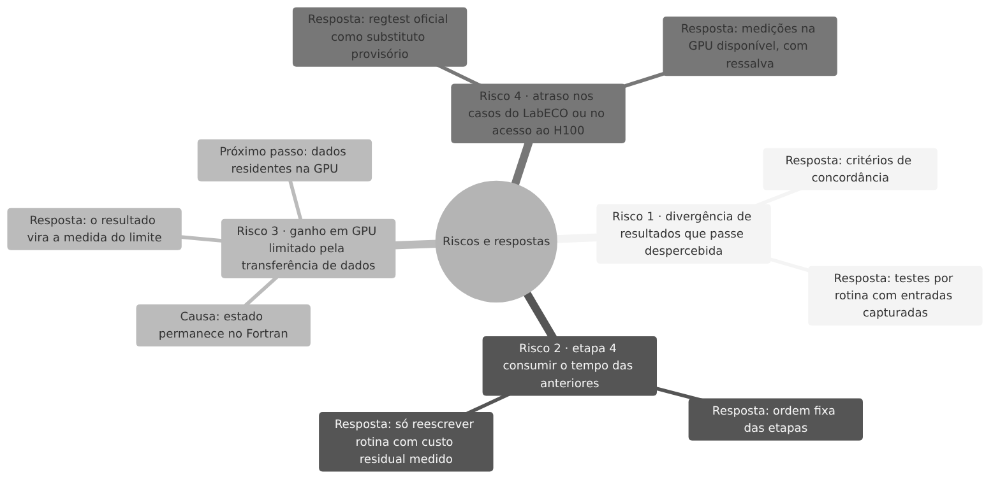

# Figures

<!-- generated by `python3 scripts/figures.py render`; edit the diagrams where they live -->

Every diagram in this repository, generated from the Mermaid source in the page it
illustrates. Each page carries a *How to read this figure* card under the diagram; the PDF
and Word builds use the renders in [`mermaid/`](mermaid/), and
[`mermaid/index.json`](mermaid/index.json) records the source hash and the pinned renderer
of each one. To add or change a figure, follow `.claude/skills/figure/SKILL.md`; `just figures`
re-renders and CI fails when a render no longer matches its source.

Found something wrong in a figure? Each entry has a link that opens an issue for it.

## [`README.md`](../../README.md)

### What does ww3-gpu build, from which sources, and on which runtime does each run mode run?

Two copies of WW3 come in from outside, pure NOAA WW3 and the owner's fork; this

`ww3-gpu-at-a-glance` · [source](../../README.md) · [PDF](mermaid/ww3-gpu-at-a-glance.pdf) · [report a mistake](https://github.com/h0ffmann/ww3-gpu/issues/new?title=Figure%20ww3-gpu-at-a-glance%3A%20)

## [`README.pt-BR.md`](../../README.pt-BR.md)

### O que o ww3-gpu compila, de quais fontes, e em qual ambiente roda cada modo?

Duas cópias do WW3 vêm de fora, o WW3 puro da NOAA e o fork do dono; este

`ww3-gpu-at-a-glance-pt` · [source](../../README.pt-BR.md) · [PDF](mermaid/ww3-gpu-at-a-glance-pt.pdf) · [report a mistake](https://github.com/h0ffmann/ww3-gpu/issues/new?title=Figure%20ww3-gpu-at-a-glance-pt%3A%20)

## [`docs/W3SDS4_TRITON_202610.md`](../../docs/W3SDS4_TRITON_202610.md)

### Where does the source-term time go, and how much of it is W3SDS4?

In this test, the routine that dissipates wave energy by breaking (`W3SDS4`) takes two thirds of the source-term time, about five times the nonlinear interaction (`W3SNL1`); with its cumulative-breaking term switched off it costs a quarter as much.

`sds4-profile-ts1` · [source](../../docs/W3SDS4_TRITON_202610.md) · [PDF](mermaid/sds4-profile-ts1.pdf) · [report a mistake](https://github.com/h0ffmann/ww3-gpu/issues/new?title=Figure%20sds4-profile-ts1%3A%20)

### Which branch of the cumulative-breaking term does W3SDS4 run, and what does each cost?

One number in the ST4 settings picks one of three versions of the same term, and the default picks the most expensive one, which WW3's own comment calls "the expensive and largely useless version".

`sds4-sdscum-branches` · [source](../../docs/W3SDS4_TRITON_202610.md) · [PDF](mermaid/sds4-sdscum-branches.pdf) · [report a mistake](https://github.com/h0ffmann/ww3-gpu/issues/new?title=Figure%20sds4-sdscum-branches%3A%20)

### In what order is W3SDS4 ported to Triton, and what gate does each step pass?

The slowest routine is rewritten for a new GPU language in small, checked steps, and nothing is timed until its answers match the original within a stated tolerance.

`triton-port-plan` · [source](../../docs/W3SDS4_TRITON_202610.md) · [PDF](mermaid/triton-port-plan.pdf) · [report a mistake](https://github.com/h0ffmann/ww3-gpu/issues/new?title=Figure%20triton-port-plan%3A%20)

### Which implementations of W3SDS4 are timed, and when does a timing count?

Five versions of the same routine get the same input, and only those whose results agree with the original Fortran are allowed into the speed comparison.

`triton-benchmark-arms` · [source](../../docs/W3SDS4_TRITON_202610.md) · [PDF](mermaid/triton-benchmark-arms.pdf) · [report a mistake](https://github.com/h0ffmann/ww3-gpu/issues/new?title=Figure%20triton-benchmark-arms%3A%20)

### How does WeatherNext 3 enter the benchmark, and what are the waves compared with?

WeatherNext 3 does not forecast waves: it supplies the wind that drives WW3, so the same wave model can be run with a different wind, and each of its 64 ensemble members becomes one WW3 run. The machine-learning wave forecast in the comparison is ECMWF's AIFS Single Wave.

`weathernext-wind-chain` · [source](../../docs/W3SDS4_TRITON_202610.md) · [PDF](mermaid/weathernext-wind-chain.pdf) · [report a mistake](https://github.com/h0ffmann/ww3-gpu/issues/new?title=Figure%20weathernext-wind-chain%3A%20)

## [`docs/W3SDS4_TRITON_PLANO_202610.pt.md`](../../docs/W3SDS4_TRITON_PLANO_202610.pt.md)

### Em que ordem o braço Triton G acontece em três meses, e onde ficam os portões?

Três meses divididos em quatro blocos: preparar as ferramentas, construir a resposta de referência, escrever as duas versões do programa novo e, por fim, medir e decidir.

`triton-g-doze-semanas` · [source](../../docs/W3SDS4_TRITON_PLANO_202610.pt.md) · [PDF](mermaid/triton-g-doze-semanas.pdf) · [report a mistake](https://github.com/h0ffmann/ww3-gpu/issues/new?title=Figure%20triton-g-doze-semanas%3A%20)

## [`docs/WW3_GPU_VS_NOAA_202610.md`](../../docs/WW3_GPU_VS_NOAA_202610.md)

### What is the same and what differs between NOAA's WW3 and ww3-gpu?

Both executables compile the same Fortran physics. ww3-gpu adds a `KOKKOS` switch, call-site branches and `bind(C)` shims into a C++/Kokkos library, and every Kokkos part can be switched back to the Fortran routine at run time inside the same binary.

`ww3-gpu-vs-noaa-architecture` · [source](../../docs/WW3_GPU_VS_NOAA_202610.md) · [PDF](mermaid/ww3-gpu-vs-noaa-architecture.pdf) · [report a mistake](https://github.com/h0ffmann/ww3-gpu/issues/new?title=Figure%20ww3-gpu-vs-noaa-architecture%3A%20)

### How is a ww3-gpu result judged against NOAA's WW3 before a timing may be recorded?

On the CPU a ported routine passes only when its output files are byte-identical to the Fortran routine of the same executable, apart from files two Fortran runs already write differently. A GPU run is judged by `nccmp-tol`'s tolerances instead (ADR-0014). A timing enters `bench/results/` only after one of these verdicts passed on the same commit.

`ww3-gpu-parity-workflow` · [source](../../docs/WW3_GPU_VS_NOAA_202610.md) · [PDF](mermaid/ww3-gpu-parity-workflow.pdf) · [report a mistake](https://github.com/h0ffmann/ww3-gpu/issues/new?title=Figure%20ww3-gpu-parity-workflow%3A%20)

### Where does a time step leave the Fortran in ww3-gpu, and what does NOAA's WW3 do at the same place?

In NOAA's WW3, W3WAVE calls W3SRCE once per sea point and W3SRCE calls the Fortran source terms. The ww3-gpu fork keeps those same calls in the same executable and adds a branch at each one: when a `WW_KOKKOS_<PART>` flag is on, the call goes through a `bind(C)` interface in `w3kokkosmd.F90` to a C++ shim and a Kokkos kernel. In phase 1 the shim copies one sea point to the device and back for every call. The `--kokkos resident` preset keeps the spectrum `VA` on the device, replaces the sea-point loop with one batched launch, computes W3OUTG's fields there, and copies `VA` back only before a host statement reads it.

` flag is on, the call goes through a `bind(C)` interface in `w3kokkosmd.F90` to a C++ shim and a Kokkos kernel. In phase 1 the shim copies one sea point to the device and back for every call. The `--kokkos resident` preset keeps the spectrum `VA` on the device, replaces the sea-point loop with one batched launch, computes W3OUTG's fields there, and copies `VA` back only before a host statement reads it." width="560" />

`ww3-gpu-step-sequence` · [source](../../docs/WW3_GPU_VS_NOAA_202610.md) · [PDF](mermaid/ww3-gpu-step-sequence.pdf) · [report a mistake](https://github.com/h0ffmann/ww3-gpu/issues/new?title=Figure%20ww3-gpu-step-sequence%3A%20)

### Which states does a WW3 routine pass through in ww3-gpu, and how many routines are in each?

A WW3 routine starts in Fortran, as in NOAA's code. In this repository it can be claimed, translated to Kokkos, wired into the fork behind a run-time flag, and regtested by WW3's own regtests, which compare the Fortran and the Kokkos routine in the same executable. At this commit 310 of WW3's 1023 routines are translated, 60 are wired and 10 are regtested. Two of them (W3SNL1, INSNL1) have passed the L2 replay. None has passed on CUDA, and no part is on by default.

`ww3-gpu-port-lifecycle` · [source](../../docs/WW3_GPU_VS_NOAA_202610.md) · [PDF](mermaid/ww3-gpu-port-lifecycle.pdf) · [report a mistake](https://github.com/h0ffmann/ww3-gpu/issues/new?title=Figure%20ww3-gpu-port-lifecycle%3A%20)

### How does a kernel's expf or logf get the bits of NOAA's CPU build on a GPU, and what has been checked?

Every transcendental call in the ported kernels goes through `ww::dm`. On the host it is the same Kokkos call as before, so the CPU build still calls glibc and its regtest record stands. On a CUDA device built with `WW_KOKKOS_LIBM` (on by default) it calls `ww::libm`, copies of the algorithms glibc 2.44 uses (ARM optimized-routines for `expf`, `logf`, `powf`, `sincosf`, `exp`; CORE-MATH for `tanhf`, `log10f`, `atan2f`, `tanh`; libmvec's SSE4 lanes), instead of CUDA's libdevice, which uses other algorithms. On the host these copies equal glibc on every float for the unary functions. Whether the device gives the same bits has not been run.

`ww3-gpu-device-math-dataflow` · [source](../../docs/WW3_GPU_VS_NOAA_202610.md) · [PDF](mermaid/ww3-gpu-device-math-dataflow.pdf) · [report a mistake](https://github.com/h0ffmann/ww3-gpu/issues/new?title=Figure%20ww3-gpu-device-math-dataflow%3A%20)

## [`kokkos/README.md`](../../kokkos/README.md)

### How does one Kokkos source reach the CPU and the GPU of the lab's workstation?

WW3's own code is built for the processor only; the ported piece is written once and turned into a program for one thread, for the whole processor or for the graphics card, depending on how it is built.

`kokkos-one-source-backends` · [source](../../kokkos/README.md) · [PDF](mermaid/kokkos-one-source-backends.pdf) · [report a mistake](https://github.com/h0ffmann/ww3-gpu/issues/new?title=Figure%20kokkos-one-source-backends%3A%20)

### How do the original Fortran routine and its Kokkos kernel coexist in one WW3 binary?

The GPU code is added next to the original Fortran, not in place of it; a switch read at run time picks which one runs, so both are tested with the same executable.

`kokkos-interop-one-binary` · [source](../../kokkos/README.md) · [PDF](mermaid/kokkos-interop-one-binary.pdf) · [report a mistake](https://github.com/h0ffmann/ww3-gpu/issues/new?title=Figure%20kokkos-interop-one-binary%3A%20)

## [`pubs/proposal/mapas-mentais.pt.md`](../../pubs/proposal/mapas-mentais.pt.md)

### Do que trata a proposta, em um único mapa?

O projeto mede quanto tempo o WW3 leva para produzir a previsão de ondas do LabECO e reduz esse tempo em quatro etapas, aceitando só as mudanças cujos resultados fiquem dentro das tolerâncias acordadas com o laboratório.

`proposta-visao-geral` · [source](../../pubs/proposal/mapas-mentais.pt.md) · [PDF](mermaid/proposta-visao-geral.pdf) · [report a mistake](https://github.com/h0ffmann/ww3-gpu/issues/new?title=Figure%20proposta-visao-geral%3A%20)

### Que critério cada etapa de otimização precisa cumprir antes da seguinte?

As otimizações vão da mais barata (opções de compilação) à mais cara (reescrita para GPU), e cada alteração só avança se os resultados continuarem concordando com a execução de referência e, na etapa 4, se houver ganho medido.

`proposta-escada-otimizacao` · [source](../../pubs/proposal/mapas-mentais.pt.md) · [PDF](mermaid/proposta-escada-otimizacao.pdf) · [report a mistake](https://github.com/h0ffmann/ww3-gpu/issues/new?title=Figure%20proposta-escada-otimizacao%3A%20)

### Quando um kernel em GPU entra na configuração operacional?

Uma rotina reescrita para GPU só passa a ser usada nas previsões se seus resultados concordarem com os da original dentro das tolerâncias e se ela tornar a previsão completa mais rápida no H100.

`proposta-decisao-operacao` · [source](../../pubs/proposal/mapas-mentais.pt.md) · [PDF](mermaid/proposta-decisao-operacao.pdf) · [report a mistake](https://github.com/h0ffmann/ww3-gpu/issues/new?title=Figure%20proposta-decisao-operacao%3A%20)

### Que testes o WW3 e o WW4 ofereciam em setembro e outubro de 2026, e o que o projeto acrescenta?

O WW3 só informa se duas execuções são idênticas ou não, e o WW4 ainda não tem testes do modelo completo; o projeto constrói o comparador com tolerâncias e os testes por rotina que faltam.

`testes-ww3-ww4` · [source](../../pubs/proposal/mapas-mentais.pt.md) · [PDF](mermaid/testes-ww3-ww4.pdf) · [report a mistake](https://github.com/h0ffmann/ww3-gpu/issues/new?title=Figure%20testes-ww3-ww4%3A%20)

### Como a rotina original em Fortran e o kernel em Kokkos convivem em um único executável?

O código novo em C++/Kokkos entra ao lado do Fortran original, e não no lugar dele; uma chave lida durante a execução escolhe qual dos dois roda, e os dois caminhos são testados com o mesmo executável.

`proposta-interoperabilidade` · [source](../../pubs/proposal/mapas-mentais.pt.md) · [PDF](mermaid/proposta-interoperabilidade.pdf) · [report a mistake](https://github.com/h0ffmann/ww3-gpu/issues/new?title=Figure%20proposta-interoperabilidade%3A%20)

### Como cada versão traduzida é verificada contra a anterior?

O Fortran é traduzido para C e depois para C++/Kokkos em passos pequenos, e cada versão é verificada contra a anterior: o Kokkos serial deve ser idêntico bit a bit ao C, e a versão em GPU é comparada estatisticamente com a de CPU.

`proposta-validacao-traducao` · [source](../../pubs/proposal/mapas-mentais.pt.md) · [PDF](mermaid/proposta-validacao-traducao.pdf) · [report a mistake](https://github.com/h0ffmann/ww3-gpu/issues/new?title=Figure%20proposta-validacao-traducao%3A%20)

### Quando acontece cada etapa do projeto?

O projeto ocupa dois períodos letivos, de outubro de 2026 a abril de 2027, com uma atividade por mês e a defesa a partir de maio de 2027.

`proposta-cronograma` · [source](../../pubs/proposal/mapas-mentais.pt.md) · [PDF](mermaid/proposta-cronograma.pdf) · [report a mistake](https://github.com/h0ffmann/ww3-gpu/issues/new?title=Figure%20proposta-cronograma%3A%20)

### Quais são os riscos do projeto e como cada um é mitigado?

São quatro riscos, e para cada um a proposta já define a resposta: testes contra divergências, ordem fixa das etapas, medida do limite imposto pela transferência CPU–GPU e substitutos provisórios para atrasos.

`proposta-riscos` · [source](../../pubs/proposal/mapas-mentais.pt.md) · [PDF](mermaid/proposta-riscos.pdf) · [report a mistake](https://github.com/h0ffmann/ww3-gpu/issues/new?title=Figure%20proposta-riscos%3A%20)

## [`pubs/proposal/schedule.en.md`](../../pubs/proposal/schedule.en.md)

### When does each activity of the project happen?

The project takes two academic periods, from October 2026 to April 2027, with one activity per month and the defence from May 2027.

`proposal-schedule` · [source](../../pubs/proposal/schedule.en.md) · [PDF](mermaid/proposal-schedule.pdf) · [report a mistake](https://github.com/h0ffmann/ww3-gpu/issues/new?title=Figure%20proposal-schedule%3A%20)
