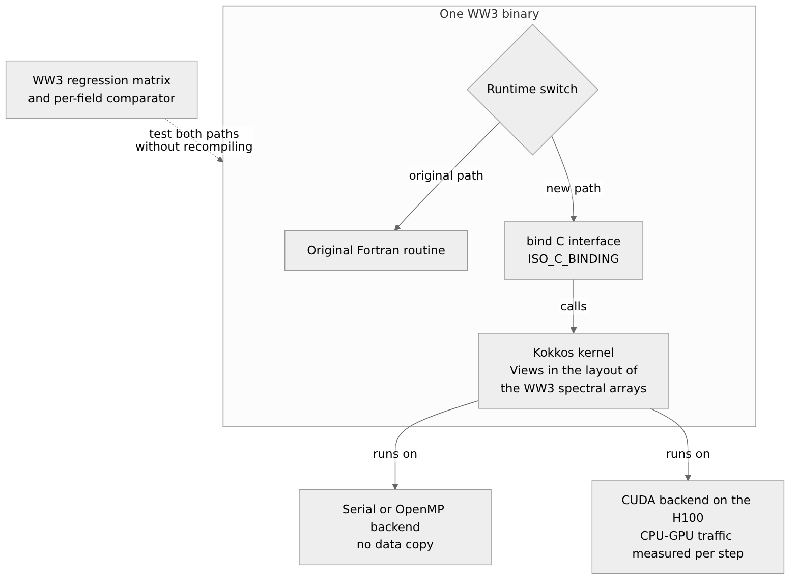
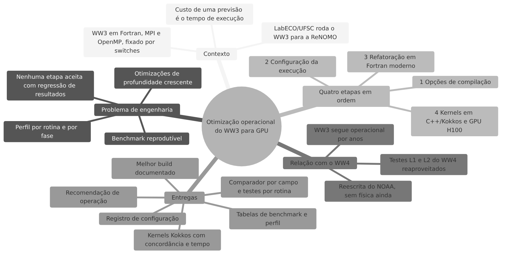
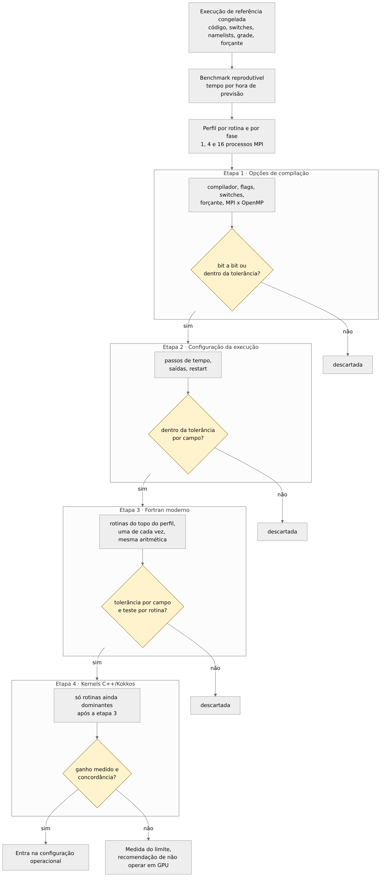
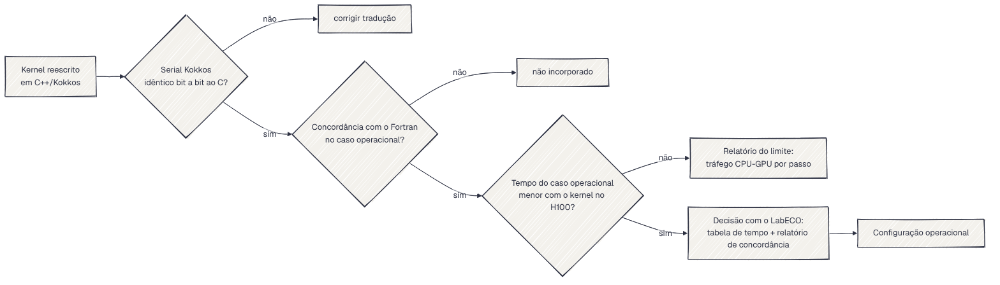
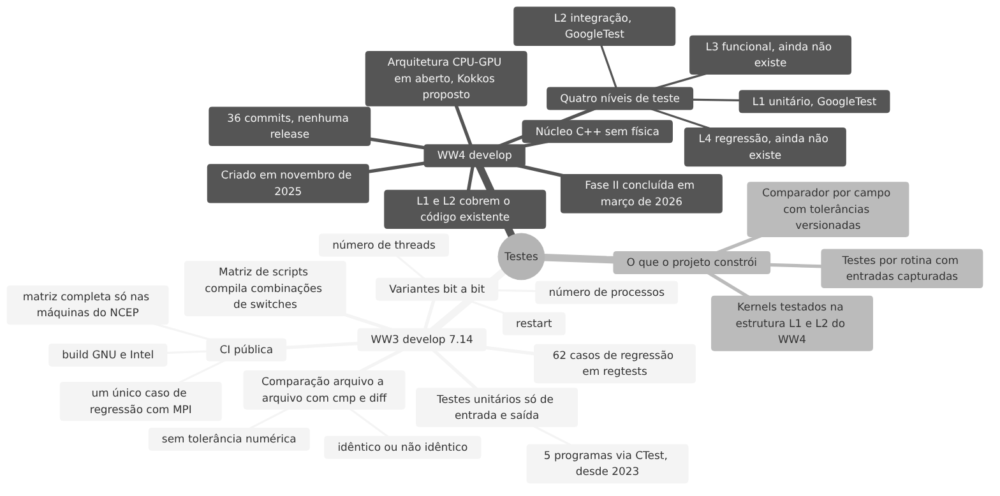
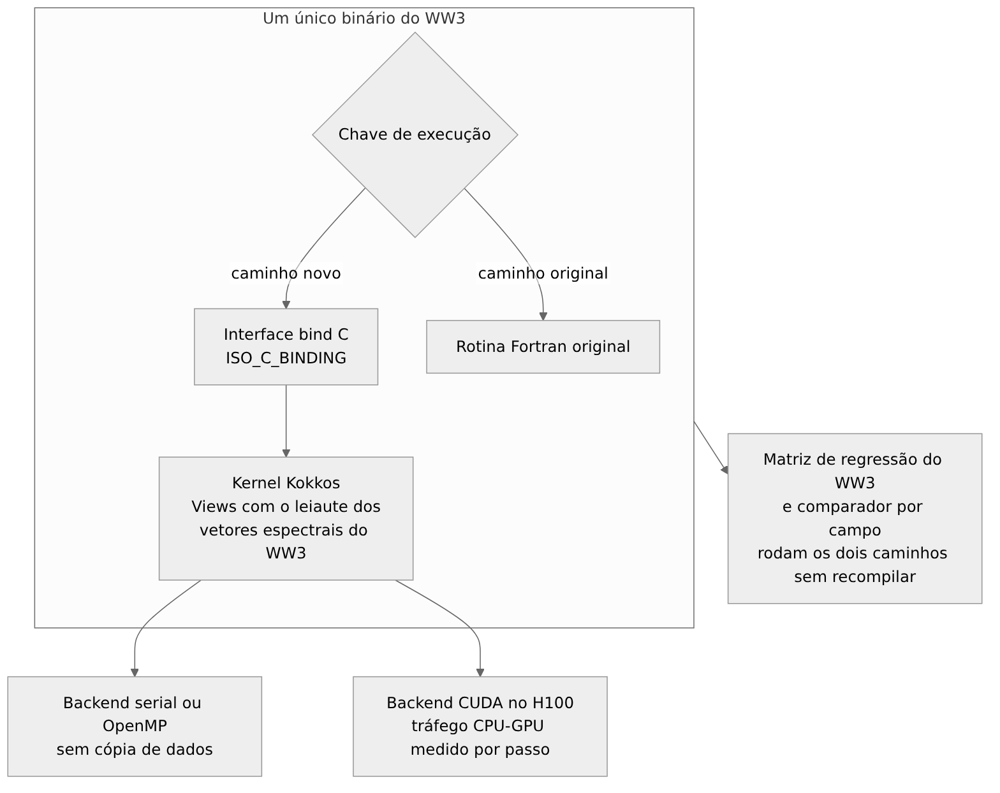
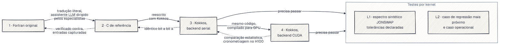
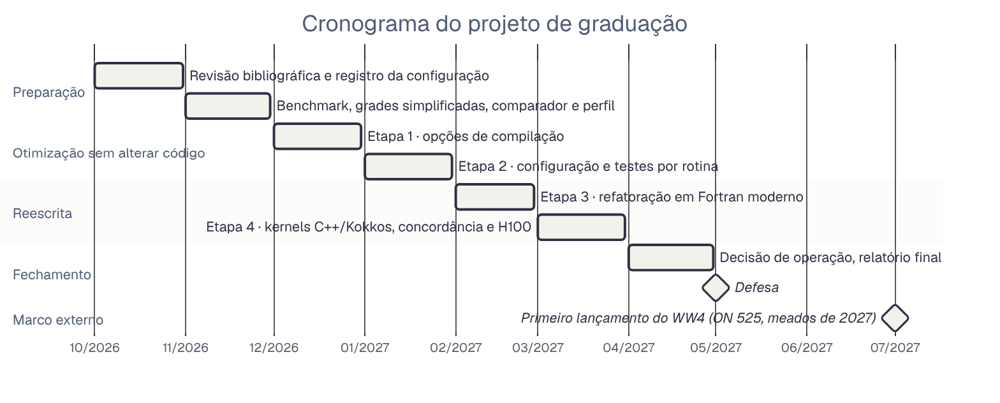
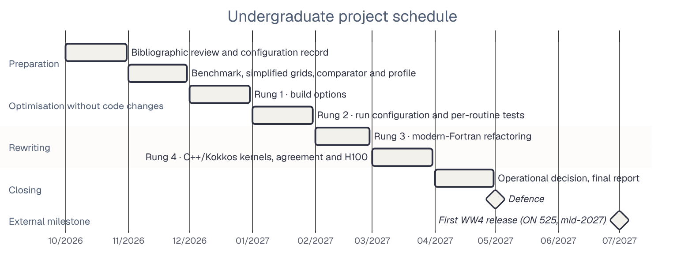

# Figures

<!-- generated by `python3 scripts/figures.py render`; edit the diagrams where they live -->

Every diagram in this repository, generated from the Mermaid source in the page it
illustrates. Each page carries a *How to read this figure* card under the diagram; the PDF
and Word builds use the renders in [`mermaid/`](mermaid/), and
[`mermaid/index.json`](mermaid/index.json) records the source hash and the pinned renderer
of each one. To add or change a figure, follow `.claude/skills/figure/SKILL.md`; `just figures`
re-renders and CI fails when a render no longer matches its source.

Found something wrong in a figure? Each entry has a link that opens an issue for it.

## [`kokkos/README.md`](../../kokkos/README.md)

### How do the original Fortran routine and its Kokkos kernel coexist in one WW3 binary?

The GPU code is added next to the original Fortran, not in place of it; a switch read at run time picks which one runs, so both are tested with the same executable.

`kokkos-interop-one-binary` · [source](../../kokkos/README.md) · [PDF](mermaid/kokkos-interop-one-binary.pdf) · [report a mistake](https://github.com/h0ffmann/ww3-gpu/issues/new?title=Figure%20kokkos-interop-one-binary%3A%20)

## [`pubs/proposal/mapas-mentais.pt.md`](../../pubs/proposal/mapas-mentais.pt.md)

### Do que trata a proposta, em um único mapa?

O projeto mede quanto tempo o WW3 leva para produzir a previsão de ondas do LabECO e reduz esse tempo em quatro etapas, aceitando só as mudanças cujos resultados fiquem dentro das tolerâncias acordadas com o laboratório.

`proposta-visao-geral` · [source](../../pubs/proposal/mapas-mentais.pt.md) · [PDF](mermaid/proposta-visao-geral.pdf) · [report a mistake](https://github.com/h0ffmann/ww3-gpu/issues/new?title=Figure%20proposta-visao-geral%3A%20)

### Que critério cada etapa de otimização precisa cumprir antes da seguinte?

As otimizações vão da mais barata (opções de compilação) à mais cara (reescrita para GPU), e cada alteração só avança se os resultados continuarem concordando com a execução de referência e, na etapa 4, se houver ganho medido.

`proposta-escada-otimizacao` · [source](../../pubs/proposal/mapas-mentais.pt.md) · [PDF](mermaid/proposta-escada-otimizacao.pdf) · [report a mistake](https://github.com/h0ffmann/ww3-gpu/issues/new?title=Figure%20proposta-escada-otimizacao%3A%20)

### Quando um kernel em GPU entra na configuração operacional?

Uma rotina reescrita para GPU só passa a ser usada nas previsões se seus resultados concordarem com os da original dentro das tolerâncias e se ela tornar a previsão completa mais rápida no H100.

`proposta-decisao-operacao` · [source](../../pubs/proposal/mapas-mentais.pt.md) · [PDF](mermaid/proposta-decisao-operacao.pdf) · [report a mistake](https://github.com/h0ffmann/ww3-gpu/issues/new?title=Figure%20proposta-decisao-operacao%3A%20)

### Que testes o WW3 e o WW4 ofereciam em setembro e outubro de 2026, e o que o projeto acrescenta?

O WW3 só informa se duas execuções são idênticas ou não, e o WW4 ainda não tem testes do modelo completo; o projeto constrói o comparador com tolerâncias e os testes por rotina que faltam.

`testes-ww3-ww4` · [source](../../pubs/proposal/mapas-mentais.pt.md) · [PDF](mermaid/testes-ww3-ww4.pdf) · [report a mistake](https://github.com/h0ffmann/ww3-gpu/issues/new?title=Figure%20testes-ww3-ww4%3A%20)

### Como a rotina original em Fortran e o kernel em Kokkos convivem em um único executável?

O código novo em C++/Kokkos entra ao lado do Fortran original, e não no lugar dele; uma chave lida durante a execução escolhe qual dos dois roda, e os dois caminhos são testados com o mesmo executável.

`proposta-interoperabilidade` · [source](../../pubs/proposal/mapas-mentais.pt.md) · [PDF](mermaid/proposta-interoperabilidade.pdf) · [report a mistake](https://github.com/h0ffmann/ww3-gpu/issues/new?title=Figure%20proposta-interoperabilidade%3A%20)

### Como cada versão traduzida é verificada contra a anterior?

O Fortran é traduzido para C e depois para C++/Kokkos em passos pequenos, e cada versão é verificada contra a anterior: o Kokkos serial deve ser idêntico bit a bit ao C, e a versão em GPU é comparada estatisticamente com a de CPU.

`proposta-validacao-traducao` · [source](../../pubs/proposal/mapas-mentais.pt.md) · [PDF](mermaid/proposta-validacao-traducao.pdf) · [report a mistake](https://github.com/h0ffmann/ww3-gpu/issues/new?title=Figure%20proposta-validacao-traducao%3A%20)

### Quando acontece cada etapa do projeto?

O projeto ocupa dois períodos letivos, de outubro de 2026 a abril de 2027, com uma atividade por mês e a defesa a partir de maio de 2027.

`proposta-cronograma` · [source](../../pubs/proposal/mapas-mentais.pt.md) · [PDF](mermaid/proposta-cronograma.pdf) · [report a mistake](https://github.com/h0ffmann/ww3-gpu/issues/new?title=Figure%20proposta-cronograma%3A%20)

### Quais são os riscos do projeto e como cada um é mitigado?

São quatro riscos, e para cada um a proposta já define a resposta: testes contra divergências, ordem fixa das etapas, medida do limite imposto pela transferência CPU–GPU e substitutos provisórios para atrasos.

`proposta-riscos` · [source](../../pubs/proposal/mapas-mentais.pt.md) · [PDF](mermaid/proposta-riscos.pdf) · [report a mistake](https://github.com/h0ffmann/ww3-gpu/issues/new?title=Figure%20proposta-riscos%3A%20)

## [`pubs/proposal/schedule.en.md`](../../pubs/proposal/schedule.en.md)

### When does each activity of the project happen?

The project takes two academic periods, from October 2026 to April 2027, with one activity per month and the defence from May 2027.

`proposal-schedule` · [source](../../pubs/proposal/schedule.en.md) · [PDF](mermaid/proposal-schedule.pdf) · [report a mistake](https://github.com/h0ffmann/ww3-gpu/issues/new?title=Figure%20proposal-schedule%3A%20)
