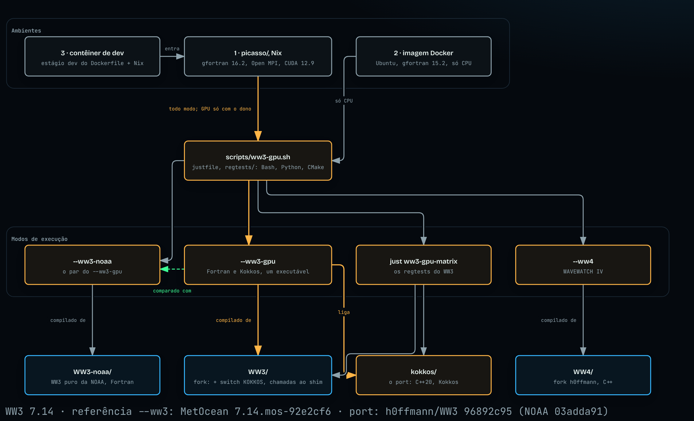
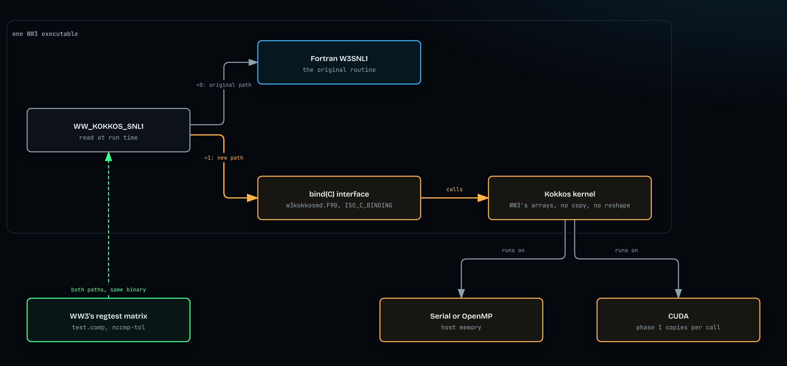
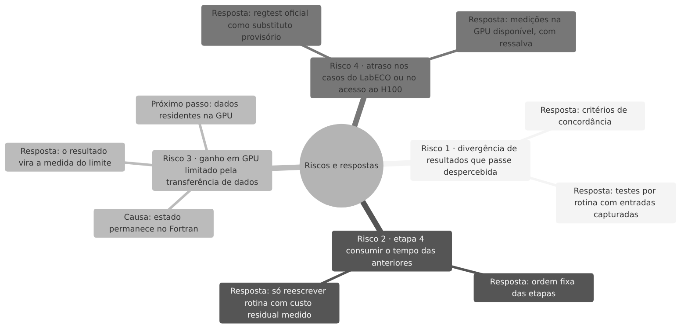

<!-- cite: main="Claude"; last="Matheus Hoffmann" -->

> **Este texto é a terceira versão do relatório sobre o projeto ww3-gpu.**
>
> - **Vale o original.** Se este texto e os arquivos do repositório discordam, valem os arquivos.
>   Os arquivos principais são [`kokkos/PORT_STATUS.md`][port-status], [`kokkos/ports.tsv`][ports]
>   e o [`README.pt-BR.md`][readme-pt].
> - **Feita a partir de:** o repositório em 2026-10-20, commit `b8a6463` de `main`. A versão
>   anterior usou o commit `23130fe`, de 2026-10-16.
> - **Para quem é:** o Prof. Pedro Cruz, D.Sc. (UFRJ),
>   e qualquer pessoa que programa, mas não estuda oceanografia nem física.
> - **O que ficou de fora:** as equações, os detalhes de cada rotina e as tabelas completas. Cada
>   trecho resumido aponta para o arquivo de origem.
> - **Como foi escrita:** o texto foi gerado por Claude com a skill
>   [Português Técnico Controlado][ptc] (PTC), versão 1.1.0, de Kayque Rotondo. A revisão é de
>   Matheus Hoffmann.

## Os links, num lugar só

| O quê | Onde |
|---|---|
| Código (GitHub) | <https://github.com/h0ffmann/ww3-gpu> |
| Resumo do projeto em português | [`README.pt-BR.md`][readme-pt] |
| Site | <https://h0ffmann.github.io/ww3-gpu/> (em português: <https://h0ffmann.github.io/ww3-gpu/pt-BR/>) |
| Esta página no site | <https://h0ffmann.github.io/ww3-gpu/relatorio-gta/> |
| Zenodo (o DOI que abre sempre a versão mais recente) | [10.5281/zenodo.23221351](https://doi.org/10.5281/zenodo.23221351) |
| Métricas do port | [`kokkos/PORT_STATUS.md`][port-status], [`kokkos/PORT_TABLE.tsv`][port-table], [`kokkos/PORT_RANKING.md`][port-ranking] e a seção "port" do site |
| Resultados na CPU, escritos para os modeladores da NOAA | [`docs/NOAA_PROGRESS_RECORD_202610.md`][noaa-record] |
| O que falta para uso operacional | [`docs/PRODUCTION_READINESS_202610.md`][readiness] |
| Decisões (ADRs, *Architecture Decision Records*) | [`docs/ADRs.md`][adrs] e a página <https://h0ffmann.github.io/ww3-gpu/adrs/> |
| Desenhos de mudança (WFIPs, *Wave Forecaster Improvement Proposals*) | [`docs/WFIPs/`][wfips] |
| Planos de engenharia | [`docs/plans/`][plans] |
| Diário do que foi tentado | [`docs/log/`][log] |
| O livro (17 lições) | <https://h0ffmann.github.io/ww3-gpu/book/> e o [PDF](https://h0ffmann.github.io/ww3-gpu/ww3-lab-course.pdf) |
| O pedido de acesso à H100 | [h0ffmann/ww3-gpu#143][h100] |
| O DIA (*Discrete Interaction Approximation*) na GPU, versão 2 | [h0ffmann/ww3-dia-gpu-v2][v2], comparado com o original [ww3-dia-gpu][v1] |
| O artigo com receita parecida | Koldunov et al., 2026, [arXiv:2606.11356][koldunov] |
| Glossário de siglas | [`docs/GLOSSARY.md`][glossary] |
| A skill de escrita deste texto | [Português Técnico Controlado][ptc] (PTC), versão 1.1.0, de Kayque Rotondo, nível `descritivo` |

## Como ler as marcas

Cada afirmação do repositório tem uma marca. **(v)** quer dizer "verificado". Nesse caso, uma
pessoa ou um agente conferiu a afirmação numa fonte ou num comando, e o texto nomeia essa fonte.
**⚠** quer dizer "ainda não verificado". Todo número vem com o comando que reproduz o número. Este
relatório segue a mesma regra.

## 1. O problema, em linguagem de computação

**O modelo.** O WAVEWATCH III® (WW3) é o modelo de previsão de ondas da NOAA, a agência americana
de oceano e atmosfera. O WW3 é um programa em Fortran com 263.375 linhas (v, `kokkos/PORT_STATUS.md`,
contadas no commit `03adda91` do WW3).

**O que o WW3 calcula.** O modelo divide o mar numa grade de pontos. Em cada ponto de mar, o WW3
guarda um vetor de números chamado espectro. O espectro diz quanta energia de onda existe em cada
frequência e em cada direção. A cada passo de tempo, o programa faz duas etapas:

1. **Propagação:** o programa move a energia de um ponto da grade para os pontos vizinhos. A etapa
   lembra um *stencil* sobre uma imagem.
2. **Termos-fonte:** em cada ponto, o programa soma a energia que o vento coloca, a energia que a
   quebra das ondas tira e a energia que as ondas trocam entre si. Nesta etapa, um ponto não depende
   de outro ponto.

**Por que a GPU ajuda.** A segunda etapa é um laço sobre pontos independentes: 9.520 pontos de mar no caso `full`. Esse
laço tem o formato de um *map* sobre um vetor grande, e uma GPU executa esse formato bem. No perfil medido, só o DIA ocupa 48,4 % do tempo de execução (seção 4).

**A regra que torna o problema difícil.** A versão em GPU precisa dar **o mesmo resultado, bit a
bit**, que o Fortran original, dentro do mesmo executável do WW3. Um resultado parecido não basta.
Se um bit muda, a tradução está errada até que duas execuções do próprio Fortran mostrem a mesma diferença (`AGENTS.md`, "Bit for
bit with the Fortran").

## 2. A fase atual do projeto

**Velocidade primeiro, validação depois.** Em 2026-10-17, o dono do projeto fixou o objetivo
principal: deixar o WW3 mais rápido com Kokkos e CUDA, sem mudar a aritmética do Fortran
([ADR-0016][adr16]). A mesma decisão adiou os regtests do WW3 para uma **fase de validação**. O dono do projeto decide quando essa fase começa. Até o início dessa fase, o projeto mostra a paridade bit a bit por análise
estática do código compilado (seção 7). Todo número de velocidade dessa fase leva a marca
"regtest pendente ⚠".

**O que mudou de 2026-10-16 a 2026-10-19.** O `main` recebeu 269 commits nesse intervalo, em 39
pull requests, do #158 ao #206 (v, `git log 3445100..b8a6463`). Os seis grupos de mudança abaixo
resumem esses commits:

1. **Tradução em massa.** Os PRs de #159 a #168 traduziram as rotinas mais caras que ainda estavam em Fortran e ligaram essas rotinas ao fork. No intervalo inteiro, o número de rotinas traduzidas foi de 91 para
   316, e o número de rotinas ligadas foi de 10 para 72.
2. **O passo de tempo residente.** Com `--kokkos resident`, o espectro fica no lado do Kokkos
   durante a execução inteira. Sete partes do passo de tempo executam em Kokkos (seção 3,
   [WFIP-0005][wfip5]; PRs #173, #179, #184 e #191).
3. **A matemática da GPU.** Uma GPU NVIDIA calcula `expf` e `logf` com algoritmos diferentes dos
   algoritmos da `glibc`. Os PRs #177 e #178 trocaram essas chamadas por cópias das funções da `glibc` compiladas para a GPU ([WFIP-0006][wfip6]). Nenhuma execução na GPU comparou ainda essas cópias.
4. **Produção num nó só.** O PR #191 atualizou o pin do fork e acrescentou o modo estrito. O modo estrito interrompe a execução quando uma parte volta para o Fortran sem aviso. O mesmo PR mostrou que o `ww3_multi` e os builds com OpenMP também dão saídas idênticas byte a byte às do Fortran ([ADR-0017][adr17]).
5. **Pontos em vetor e grade não estruturada.** Desde os PRs #199 e #201, o código Kokkos calcula oito pontos de mar ao mesmo tempo, um ponto por posição do registrador SIMD (*Single Instruction, Multiple Data*) da CPU. Os PRs #202 e #204 traduziram a propagação na
   grade não estruturada (`W3XYPUG`), e o regtest `ww3_tp2.6` deu os bytes do Fortran.
6. **O caminho para o GFS-Wave.** O PR #206 levou o `W3SRCE` em lote para a switch dos regtests do GFS-Wave (Global Forecast System, ondas), o sistema que a NOAA usa na previsão operacional de ondas ([plano 007][plan7]).

## 3. Como o código é organizado: as formas de executar

O código do WW3 não é editado neste repositório. O código vem de fora, em submódulos do git, isto
é, repositórios dentro do repositório. O ww3-gpu acrescenta só a reescrita em C++ e as ferramentas
em volta (v, [`README.pt-BR.md`][readme-pt], "como funciona").

### Os forks

| Diretório | O que é | Para que serve |
|---|---|---|
| `WW3-noaa/` | o WW3 da NOAA, [NOAA-EMC/WW3](https://github.com/NOAA-EMC/WW3) no commit `03adda91`, sem mudança | a referência: o resultado que o projeto precisa reproduzir |
| `WW3/` | o fork [h0ffmann/WW3](https://github.com/h0ffmann/WW3) no commit `96892c95` (branch `ww3-gpu/gfs-srce-be5bdbea`): o WW3 da NOAA mais o patch KOKKOS. O patch muda 9 arquivos e acrescenta 7 módulos em `model/src/`, com 5.902 linhas acrescentadas e nenhuma linha removida | colocar dentro do WW3 a chamada para o código novo |
| `WW4/` | o fork [h0ffmann/WW4](https://github.com/h0ffmann/WW4), branch `develop`: o WAVEWATCH IV, que a NOAA reescreve em C++ | acompanhar o sucessor do WW3 |
| `picasso/` | [h0ffmann/picasso](https://github.com/h0ffmann/picasso) ([10.5281/zenodo.23311208](https://doi.org/10.5281/zenodo.23311208)): o conjunto de compiladores fixado com Nix | dar a todas as pessoas as mesmas versões de compilador |

(v) Os números do patch vêm de `git -C WW3 diff --shortstat 03adda91 96892c95 -- model` e de
`git -C WW3 diff --name-status`, executados em 2026-10-20.

**Por que o fork do WW3 existe.** A chamada para o código em C++ precisa estar dentro do WW3. Este
repositório não edita o WW3, então o fork guarda essa chamada. A chamada fica atrás da chave de
compilação `KOKKOS`. Antes de cada execução, o script `scripts/ww3-gpu.sh` compara o fork com o WW3
da NOAA. Se o fork muda um arquivo fora do patch, o script termina com o código de saída 3.

### Os três modos de executar

O script `scripts/ww3-gpu.sh` controla os três modos:

| Modo | O que executa | Compilado de |
|---|---|---|
| `--ww3-noaa` | o WW3 como a NOAA escreve | `WW3-noaa/` |
| `--ww3-gpu` | o WW3 do fork com o código Kokkos. O script executa o caso duas vezes no mesmo executável, uma vez com o Fortran e uma vez com o Kokkos, e compara as saídas | `WW3/` e `kokkos/` |
| `--ww4` | o WAVEWATCH IV. Hoje esse modo termina com o código de saída 5, porque o WW4 ainda não tem as partes que os casos usam | `WW4/` |

Cada modo aceita `--cpu` (o padrão) ou `--gpu`. Só o `--ww3-gpu` tem caminho de GPU. Uma execução
na GPU exige uma pessoa como supervisora. O script pede um "yes" digitado no terminal e não continua sem essa resposta.

### A chave em tempo de execução

O executável do `--ww3-gpu` contém as duas versões de cada rotina ligada. Uma variável de ambiente
escolhe a versão, sem recompilar: `WW_KOKKOS_<PARTE>=0` usa o Fortran e `WW_KOKKOS_<PARTE>=1` usa o
Kokkos. Assim, o teste compara as duas versões com o mesmo binário, a mesma entrada e o mesmo
compilador. A opção `--kokkos` escolhe um conjunto de partes:

| `--kokkos` | Partes em Kokkos | Uso |
|---|---|---|
| `none` | nenhuma parte | só o Fortran, no build com Kokkos |
| `all` | todas as partes do build | o teste mais amplo da tradução |
| `gpu` | `SRCE` | o padrão do `--gpu`: o `W3SRCE` inteiro em cada chamada ([ADR-0013][adr13]) |
| `resident` | `SRCE`, `XYP3`, `KTP3`, `OUTG`, `IOPE`, `UPDV`, `CPRT` | o passo de tempo inteiro em Kokkos, com o espectro guardado no lado do Kokkos |

**Kokkos** é uma biblioteca C++ do Sandia National Laboratories (⚠, `docs/GLOSSARY.md`). Quem programa escreve o kernel uma vez e compila esse kernel para vários *backends*: Serial, OpenMP (vários núcleos
da CPU) ou CUDA (GPU NVIDIA). O Fortran chama o C++ por uma interface `bind(C)`, o padrão
`ISO_C_BINDING` do Fortran.

**Por que o espectro fica no lado do Kokkos.** A GPU tem memória própria. Se cada rotina copia o
espectro para a GPU e de volta, as cópias ocupam a maior parte do tempo da chamada. No benchmark do DIA, a chamada inteira levou 0,75 ms, e o kernel levou 0,047 ms: as cópias foram cerca de 94 % da chamada (v, [`bench/results/`][bench-snl1]). O preset `resident` copia o espectro para o lado do Kokkos uma vez,
no começo. O espectro volta ao Fortran só quando o WW3 escreve uma saída ou um restart, e no fim da execução.

### Os três ambientes

O mesmo script funciona em três ambientes (v, [`README.pt-BR.md`][readme-pt], "três ambientes"):

1. **picasso (Nix):** a referência. Os veredictos bit a bit e todo tempo medido vêm desse ambiente.
2. **Imagem Docker:** só CPU e só os casos pequenos, para quem não quer instalar o Nix. Uma pessoa inicia à mão um workflow do GitHub Actions. Esse workflow publica as imagens no GHCR (GitHub Container Registry).
3. **Dev container:** para o VS Code. Por dentro, o dev container usa o picasso.

## 4. O que já foi portado

**O que "portado" quer dizer neste relatório.** Uma rotina está **portada** quando o WW3 chama o código Kokkos e esse código passa nos testes de regressão originais da NOAA (os *regtests*) com o resultado do Fortran. Traduzir não basta. Compilar não basta. O ww3-gpu não muda a lógica dos
regtests. Os regtests são a tabela verdade da verificação (seção 7).

O site e o [`PORT_STATUS.md`][port-status] contam o trabalho em três níveis. Cada nível exige mais
do que o nível anterior:

| Nível | O que quer dizer | Parte do tempo de execução | Rotinas | Linhas do WW3 |
|---|---|---|---|---|
| **traduzido** | o código Kokkos existe e foi conferido só por leitura | **99,3 %** | 316 de 1.023 | 69.024 de 263.375 (26,21 %) |
| **ligado** | o WW3 do fork chama esse código, atrás da chave | **99,3 %** | 72 de 1.023 | 19.059 (7,24 %) |
| **portado** | os regtests executaram com o código dentro do WW3 e deram o resultado do Fortran | **48,6 %** | 14 de 1.023 | 3.151 (1,20 %) |

(v) `python3 scripts/port_score.py --check`, executado em 2026-10-20 no commit `b8a6463`: as tabelas
estão em dia. O código Kokkos tem 62.257 linhas de C++ em 355 arquivos. Na versão anterior deste
relatório, os números eram 91, 10 e 2 rotinas, com 19.491 linhas de C++. Nos arquivos do repositório,
em inglês, os três níveis se chamam *translated*, *ported* e *regtested*. Neste relatório,
"portado" é o terceiro nível.

**A distância entre os níveis.** A distância entre 99,3 % e 48,6 % é o trabalho que falta. Esse
trabalho é a fase de validação: passar cada unidade ligada nos regtests da NOAA.

**As 14 rotinas portadas** (v, coluna `regtested` de [`kokkos/ports.tsv`][ports]):

- **O DIA:** `W3SNL1` e as tabelas do DIA, `INSNL1`. O DIA é 48,4 % do tempo no perfil. O resultado
  é idêntico byte a byte ao Fortran nas 125 entradas da matriz de regtests do WW3 (100 seriais e 25 com OpenMP; 2026-10-15, [`port_report/W3SNL1_KOKKOS.md`][snl1]).
- **O suporte do `W3WAVE`:** `W3GATH`, `W3SCAT`, `W3UWND`, `W3DZXY`, `WAVNU2`, `DISTAB`, `W3MAP3` e
  `W3MAPT`. A verificação usou os casos `smoke` e `full` (2026-10-16).
- **A grade não estruturada:** `W3XYPUG` e `W3XYPFSN2`. As duas entradas do regtest `ww3_tp2.6`
  deram os bytes do Fortran (2026-10-19, [`docs/log/2026-10-19-xypug-tp2.6-rebased.md`][xypug]).
- **O `ww3_multi`:** `WMIOHG` e `WMIOEG`, nas entradas de `mww3_test_01` a `mww3_test_05`.

**Uma ressalva sobre a contagem.** O caso `smoke` é o regtest `ww3_ts1` da NOAA. O caso `full`
(`bench_small`, 9.520 pontos de mar) é um caso do próprio repositório, e a contagem do repositório
inclui esse caso. Oito das 14 rotinas passaram só pelos casos `smoke` e `full`, com comparação byte a byte dentro do WW3. Essas oito rotinas contam como portadas porque a contagem inclui o caso `full`. Essas oito rotinas ainda não passaram pela matriz completa da NOAA.

**As rotinas só ligadas.** A física ST4 (o conjunto de termos-fonte que a chave de compilação `ST4` escolhe) tem três rotinas ligadas ao WW3: `W3SIN4` (o vento), `W3SDS4` (a quebra das ondas) e `W3SPR4` (os parâmetros médios). O `W3SRCE` e a propagação (`W3XYP3`, `W3KTP3`, `W3QCK1`, `W3QCK3`) também estão ligados ao WW3. Essas rotinas deram saídas idênticas byte a byte nos casos de teste. A matriz de regtests
dessas rotinas espera a fase de validação.

## 5. Velocidade: o que foi medido

Todos os números desta seção foram medidos numa CPU Intel Core i9-14900 (24 núcleos, 32 threads) e
numa GPU RTX 4090. Os números de modelo inteiro estão marcados com "regtest pendente ⚠".

| Medição | Resultado | Fonte |
|---|---|---|
| Modelo inteiro na CPU, caso `full`, 32 threads, preset `resident` | 15,84 s contra 26,18 s do WW3 da NOAA: **1,65 vez mais rápido** (39,5 % menos tempo); regtest pendente ⚠ | mediana de dez execuções, 2026-10-18, [registro da NOAA][noaa-record], seção 3 |
| O mesmo caso com 1 thread | 174,78 s contra 174,27 s: o mesmo tempo | uma execução, máquina compartilhada ⚠ |
| Kernel do DIA, fora do WW3, 1.000 pontos por chamada, 1 thread | 25,88 ms | mediana de três, 2026-09-15, [`bench/results/`][bench-snl1] |
| O mesmo kernel com OpenMP, 32 threads | 5,95 ms (4,4 vezes) | a mesma fonte |
| O mesmo kernel com CUDA, RTX 4090, com as cópias | 0,75 ms (34 vezes) | a mesma fonte |
| O mesmo kernel com CUDA, só o kernel | 0,047 ms | a mesma fonte |
| Modelo inteiro na GPU | nenhuma execução até 2026-10-20; o build CUDA compila | [`docs/log/2026-10-18-cuda-build-only.md`][cuda-build] |

**Como ler esses números.** O ganho de 1,65 vez na CPU vem da divisão do trabalho entre threads. Com
1 thread, o Kokkos e o Fortran levam o mesmo tempo. O ganho só existe nos builds de memória
compartilhada (`SHRD`). No build com MPI (*Message Passing Interface*), que o GFS-Wave usa, o WW3 executa o Fortran por decisão
de projeto ([ADR-0017][adr17]). O 34 vezes do DIA vale só para o kernel isolado, não para o WW3
inteiro.

## 6. A receita: tradução com disciplina

**O artigo parecido.** A receita do livro lembra a receita de Koldunov et al. (2026), "An Ocean
Model Ported by a Large Language Model: Experience and Lessons from FESOM2 (Fortran to C to
C++/Kokkos)" ([arXiv:2606.11356][koldunov]). Nesse trabalho, especialistas dirigiram um assistente
de código. O assistente traduziu cerca de 74 mil linhas de Fortran do modelo oceânico FESOM2 para C e
depois de C para C++ com Kokkos. O assistente traduzia linha a linha, sem mudar o algoritmo para ganhar velocidade. Cada etapa
tinha um teste de aceitação próprio (v, resumo do arXiv, lido em 2026-10-16).

**Onde o ww3-gpu é diferente.** A estratégia do ww3-gpu é a **tradução com disciplina, direta de
Fortran para Kokkos**:

- **Sem etapa em C.** Cada instrução do Fortran vira uma instrução em C++, na mesma ordem. A ordem dos laços muda só onde um kernel não pode alocar memória. O tipo `float`
  substitui o `REAL` do WW3, e a álgebra não muda.
- **Sem testes próprios do Kokkos.** O código Kokkos não tem teste unitário, GoogleTest nem dado
  capturado de uma rotina traduzida ([ADR-0010][adr10]). A [ADR-0019][adr19], ainda proposta, propõe permitir GoogleTest só para a infraestrutura que não traduz rotina do WW3.
- **Sem regtests durante a tradução.** Durante a tradução, o projeto mostra a paridade pela comparação do código que os dois compiladores produzem com `-O3` (GIMPLE ou desmontagem) ([ADR-0016][adr16], que substitui a [ADR-0011][adr11]).
- **O teste vem depois, de uma vez, dentro do WW3.** Na fase de validação, cada unidade ligada ao
  fork passa pelos regtests da NOAA. O DIA (`W3SNL1`) seguiu esse caminho com sucesso: o resultado
  foi idêntico byte a byte nas 125 entradas que executaram (100 seriais e 25 com OpenMP).

**O ciclo de trabalho.** O projeto tem uma pessoa só. Cada mudança de engenharia segue o ciclo do plugin Compound Engineering, no tamanho da mudança: planejar, fazer, revisar e registrar o que a mudança ensinou. Uma mudança pequena vai direto ao trabalho e às verificações. Os
planos ficam em [`docs/plans/`][plans].

## 7. Como a tradução é verificada

**O regtest é a tabela verdade.** Os únicos testes do código Kokkos são os testes do próprio WW3: os
regtests que a NOAA mantém na matriz `regtests/bin/matrix.base`. O ww3-gpu não muda a lógica desses
testes. Cada entrada executa duas vezes no mesmo executável, uma vez com o Fortran e uma vez com o
Kokkos. O `test.comp` da NOAA compara as saídas. Um arquivo diferente reprova a rotina
([ADR-0010][adr10]).

**A ferramenta de tolerância: `nccmp-tol`.** O [`nccmp-tol`][nccmp-tol] trabalha ao lado do
`test.comp`. O `nccmp-tol` compara dois arquivos NetCDF (*Network Common Data Form*, um formato de arquivo científico) variável por variável. Cada variável tem uma
tolerância absoluta e uma tolerância relativa no arquivo [`tolerances.txt`][tolerances]. Por exemplo,
a altura de onda `hs` aceita uma diferença absoluta de até 0,0001 m ou uma diferença relativa de até 0,0001. O `nccmp-tol` mede o tamanho de cada
diferença, campo por campo.

O `nccmp-tol` nunca transforma uma diferença em aprovação: o veredicto é
do `test.comp`, bit a bit. Uma pessoa revisa toda mudança num script de comparação ou numa
tolerância antes do merge (`AGENTS.md`, "Never cheat a regtest tool").

**A exceção.** O projeto perdoa só um arquivo que o próprio Fortran escreve de forma diferente em
duas execuções seguidas. A matriz mede esse caso com uma segunda execução do Fortran.

**Duas proteções novas.** O modo estrito (`WW_KOKKOS_STRICT=1`) interrompe a execução quando uma parte
volta para o Fortran. Com `WW_KOKKOS_VA_POISON=1`, o código Kokkos preenche com NaN a cópia desatualizada do espectro no lado do Fortran. Se uma rotina do Fortran lê essa cópia sem sincronizar, uma saída muda, e a
comparação byte a byte falha.

**Por que bit a bit é difícil.** O repositório registra dois exemplos reais. Primeiro: com a contração ligada, o compilador junta `a*b + c` numa instrução só (FMA). A FMA arredonda uma vez, e às vezes o resultado muda no último bit. Por isso o projeto compila o código Kokkos com `-ffp-contract=off` e, na GPU, com `--fmad=false`. Segundo: o
gfortran expande `x**11` de um jeito em `-O0` e de outro jeito em `-O3` (v,
[`docs/log/2026-10-14-snl1-bitwise-af11.md`][af11]).

## 8. O DIA na GPU: ww3-dia-gpu e ww3-dia-gpu-v2

Em março de 2026, outro autor propôs à NOAA um kernel CUDA do DIA, o [ww3-dia-gpu][v1] original
(commit `38919d2`, de 2026-03-26). O [ww3-dia-gpu-v2][v2], criado em 2026-10-15, documenta a versão
deste projeto e compara as duas versões (v, [`docs/W3SNL1_GPU_COMPARISON_202610.md`][cmp]).

| | ww3-dia-gpu (original) | ww3-dia-gpu-v2 (este projeto) |
|---|---|---|
| O que calcula | uma parte da seção 3 do `W3SNL1` (`SA1`, `SA2`), com dados sintéticos | o `W3SNL1` inteiro e as tabelas do DIA (`INSNL1`): a fonte `S` e a diagonal `D` |
| Chamado pelo WW3 | não | sim, pelo `W3SRCE` do fork, atrás da chave `KOKKOS` |
| Bit a bit contra | o próprio kernel, em outra ordem de laço | o Fortran, dentro do mesmo executável do WW3 |
| Regtests da NOAA | nenhuma entrada possível | 125 de 125 entradas idênticas byte a byte (100 seriais e 25 com OpenMP) |
| Velocidade publicada | 16,8 vezes, layout contra layout, na mesma RTX 3060 | 34 vezes contra 1 núcleo, numa RTX 4090, com as cópias de memória |

Os dois números de velocidade não são comparáveis. As GPUs são diferentes, a quantidade de trabalho é
diferente, e nenhum dos dois números mede o WW3 inteiro.

## 9. A H100 e a primeira execução na GPU

A pergunta do projeto é: o WW3 fica mais rápido na GPU **sem mudar a resposta**? Responder a essa pergunta exige três medidas na mesma máquina:

- **A tradução** diz que o código existe e compila para a GPU. Hoje a tradução cobre 99,3 % do
  tempo.
- **O regtest** diz que o código dá os mesmos bits que o Fortran. Hoje 48,6 % do tempo está
  portado, e só na CPU.
- **O tempo** vale só quando o regtest passou na mesma máquina.

**A primeira execução na GPU.** O build CUDA do preset `resident` compila. O nvcc emite 51 avisos no código
Kokkos, e nenhum aviso está numa parte ligada (v, [`docs/log/2026-10-18-cuda-build-only.md`][cuda-build]). O [plano 003][plan3] descreve a
primeira execução supervisionada, numa RTX 4090. O dono do projeto vai iniciar essa execução no terminal. Até 2026-10-20, essa execução não aconteceu.
Na GPU, a regra é diferente da regra da CPU: o `nccmp-tol` julga a execução pelas tolerâncias, e o registro da execução guarda a diferença de cada campo, sem alargar tolerância ([ADR-0014][adr14]).

**A H100.** A issue [h0ffmann/ww3-gpu#143][h100], aberta em 2026-10-16, pede acesso à NVIDIA H100 do
LabECO, na UFSC. A issue lista o que conferir: o driver, o CUDA para `sm_90`, o Nix, os contêineres,
o escalonador e o uso exclusivo da GPU para medir. Até 2026-10-20, a issue está aberta. O repositório
já tem um preset `cuda-h100-release`. Na H100, o projeto precisa de duas medições: os regtests do WW3, Fortran contra Kokkos, para a paridade, e a mediana de três execuções, para o tempo. Sem esse
acesso, os números da H100 na proposta continuam projeções (⚠).

## 10. ADRs e WFIPs: como as decisões ficam escritas

Agentes de código (Claude Code) fazem parte do trabalho deste projeto. Para conferir o trabalho de um agente, o
projeto escreve toda decisão e todo plano no repositório, com data e evidência.

**ADR** (*Architecture Decision Record*, registro de decisão) é um texto curto sobre uma escolha já
feita. A ADR descreve o contexto, a decisão, as alternativas e as consequências. Uma ADR não agenda
trabalho. Uma ADR aceita não muda. Uma ADR nova substitui a ADR antiga.

O repositório tem 18 ADRs
([`docs/ADRs.md`][adrs]). Estas ADRs importam mais para o port:

| ADR | Decisão | Situação |
|---|---|---|
| [ADR-0002][adr2] | portar na ordem do tempo medido, a rotina mais cara primeiro | aceita |
| [ADR-0010][adr10] | o código Kokkos não tem testes próprios; os regtests do WW3 são os únicos testes | aceita |
| [ADR-0014][adr14] | a GPU é julgada pelas tolerâncias do `nccmp-tol`; a CPU continua bit a bit | aceita |
| [ADR-0016][adr16] | velocidade é o objetivo; os regtests vão para a fase de validação | aceita; substitui a ADR-0011 |
| [ADR-0017][adr17] | o código Kokkos executa num nó só; o build com MPI fica no Fortran | aceita |
| [ADR-0019][adr19] | GoogleTest só para a infraestrutura, nunca para uma rotina traduzida | proposta |

**WFIP** (*Wave Forecaster Improvement Proposal*) é o desenho de uma mudança grande, escrito
**antes** da mudança. Cada WFIP aponta para um entregável da proposta do projeto (de D1 a D6). Cada
WFIP tem uma lista de "pronto" (*definition of done*) que conta quanto falta. Um script reprova a
integração contínua (CI) quando o índice fica desatualizado. O formato lembra um RFC (*Request for Comments*) ou um *design doc*. O repositório tem
cinco WFIPs ([`docs/WFIPs/`][wfips]):

| WFIP | O que desenha | Situação |
|---|---|---|
| [WFIP-0001][wfip1] | executar o WW3 com vento do WeatherNext 3 numa RTX 4090 | adiada (2026-10-15) |
| [WFIP-0002][wfip2] | o laboratório como livro, compilado do repositório | parcial: 1 de 7 itens |
| [WFIP-0003][wfip3] | o DIA em Kokkos pela matriz de regtests do WW3, no fork | **implementada** em 2026-10-15: 7 de 7 itens |
| [WFIP-0005][wfip5] | o passo de tempo residente: o espectro mora na GPU | rascunho: 0 de 8 itens |
| [WFIP-0006][wfip6] | a GPU calcula os bits da `libm` da `glibc` | parcial: unidades de 1 a 4, num total de 5 |

## 11. O próximo passo

A ordem do trabalho segue o tempo medido ([`kokkos/PORT_RANKING.md`][port-ranking]). Todas as rotinas de cálculo que o perfil mede já estão traduzidas. O que resta no ranking são as rotinas de inicialização e as rotinas de entrada e saída. As três frentes abertas em 2026-10-20 são:

1. **O GFS-Wave.** O [plano 007][plan7] leva o `W3SRCE` em lote e o `W3XYP3` para a switch dos
   regtests do GFS-Wave (de `ww3_ufs1.1` a `ww3_ufs1.3`). O passo 1 está pronto. Os passos de 2 a 4 estão
   bloqueados ([`docs/log/2026-10-19-gfs-risk-runs.md`][gfs-runs]).
2. **A primeira execução na GPU**, supervisionada pelo dono do projeto ([plano 003][plan3]).
3. **As lacunas para uso operacional.** O [`PRODUCTION_READINESS_202610.md`][readiness] lista 13
   lacunas em ordem de gravidade. Três lacunas bloqueiam o uso no GFS-Wave:
   - nenhuma switch de regtest tem o conjunto de termos-fonte que o `W3SRCE` em Kokkos traduz;
   - o MPI fica fora do código Kokkos;
   - a paridade não foi medida com o compilador da operação nem na GPU.

Depois dessas frentes, o dono do projeto vai iniciar a fase de validação.

## 12. Como citar

Cite o DOI que abre sempre a versão mais recente:
[10.5281/zenodo.23221351](https://doi.org/10.5281/zenodo.23221351). O registro no Zenodo é do tipo
livro. A versão publicada mais recente é a `v0.1.3`, de 2026-10-09 (v, [`RELEASES.md`][releases]). Os dados
para citação estão em [`CITATION.cff`][cff] e no
[`README.md`](https://github.com/h0ffmann/ww3-gpu#how-to-cite).

## Glossário do projeto

A PTC-6 da skill pede um termo para cada conceito, sempre o mesmo termo. Esta tabela fixa os termos deste
relatório.

| Termo | Definição em uma linha | Não usar |
|---|---|---|
| backend | o alvo para o qual o Kokkos compila o kernel: Serial, OpenMP ou CUDA | plataforma |
| bit a bit | os dois resultados têm exatamente os mesmos bits, sem tolerância | igual, parecido |
| DIA | o método aproximado que o WW3 usa para as trocas de energia entre ondas | — |
| execução | um processamento completo de um caso, do começo ao fim | rodada |
| FMA | uma instrução que calcula `a*b + c` com um arredondamento só | — |
| GIMPLE | a representação intermediária do GCC (*GNU Compiler Collection*), a mesma para Fortran e C++ | — |
| ligado | o WW3 do fork chama o código Kokkos, atrás da chave | portado |
| `nccmp-tol` | o comparador de NetCDF com tolerância por variável; mede a diferença, não aprova | validador |
| portado | o código Kokkos passou nos regtests da NOAA dentro do WW3 | traduzido, ligado |
| regtest | um caso de teste completo do WW3, com entrada e saída de referência; a tabela verdade | teste unitário |
| shim | a camada fina que liga o Fortran ao C++ | adaptador |
| termo-fonte | a parte do cálculo feita ponto a ponto, sem olhar os vizinhos | — |
| traduzido | o código Kokkos existe e foi conferido só por leitura | portado |

## Referências

- [`README.pt-BR.md`][readme-pt] do ww3-gpu, commit `b8a6463`, lido em 2026-10-20. O resumo do
  projeto em português. As seções "em um minuto", "como funciona", "onde o projeto está" e "três
  ambientes" deram o contexto deste relatório. Os números do README são de 2026-10-17. Este relatório
  usa os números de 2026-10-20 do `PORT_STATUS.md`.
- [`kokkos/PORT_STATUS.md`][port-status] e [`kokkos/ports.tsv`][ports], commit `b8a6463`.
- [`docs/NOAA_PROGRESS_RECORD_202610.md`][noaa-record], versão de 2026-10-18.
- [`docs/PRODUCTION_READINESS_202610.md`][readiness].
- Koldunov et al., 2026, [arXiv:2606.11356][koldunov].
- Rotondo, K. [Português Técnico Controlado][ptc], versão 1.1.0, commit `cfdffad`, licença MIT.

[readme-pt]: https://github.com/h0ffmann/ww3-gpu/blob/main/README.pt-BR.md
[port-status]: https://github.com/h0ffmann/ww3-gpu/blob/main/kokkos/PORT_STATUS.md
[port-table]: https://github.com/h0ffmann/ww3-gpu/blob/main/kokkos/PORT_TABLE.tsv
[port-ranking]: https://github.com/h0ffmann/ww3-gpu/blob/main/kokkos/PORT_RANKING.md
[ports]: https://github.com/h0ffmann/ww3-gpu/blob/main/kokkos/ports.tsv
[snl1]: https://github.com/h0ffmann/ww3-gpu/blob/main/kokkos/port_report/W3SNL1_KOKKOS.md
[bench-snl1]: https://github.com/h0ffmann/ww3-gpu/blob/main/bench/results/snl1-i9-14900-rtx4090-2026-09-15.json
[noaa-record]: https://github.com/h0ffmann/ww3-gpu/blob/main/docs/NOAA_PROGRESS_RECORD_202610.md
[readiness]: https://github.com/h0ffmann/ww3-gpu/blob/main/docs/PRODUCTION_READINESS_202610.md
[xypug]: https://github.com/h0ffmann/ww3-gpu/blob/main/docs/log/2026-10-19-xypug-tp2.6-rebased.md
[gfs-runs]: https://github.com/h0ffmann/ww3-gpu/blob/main/docs/log/2026-10-19-gfs-risk-runs.md
[cuda-build]: https://github.com/h0ffmann/ww3-gpu/blob/main/docs/log/2026-10-18-cuda-build-only.md
[af11]: https://github.com/h0ffmann/ww3-gpu/blob/main/docs/log/2026-10-14-snl1-bitwise-af11.md
[plans]: https://github.com/h0ffmann/ww3-gpu/tree/main/docs/plans
[plan3]: https://github.com/h0ffmann/ww3-gpu/blob/main/docs/plans/2026-10-18-003-gpu-first-supervised-run-plan.md
[plan7]: https://github.com/h0ffmann/ww3-gpu/blob/main/docs/plans/2026-10-19-007-gfs-wave-target-plan.md
[adrs]: https://github.com/h0ffmann/ww3-gpu/blob/main/docs/ADRs.md
[adr2]: https://github.com/h0ffmann/ww3-gpu/blob/main/docs/ADRs.md#adr-0002
[adr10]: https://github.com/h0ffmann/ww3-gpu/blob/main/docs/ADRs.md#adr-0010
[adr11]: https://github.com/h0ffmann/ww3-gpu/blob/main/docs/ADRs.md#adr-0011
[adr13]: https://github.com/h0ffmann/ww3-gpu/blob/main/docs/ADRs.md#adr-0013
[adr14]: https://github.com/h0ffmann/ww3-gpu/blob/main/docs/ADRs.md#adr-0014
[adr16]: https://github.com/h0ffmann/ww3-gpu/blob/main/docs/ADRs.md#adr-0016
[adr17]: https://github.com/h0ffmann/ww3-gpu/blob/main/docs/ADRs.md#adr-0017
[adr19]: https://github.com/h0ffmann/ww3-gpu/blob/main/docs/ADRs.md#adr-0019
[wfips]: https://github.com/h0ffmann/ww3-gpu/blob/main/docs/WFIPs/README.md
[wfip1]: https://github.com/h0ffmann/ww3-gpu/blob/main/docs/WFIPs/WFIP-0001-weathernext3-wind-rtx4090.md
[wfip2]: https://github.com/h0ffmann/ww3-gpu/blob/main/docs/WFIPs/WFIP-0002-lab-as-a-book.md
[wfip3]: https://github.com/h0ffmann/ww3-gpu/blob/main/docs/WFIPs/WFIP-0003-kokkos-regtest-matrix.md
[wfip5]: https://github.com/h0ffmann/ww3-gpu/blob/main/docs/WFIPs/WFIP-0005-device-resident-step.md
[wfip6]: https://github.com/h0ffmann/ww3-gpu/blob/main/docs/WFIPs/WFIP-0006-device-libm-bits.md
[log]: https://github.com/h0ffmann/ww3-gpu/blob/main/docs/log/README.md
[glossary]: https://github.com/h0ffmann/ww3-gpu/blob/main/docs/GLOSSARY.md
[releases]: https://github.com/h0ffmann/ww3-gpu/blob/main/RELEASES.md
[cff]: https://github.com/h0ffmann/ww3-gpu/blob/main/CITATION.cff
[h100]: https://github.com/h0ffmann/ww3-gpu/issues/143
[v1]: https://github.com/consigcody94/ww3-dia-gpu
[v2]: https://github.com/h0ffmann/ww3-dia-gpu-v2
[koldunov]: https://arxiv.org/abs/2606.11356
[cmp]: https://github.com/h0ffmann/ww3-gpu/blob/main/docs/W3SNL1_GPU_COMPARISON_202610.md
[nccmp-tol]: https://github.com/h0ffmann/ww3-gpu/blob/main/kokkos/tools/nccmp-tol/README.md
[tolerances]: https://github.com/h0ffmann/ww3-gpu/blob/main/kokkos/tools/nccmp-tol/tolerances.txt
[ptc]: https://github.com/kayquer/portugues-tecnico-controlado
