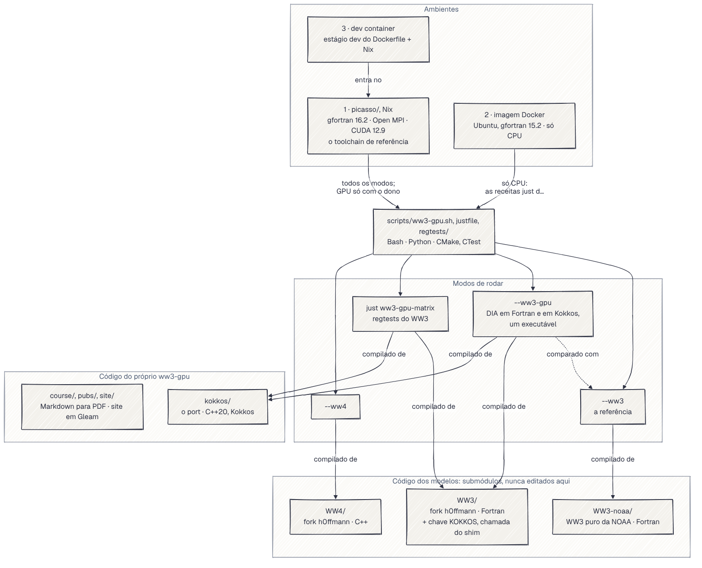
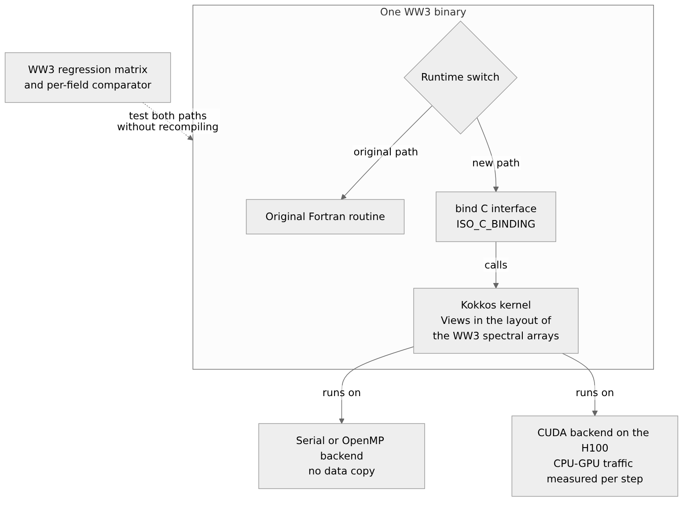
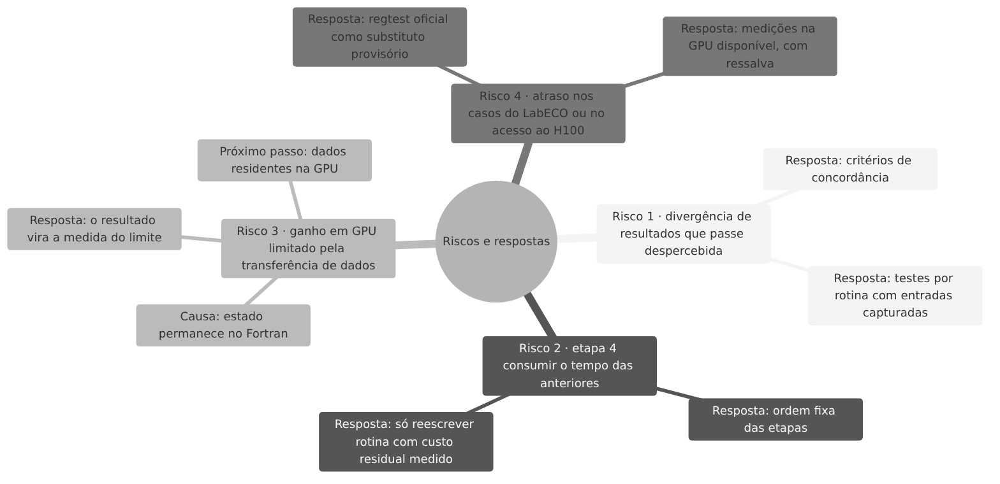
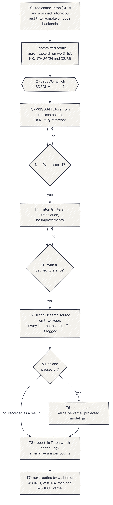

<!-- cite: main="Claude"; last="Matheus Hoffmann" -->

> **Esta é uma versão fácil, em português, do estado do projeto ww3-gpu.**
>
> - **Vale o original.** Se este texto e os arquivos do repositório discordarem, valem os
>   arquivos. Os principais são [`kokkos/PORT_STATUS.md`][port-status], [`kokkos/ports.tsv`][ports]
>   e o [`README.pt-BR.md`][readme-pt].
> - **Feita a partir de:** o repositório em 16 de outubro de 2026, commit `23130fe` de `main`.
> - **Para quem é:** o Prof. Pedro Cruz, do GTA (Grupo de Teleinformática e Automação, DEL/UFRJ),
>   e qualquer pessoa que programa, mas não é da oceanografia nem da física.
> - **O que ficou de fora:** as equações, os detalhes de cada rotina e as tabelas completas. Cada
>   parte encurtada aponta para o arquivo de onde veio.
> - **Escrita por:** Claude, no estilo da skill `easy-pt-br` de h0ffmann/closed-source; revisão
>   de Matheus Hoffmann.

## Os links, num lugar só

| O quê | Onde |
|---|---|
| Código (GitHub) | <https://github.com/h0ffmann/ww3-gpu> |
| Site | <https://h0ffmann.github.io/ww3-gpu/> (em português: <https://h0ffmann.github.io/ww3-gpu/pt-BR/>) |
| Esta página no site | <https://h0ffmann.github.io/ww3-gpu/relatorio-gta/> |
| Zenodo (DOI que sempre abre a versão mais nova) | [10.5281/zenodo.23221351](https://doi.org/10.5281/zenodo.23221351) |
| Métricas do port | [`kokkos/PORT_STATUS.md`][port-status], [`kokkos/PORT_TABLE.tsv`][port-table], [`kokkos/PORT_RANKING.md`][port-ranking], e a seção "port" do site |
| Decisões (ADRs) | [`docs/ADRs/`][adrs] e a página <https://h0ffmann.github.io/ww3-gpu/adrs/> |
| Desenhos de mudança (WFIPs) | [`docs/WFIPs/`][wfips] |
| Diário do que foi tentado | [`docs/log/`][log] |
| O livro (17 lições) | <https://h0ffmann.github.io/ww3-gpu/book/> e o [PDF](https://h0ffmann.github.io/ww3-gpu/ww3-lab-course.pdf) |
| O pedido de acesso à H100 | [h0ffmann/ww3-gpu#143][h100] |
| O DIA na GPU, versão 2 | [h0ffmann/ww3-dia-gpu-v2][v2], comparado com o original [ww3-dia-gpu][v1] |
| O artigo cuja receita é parecida | Koldunov et al., 2026, [arXiv:2606.11356][koldunov] |
| Glossário de siglas | [`docs/GLOSSARY.md`][glossary] |

## Como ler as marcas

Cada afirmação deste repositório carrega uma marca. **(v)** quer dizer "verificado": alguém
conferiu numa fonte ou rodou um comando, e o texto diz qual. **⚠** quer dizer "não verificado
ainda". Todo número vem com o comando que o reproduz. Este relatório segue a mesma regra.

## 1. O problema, em linguagem de computação

**O modelo.** O WAVEWATCH III® (WW3) é o modelo de previsão de ondas do mar da NOAA, a agência
americana de oceano e atmosfera. É um programa em Fortran com cerca de 263 mil linhas (v,
`kokkos/ports.tsv`, medido no commit `03adda91` do WW3).

**O que ele calcula.** O mar é dividido numa grade de pontos. Em cada ponto, o WW3 guarda um
vetor de números: quanta energia de onda existe em cada frequência e em cada direção. Esse vetor
se chama espectro. A cada passo de tempo, o programa faz duas coisas:

1. **Propagação:** move a energia de um ponto da grade para os vizinhos. É parecido com um
   *stencil* numa imagem.
2. **Termos-fonte:** em cada ponto, sozinho, soma o que o vento coloca, o que a quebra das ondas
   tira e o que as ondas trocam entre si. Um ponto não depende do outro nesta etapa.

**Por que a GPU ajuda.** A segunda etapa é um laço sobre milhares de pontos independentes. Isso
é o formato ideal para uma GPU, um *map* sobre um vetor grande. Medimos onde o tempo vai: os
termos-fonte somam a maior parte do tempo de uma rodada (seção 3).

**A regra que torna o problema difícil.** A versão na GPU tem que dar **o mesmo resultado, bit a
bit**, que o Fortran original, dentro do mesmo executável do WW3. Não basta "parecido". Se um
único bit muda, a tradução está errada até que se prove o contrário (regra do `AGENTS.md`, "Bit
for bit with the Fortran").

## 2. Como o código é organizado: as formas de rodar

O código do WW3 não é editado aqui. Ele vem de fora, em submódulos do git (repositórios dentro do
repositório). O ww3-gpu só acrescenta a reescrita em C++ e as ferramentas em volta.

### Os forks

| Diretório | O que é | Para que serve |
|---|---|---|
| `WW3-noaa/` | o WW3 puro da NOAA, [NOAA-EMC/WW3](https://github.com/NOAA-EMC/WW3) no commit `03adda91`, sem nenhuma mudança | a referência: o resultado que precisamos reproduzir |
| `WW3/` | o fork [h0ffmann/WW3](https://github.com/h0ffmann/WW3), branch `ww3-gpu/kokkos-st4`: o WW3 puro mais um patch pequeno, 5 arquivos em `model/src/` e 813 linhas acrescentadas (v, `README.md`, lido em 2026-10-16) | colocar dentro do WW3 a chamada para o código novo |
| `WW4/` | o fork [h0ffmann/WW4](https://github.com/h0ffmann/WW4), branch `develop`: o WAVEWATCH IV, que a NOAA reescreve do zero em C++ | acompanhar o sucessor do WW3 |
| `picasso/` | [h0ffmann/picasso](https://github.com/h0ffmann/picasso) ([10.5281/zenodo.23311208](https://doi.org/10.5281/zenodo.23311208)): o conjunto de compiladores fixado com Nix | garantir que todos compilam com as mesmas versões |

**Por que existe o fork do WW3.** A chamada para o código em C++ precisa estar dentro do WW3. Como
este repositório nunca edita o WW3, o fork carrega essa chamada. Ela fica atrás de uma chave de
compilação, `KOKKOS`. Antes de cada rodada, um script compara o fork com o WW3 puro. Se o fork
mudou qualquer coisa fora do patch, o script para com erro (código de saída 3).

### Os três modos de rodar

Tudo passa por um script só, `scripts/ww3-gpu.sh`:

| Modo | O que roda | Compilado de |
|---|---|---|
| `--ww3` | o WW3 como a NOAA escreve | `WW3-noaa/` |
| `--ww3-gpu` | o WW3 do fork, com as rotinas portadas em Kokkos; roda o caso duas vezes no mesmo executável, uma com o Fortran e outra com o Kokkos, e compara as saídas | `WW3/` e `kokkos/` |
| `--ww4` | o WAVEWATCH IV; hoje ele para com código 5, porque o WW4 ainda não tem os termos-fonte nem a propagação | `WW4/` |

Cada modo aceita `--cpu` (o padrão) ou `--gpu`. Só o `--ww3-gpu` tem caminho de GPU. Rodar na GPU
exige uma pessoa supervisionando: o script pede um "yes" digitado no terminal e para sem ele.

### A chave em tempo de execução

Dentro do executável do `--ww3-gpu` existem as duas versões de cada rotina portada. Uma variável
de ambiente escolhe qual roda, sem recompilar: `WW_KOKKOS_SNL1=0` usa o Fortran e
`WW_KOKKOS_SNL1=1` usa o Kokkos. O mesmo vale para `WW_KOKKOS_SDS4`, `WW_KOKKOS_SIN4` e
`WW_KOKKOS_SPR4`. Assim o teste compara as duas versões com o mesmo binário, a mesma entrada e o
mesmo compilador.

**Kokkos** é uma biblioteca C++ liderada pelo Sandia National Laboratories (⚠, `docs/GLOSSARY.md`). Você escreve o kernel uma vez e
compila para vários *backends*: Serial, OpenMP (vários núcleos da CPU) ou CUDA (GPU NVIDIA). A
chamada do Fortran para o C++ passa por uma interface `bind(C)`, o padrão `ISO_C_BINDING` do
Fortran.

### Os três ambientes

O mesmo script roda em três lugares (v, `README.pt-BR.md`, "três ambientes"):

1. **picasso (Nix):** a referência. Os veredictos bit a bit e todo tempo medido saem daqui.
2. **Imagem Docker:** só CPU, só os casos pequenos, para quem não quer instalar Nix.
3. **Dev container:** para o VS Code; por dentro, ele usa o picasso.

## 3. O que já foi portado

**O que "portado" quer dizer aqui.** Uma rotina só está **portada** quando o código em Kokkos,
chamado de dentro do WW3, passa nos testes de regressão originais da NOAA, os *regtests*, e dá o
mesmo resultado que o Fortran. Traduzir não basta, e compilar não basta. O ww3-gpu não muda a
lógica dos regtests: eles são a tabela verdade da validação (seção 5).

O site e o [`PORT_STATUS.md`][port-status] contam o trabalho em três níveis. Cada nível é mais
exigente que o anterior:

| Nível | O que quer dizer | Parte do tempo de rodada | Rotinas |
|---|---|---|---|
| **traduzido** | existe o código em Kokkos, conferido só por leitura | **99,3 %** | 91 de 1 023 |
| **ligado** | o WW3 do fork chama esse código, atrás da sua chave | **87,4 %** | 10 de 1 023 |
| **portado** | os regtests da NOAA rodaram com ele dentro do WW3 e deram o resultado do Fortran | **48,4 %** | 2 de 1 023 |

(v) `python3 scripts/port_score.py --check`, rodado em 2026-10-16 no commit `23130fe`: as tabelas
estão em dia. O código Kokkos tem 19 491 linhas de C++ em 104 arquivos. Nos arquivos do
repositório, em inglês, os três níveis se chamam *translated*, *ported* e *regtested*. Neste
relatório, "portado" é o terceiro: o único que a NOAA atestaria.

**Como ler essa tabela.** A distância entre 99,3 % e 48,4 % é exatamente o trabalho que falta: levar
cada unidade traduzida para dentro do fork e passá-la nos regtests.

### A primeira rotina portada: `W3SNL1`

`W3SNL1` calcula as interações entre ondas (o método DIA). É a rotina mais cara: **48,4 % do
tempo** de uma rodada, sozinha (v, perfil `gprof` do caso `bench_small`, 9 520 pontos de mar,
12 horas simuladas, 1 thread, 2026-10-14, `just profile-case full`).

- **Resultado:** idêntica byte a byte ao Fortran nas 100 entradas seriais da matriz de testes de
  regressão do WW3, e nas 25 entradas com OpenMP (v, 2026-10-15, `just ww3-gpu-matrix`,
  [`port_report/W3SNL1_KOKKOS.md`][snl1]).
- **Velocidade do kernel, fora do WW3** (1 000 pontos por chamada, i9-14900 e RTX 4090, mediana
  de três rodadas, 2026-09-15):

| Backend | Tempo por chamada | Ganho sobre 1 thread |
|---|---|---|
| Serial, 1 thread | 25,88 ms | 1,0× |
| OpenMP, 32 threads | 5,95 ms | 4,4× |
| CUDA, RTX 4090 | 0,75 ms | 34× |
| CUDA, só o kernel, sem cópia | 0,047 ms | |

Os números vêm de [`bench/results/snl1-i9-14900-rtx4090-2026-09-15.json`][bench-snl1].

**Duas ressalvas honestas.** Primeira: na GPU, 94 % do tempo da chamada é cópia de memória entre
CPU e GPU. Hoje cada chamada copia o espectro de ida e volta (a "fase 1"). A "fase 2" deixa os
dados morando na GPU, e só então o ganho do kernel aparece no modelo. Segunda: dentro do WW3, com
1 thread de CPU, a versão Kokkos ainda é **mais lenta** que o Fortran (217,9 s contra 152,7 s no
`bench_small`, `just full-ww3-gpu`, 2026-10-14). O WW3 ainda não rodou com o Kokkos na GPU.

### As outras rotinas

- **Física ST4** (`W3SDS4`, `W3SIN4`, `W3SPR4`: o vento, a quebra das ondas e os parâmetros
  médios, mais 39,0 % do tempo no mesmo perfil): ligadas ao WW3 e idênticas byte a byte nos dois
  casos de teste (v, 2026-10-15, [`docs/log/2026-10-15-st4-checkpoint.md`][st4]). Falta a matriz
  completa de regtests para chamá-las de portadas.
- **`W3SRCE`** (a rotina que chama todos os termos-fonte): traduzida e ligada num branch separado
  do fork; espera o seu ponto de checagem.
- **Só traduzidas** (2026-10-16): a propagação e o resto do laço de tempo (`W3XYP3`, `W3QCK1/2/3`,
  `W3GATH`, `W3SCAT` e outras), os pacotes que a NOAA usa em operação (`PDLIB`, gelo, reflexão,
  `NL3`) e, no PR #157, as outras físicas de vento e quebra (`ST0` a `ST6`), os fluxos (`FLX1` a
  `FLX5`) e o `SWL`. A paridade delas foi argumentada lendo o código otimizado dos dois
  compiladores. Nenhuma rodou ainda.

## 4. A receita: tradução com disciplina

**O artigo parecido.** A receita do livro lembra a de Koldunov et al. (2026), "An Ocean Model
Ported by a Large Language Model: Experience and Lessons from FESOM2 (Fortran to C to
C++/Kokkos)" ([arXiv:2606.11356][koldunov]). Lá, especialistas dirigiram um assistente de código
para levar cerca de 74 mil linhas de Fortran do modelo oceânico FESOM2 para C, e depois de C para
C++ com Kokkos. O assistente tinha que traduzir ao pé da letra, sem otimizar. Cada etapa tinha o
seu teste de aceitação: a versão em C contra estatísticas de cinco anos de simulação, e a versão
Kokkos bit a bit contra a versão em C na CPU (v, resumo do arXiv, lido em 2026-10-16).

**Onde o ww3-gpu é diferente.** A estratégia agora é **tradução com disciplina, direta de Fortran
para Kokkos**:

- **Sem etapa em C.** Cada linha do Fortran vira a sua linha em C++, na mesma ordem, com `float`
  no lugar do `REAL` do WW3 e sem reescrever a álgebra.
- **Sem testes próprios do Kokkos.** O port não tem teste unitário, GoogleTest nem dado capturado
  ([ADR-0010][adr10]).
- **Sem regtests durante a tradução.** Enquanto uma unidade é traduzida, a paridade é argumentada
  comparando o código otimizado (`-O3`) que o GCC gera para o Fortran e para o C++, a
  representação GIMPLE ([ADR-0011][adr11]).
- **O teste vem depois, de uma vez, dentro do WW3.** Quando a unidade acaba, ela é ligada ao fork
  do WW3 e passa pelos regtests da NOAA. Foi assim com o DIA (`W3SNL1`), com sucesso: idêntico
  byte a byte em todas as 125 entradas que rodaram.

## 5. Como sabemos que a tradução está certa

**O regtest é a tabela verdade.** Os únicos testes são os do próprio WW3: os regtests que a NOAA
mantém, na matriz `regtests/bin/matrix.base`. O ww3-gpu não muda a lógica deles. Rodamos cada
entrada duas vezes no mesmo executável, uma com o Fortran e outra com o Kokkos, e comparamos as
saídas com o `test.comp` da NOAA. Um arquivo diferente reprova a rotina ([ADR-0010][adr10]).

**A ferramenta de tolerância: `nccmp-tol`.** Ao lado do `test.comp`, o
[`nccmp-tol`][nccmp-tol] compara dois arquivos NetCDF variável por variável. Cada variável tem uma
tolerância absoluta e uma relativa, em [`tolerances.txt`][tolerances]: por exemplo, a altura de
onda `hs` passa com diferença de até `1e-4`. Ele diz **de quanto** é uma diferença, campo por
campo. Ele nunca transforma uma diferença em aprovação: o veredicto é o `test.comp`, bit a bit.
Uma tolerância nunca é alargada para um teste passar (regra do `AGENTS.md`).

**O que é perdoado.** Só um arquivo que o próprio Fortran escreve diferente em duas rodadas
seguidas. A matriz mede isso rodando o Fortran uma segunda vez.

**Nenhum tempo sem paridade.** Um número de velocidade só entra numa tabela depois que o regtest
passou no mesmo commit e na mesma máquina. `scripts/results.py check` recusa o contrário.

**Por que bit a bit é difícil.** Exemplos reais deste repositório: o compilador junta `a*b + c`
numa instrução só (FMA), que arredonda uma vez em vez de duas, e o resultado muda no último bit.
Por isso o port compila com `-ffp-contract=off` e, na GPU, `--fmad=false`. Outro: o gfortran
expande `x**11` de um jeito em `-O0` e de outro em `-O3` (v,
[`docs/log/2026-10-14-snl1-bitwise-af11.md`][af11]).

## 6. O DIA na GPU: ww3-dia-gpu e ww3-dia-gpu-v2

O [ww3-dia-gpu][v1] original é um kernel CUDA do DIA proposto à NOAA em março de 2026 por outro
autor (commit `38919d2`, de 2026-03-26) (v, [`docs/W3SNL1_GPU_COMPARISON_202610.md`][cmp]). O
[ww3-dia-gpu-v2][v2], criado em 2026-10-15, documenta a versão deste projeto e compara as duas.

| | ww3-dia-gpu (original) | ww3-dia-gpu-v2 (este projeto) |
|---|---|---|
| O que calcula | uma parte da seção 3 do `W3SNL1` (`SA1`, `SA2`), com dados sintéticos | o `W3SNL1` inteiro e as suas tabelas (`INSNL1`): a fonte `S` e a diagonal `D` |
| Chamado pelo WW3 | não | sim, pelo `W3SRCE` do fork, atrás da chave `KOKKOS` |
| "Bit a bit" contra | o próprio kernel, em outra ordem de laço | o Fortran, dentro do mesmo executável do WW3 |
| Regtests da NOAA | 0 entradas possíveis | 125 de 125 idênticas byte a byte (100 seriais e 25 OpenMP) |
| Velocidade publicada | 16,8×, layout contra layout na mesma RTX 3060 | 34× contra 1 núcleo, RTX 4090, com as cópias de memória |

Os dois números de velocidade não são comparáveis: GPUs diferentes, quantidade de trabalho
diferente, e nenhum dos dois é a aceleração do WW3 inteiro.

## 7. A H100: onde tradução e regtest se encontram

A pergunta do projeto é: o WW3 fica mais rápido na GPU **sem mudar a resposta**? A resposta só
existe quando as duas metades estão na mesma máquina:

- **A tradução** diz que o código existe e compila para a GPU (hoje, 99,3 % do tempo).
- **O regtest** diz que esse código dá os mesmos bits que o Fortran; só então ele está portado
  (hoje, 48,4 %, e só na CPU).
- **O tempo** só vale quando o regtest passou ali mesmo.

Todo número de GPU que temos veio de uma RTX 4090. A issue
[h0ffmann/ww3-gpu#143][h100] pede acesso à NVIDIA H100 do LabECO, na UFSC, e lista o que conferir
lá: driver, CUDA para `sm_90`, Nix, contêineres, o escalonador e uso exclusivo da GPU para medir.
Os regtests do WW3 rodando na H100, Fortran contra Kokkos, com a mediana de três rodadas, são a
medição que mostra a paridade na velocidade da H100. Sem esse acesso, os números da H100 na
proposta continuam sendo projeções (⚠).

Um risco já é conhecido: na GPU, funções como `expf` e `logf` da biblioteca da NVIDIA usam outros
algoritmos que a `glibc`. Desligar o FMA é necessário, mas pode não bastar (⚠, `AGENTS.md`). Se
uma rotina não conseguir dar os mesmos bits na GPU, o trabalho para e a decisão volta ao dono do
projeto.

## 8. ADRs e WFIPs: como as decisões ficam escritas

Este projeto é feito em boa parte por agentes de código (Claude Code). Para que um agente possa
ser cobrado, toda decisão e todo plano ficam escritos no repositório, com data e evidência.

**ADR** (*Architecture Decision Record*, registro de decisão) é um texto curto com uma escolha já
feita: o contexto, a decisão, as alternativas e as consequências. Ele não agenda trabalho. Uma ADR
aceita não é editada; uma nova a substitui. Hoje são dez ([`docs/ADRs/`][adrs]). As que mais
importam para o port:

| ADR | Decisão |
|---|---|
| [ADR-0002][adr2] | portar na ordem do tempo medido, a rotina mais cara primeiro |
| [ADR-0010][adr10] | o port não tem testes próprios; os regtests do WW3 são os únicos |
| [ADR-0011][adr11] | portar em unidades grandes e rodar os regtests nos pontos de checagem |
| [ADR-0001][adr1] | não usar linguagem de prova formal; usar varreduras exaustivas, diff de GIMPLE e consultas SMT |

**WFIP** (*Wave Forecaster Improvement Proposal*) é o desenho de uma mudança grande, escrito
**antes** de ela ser feita. Cada WFIP aponta para um entregável da proposta do projeto (D1 a D6)
e tem uma lista de "pronto" (*definition of done*) que conta quanto falta. Um script falha na CI
quando o índice fica desatualizado. É parecido com um RFC ou um *design doc* de engenharia. Hoje
são três ([`docs/WFIPs/`][wfips]):

| WFIP | O que desenha | Situação |
|---|---|---|
| [WFIP-0001][wfip1] | rodar o WW3 com vento do WeatherNext 3 numa RTX 4090 | adiada |
| [WFIP-0002][wfip2] | o laboratório como livro, compilado do repositório | parcial: 1 de 7 itens prontos |
| [WFIP-0003][wfip3] | o DIA em Kokkos pela matriz de regtests do WW3, no fork | **implementada** em 2026-10-15, 7 de 7 itens |

A WFIP-0001 foi adiada em 2026-10-15 pela ADR-0011, que concentrou o trabalho no port. Do livro
(WFIP-0002), o PDF já sai da CI a cada merge e a edição no Leanpub tem o seu branch; faltam o
gate de listagens, três capítulos novos e um release com o PDF.

## 9. O próximo passo e a outra frente

Depois da física ST4, a ordem segue o tempo medido ([`kokkos/PORT_RANKING.md`][port-ranking]):
o `W3SRCE`, depois a propagação, depois a fase 2 (dados morando na GPU). Uma frente paralela
testa se um kernel em Triton (a linguagem de kernels de GPU da OpenAI, escrita em Python, ⚠ `docs/GLOSSARY.md`) supera o
Kokkos na parte mais cara do `W3SDS4` ([`docs/W3SDS4_TRITON_PLANO_202610.pt.md`][triton]). A
figura abaixo é o plano dessa frente. Ela foi feita antes da ADR-0010, por isso ainda fala em
testes "L1", que saíram do projeto.

## 10. Como citar

Cite o DOI que sempre abre a versão mais nova:
[10.5281/zenodo.23221351](https://doi.org/10.5281/zenodo.23221351). O registro no Zenodo é do
tipo livro. Os dados para citação estão em [`CITATION.cff`][cff] e no
[`README.md`](https://github.com/h0ffmann/ww3-gpu#how-to-cite).

## Palavras difíceis, em uma frase cada

- **Backend:** o alvo para o qual o Kokkos compila o kernel (Serial, OpenMP, CUDA).
- **Bit a bit:** os dois resultados têm exatamente os mesmos bits, sem tolerância.
- **DIA:** o método aproximado que o WW3 usa para as trocas de energia entre ondas.
- **FMA:** uma instrução que faz `a*b + c` com um arredondamento só.
- **GIMPLE:** a representação intermediária do GCC, a mesma para Fortran e C++.
- **Regtest:** um caso de teste completo do WW3, com entrada e saída de referência; a tabela
  verdade do port.
- **`nccmp-tol`:** o comparador de arquivos NetCDF com tolerância por variável; mede a
  diferença, não aprova.
- **Shim:** a camada fina que liga o Fortran ao C++.
- **Termo-fonte:** a parte do cálculo feita ponto a ponto, sem olhar os vizinhos.

[readme-pt]: https://github.com/h0ffmann/ww3-gpu/blob/main/README.pt-BR.md
[port-status]: https://github.com/h0ffmann/ww3-gpu/blob/main/kokkos/PORT_STATUS.md
[port-table]: https://github.com/h0ffmann/ww3-gpu/blob/main/kokkos/PORT_TABLE.tsv
[port-ranking]: https://github.com/h0ffmann/ww3-gpu/blob/main/kokkos/PORT_RANKING.md
[ports]: https://github.com/h0ffmann/ww3-gpu/blob/main/kokkos/ports.tsv
[snl1]: https://github.com/h0ffmann/ww3-gpu/blob/main/kokkos/port_report/W3SNL1_KOKKOS.md
[bench-snl1]: https://github.com/h0ffmann/ww3-gpu/blob/main/bench/results/snl1-i9-14900-rtx4090-2026-09-15.json
[st4]: https://github.com/h0ffmann/ww3-gpu/blob/main/docs/log/2026-10-15-st4-checkpoint.md
[af11]: https://github.com/h0ffmann/ww3-gpu/blob/main/docs/log/2026-10-14-snl1-bitwise-af11.md
[adrs]: https://github.com/h0ffmann/ww3-gpu/blob/main/docs/ADRs/README.md
[adr1]: https://github.com/h0ffmann/ww3-gpu/blob/main/docs/ADRs/ADR-0001-proof-language.md
[adr2]: https://github.com/h0ffmann/ww3-gpu/blob/main/docs/ADRs/ADR-0002-port-order-wall-time.md
[adr10]: https://github.com/h0ffmann/ww3-gpu/blob/main/docs/ADRs/ADR-0010-kokkos-validated-by-ww3-regtests-only.md
[adr11]: https://github.com/h0ffmann/ww3-gpu/blob/main/docs/ADRs/ADR-0011-port-in-units-regtest-at-checkpoints.md
[wfips]: https://github.com/h0ffmann/ww3-gpu/blob/main/docs/WFIPs/README.md
[wfip1]: https://github.com/h0ffmann/ww3-gpu/blob/main/docs/WFIPs/WFIP-0001-weathernext3-wind-rtx4090.md
[wfip2]: https://github.com/h0ffmann/ww3-gpu/blob/main/docs/WFIPs/WFIP-0002-lab-as-a-book.md
[wfip3]: https://github.com/h0ffmann/ww3-gpu/blob/main/docs/WFIPs/WFIP-0003-kokkos-regtest-matrix.md
[log]: https://github.com/h0ffmann/ww3-gpu/blob/main/docs/log/README.md
[glossary]: https://github.com/h0ffmann/ww3-gpu/blob/main/docs/GLOSSARY.md
[triton]: https://github.com/h0ffmann/ww3-gpu/blob/main/docs/W3SDS4_TRITON_PLANO_202610.pt.md
[cff]: https://github.com/h0ffmann/ww3-gpu/blob/main/CITATION.cff
[h100]: https://github.com/h0ffmann/ww3-gpu/issues/143
[v1]: https://github.com/consigcody94/ww3-dia-gpu
[v2]: https://github.com/h0ffmann/ww3-dia-gpu-v2
[koldunov]: https://arxiv.org/abs/2606.11356
[cmp]: https://github.com/h0ffmann/ww3-gpu/blob/main/docs/W3SNL1_GPU_COMPARISON_202610.md
[nccmp-tol]: https://github.com/h0ffmann/ww3-gpu/blob/main/kokkos/tools/nccmp-tol/README.md
[tolerances]: https://github.com/h0ffmann/ww3-gpu/blob/main/kokkos/tools/nccmp-tol/tolerances.txt
